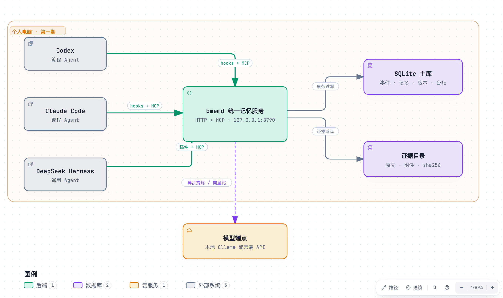
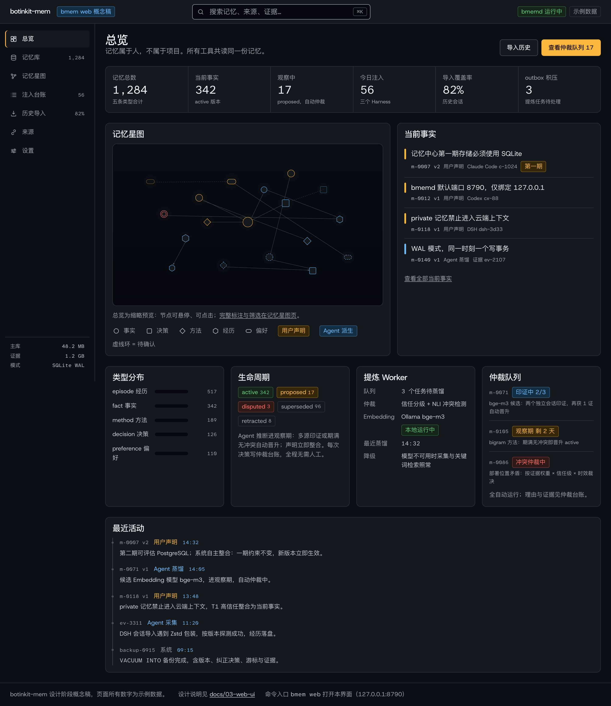

# botinkit-mem · 统一个人记忆中心

一个在本机运行的个人长期记忆服务，让 Claude Code、Codex、DeepSeek Harness（下文简称 DSH）等编码工具共用同一份记忆。系统集中保存要求、决定与验证过的经验，其他工具通过自动召回或主动检索取用。事实纠正带有版本和来源，供后续召回使用。

## 用途与设计要点

| 设计要点 | 内容 |
|---|---|
| 记忆统一存储 | 记忆不按项目、角色或工具分区，项目与设备作为来源标签和相关性线索 |
| 权威与派生分离 | 事件、事实、版本和来源是权威数据，全文与向量索引可以随时重建 |
| 先落盘后调模型 | 模型不可用时，声明、存储和关键词检索照常工作 |
| 双通路接入 | Hooks 或原生插件负责自动召回与采集，MCP 工具提供主动检索、保存、纠正和遗忘 |
| 纠正可追踪 | 事实带版本、来源和适用条件，带事实键的声明可以确定地更新当前事实 |
| 单人本机部署 | 第一期使用本机 SQLite，服务只监听回环地址，面向单个用户的工作站 |

## 架构总览



[交互版架构图（可缩放，支持明暗主题）](docs/assets/overview.html)

| 组件 | 职责 |
|---|---|
| `bmemd` | 常驻后台的记忆服务，提供 HTTP API、MCP 端点、后台提炼和管理界面 |
| SQLite 主库 | 保存事件、记忆、版本、来源与仲裁记录，使用 WAL 模式 |
| 证据目录 | 按内容哈希保存会话原文与导入到的原始证据 |
| 模型端点 | 本机托管的 Ollama 运行时，提供 bge-m3 向量化和 qwen3:4b-instruct-2507-q4_K_M 提炼模型 |

## 环境要求

- Python 3.12 及以上
- 包管理工具 [uv](https://docs.astral.sh/uv/)
- 首次安装依赖、运行时和模型需要联网
- macOS 为主要验证平台，Linux systemd 服务已有实现但实机覆盖仍待补充验证，Windows 暂未提供系统服务支持

在 macOS 或 Linux 的终端中安装 uv。

```bash
curl -LsSf https://astral.sh/uv/install.sh | sh
```

也可以使用 [uv 官方安装文档](https://docs.astral.sh/uv/getting-started/installation/) 中的其他方法。安装后重新打开终端，必要时执行 `uv python install 3.12`。

## 获取源码与安装

克隆仓库，在项目根目录安装。

```bash
git clone https://github.com/junwayne66/botinkit-mem.git
cd botinkit-mem

# 安装为本机工具
uv tool install --python 3.12 .
bmem --version
```

如果 `bmem` 不在 PATH 中，执行 `uv tool update-shell` 并重新打开终端。当前通过源码运行和本地构建的 wheel 分发。

安装为本机工具后，下文命令可直接使用 `bmem`。开发环境在项目根目录执行 `uv sync --locked --extra dev`，并通过 `uv run bmem` 运行当前源码。

## 快速开始

### 初始化

```bash
bmem init
```

`init` 会创建数据目录与数据库，安装托管的 Ollama 运行时和两个默认模型，注册当前用户的 macOS launchd 或 Linux systemd 服务并尝试加载。两个模型合计约 3.65GB，另需运行时体积。模型未就绪时声明、关键词检索和管理台仍可使用，后台提炼失败的任务会保留并等待重试。

- `--skip-models` 跳过运行时与模型安装
- `--skip-service` 跳过系统服务注册

两个开关独立生效。仅指定 `--skip-models` 时仍会执行服务注册，纯数据初始化可同时使用两个开关。

服务是否真正可用以 `init` 输出的 `registered`、`loaded`、`active` 字段，以及 `bmem doctor`、`bmem status` 的检查结果为准。设置隔离的 `BMEM_CONFIG_ROOT` 时只写入服务定义文件并跳过加载。

初始化完成后，继续执行 `connect` 与 `import` 接入 Harness 并导入历史。

### 检查状态

```bash
bmem doctor     # 检查服务、数据库、模型、运行时和已接入 Harness
bmem status     # 服务可用时查询 API，否则读取本地状态
bmem web        # 在浏览器打开管理台
bmem backup     # 首次备份
```

`bmem web` 只打开当前可用服务的地址，服务尚未启动时会提示先运行 `bmem start`。

### 独立演示环境

试验或调试时可以使用独立的数据目录和端口，避免改动日常数据。

```bash
bmem --home /tmp/bmem-demo init --skip-models --skip-service
bmem --home /tmp/bmem-demo start --port 18790
```

服务保持前台常驻。另开终端使用相同的数据目录和服务地址。

```bash
bmem --home /tmp/bmem-demo --url http://127.0.0.1:18790 declare "记忆中心使用SQLite" --fact-key storage.engine
bmem --home /tmp/bmem-demo --url http://127.0.0.1:18790 search "SQLite"
```

`bmem start` 默认监听 `127.0.0.1:8790`，可用 `--port` 或环境变量 `BMEM_PORT` 修改端口。数据目录默认是 `~/.botinkit-mem`，可用全局参数 `--home PATH` 或环境变量 `BMEM_HOME` 替换。选择已有服务时使用 `--url URL` 或环境变量 `BMEM_URL`。

### 快速验证

| 步骤 | 操作 | 预期结果 |
|---|---|---|
| 1 | 在终端执行 `bmem declare "记忆中心使用SQLite" --fact-key storage.engine` | 立即保存 T1 事实并返回记忆 ID |
| 2 | 在已接入的 Claude Code 中询问“记忆中心用什么存储” | 自动召回 SQLite 相关事实及来源 |
| 3 | 在终端执行 `bmem declare "改用SQLite WAL" --fact-key storage.engine` | 同一事实键被确定地更新为 WAL |
| 4 | 在已接入的 Codex 中再次询问存储方案 | 得到更新后的口径 |

## Harness 接入

### 接入命令

```bash
bmem connect claude-code
bmem connect codex
bmem connect dsh
```

`connect` 只接受 `claude-code`、`codex`、`dsh` 三个值。命令会修改对应 Harness 的配置，并备份或保留原用户配置。接入后重启 Harness 或重新打开会话，使新配置生效。

| Harness | 自动召回与采集 | MCP | 说明 |
|---|---|---|---|
| Claude Code | `SessionStart`、`UserPromptSubmit`、`Stop`、`SessionEnd` hooks | 是 | hooks 与 MCP 一起写入 `~/.claude` 相关配置 |
| Codex | `UserPromptSubmit`、`Stop` hooks | 是 | 需要在 Codex 中原生信任批准，`doctor` 实测为 trusted 且 enabled 才显示 connected，否则为 partial |
| DSH | 原生插件 `dsh_plugin.mjs`，prestep 召回与采集 | 是 | 插件随包分发并写入 DSH 配置 |

### 自动与主动两条通路

Hooks 与原生插件按各 Harness 的可用事件自动召回并采集内容，具体事件见适配表。MCP 端点提供下列工具，供模型在需要时主动调用。

| MCP 工具 | 用途 |
|---|---|
| `memory_recall` | 按当前任务组装受预算限制的记忆包 |
| `memory_search` | 关键词与语义检索 |
| `memory_expand` | 展开某条记忆的来源与原始证据 |
| `memory_save` | 显式保存事实、决策或经验 |
| `memory_declare` | 提交声明或纠正 |
| `memory_forget` | 遗忘指定记忆并清理派生物 |
| `memory_status` | 查询记忆库与导入状态 |

MCP 端点地址为当前服务的 `/mcp`，例如 `http://127.0.0.1:8790/mcp`。接入状态以 `bmem doctor` 的实测结果为准。

## 日常使用

```bash
bmem declare "记忆中心使用SQLite" --fact-key storage.engine   # 立即写入用户声明事实
bmem search "SQLite"                                          # 关键词与语义检索
bmem recall "存储方案" --harness codex --session demo           # 按任务组装记忆包
bmem forget MEMORY_ID                                         # 遗忘并清理派生物
bmem status                                                   # 服务与本地状态
```

### 声明与纠正

`declare` 提交的用户声明会立即落库为 T1 记忆，同一事实键的新声明会更新该事实。也可以在同一记忆上使用 `--memory-id` 配合 `--expected-revision` 做显式纠正。普通自由文本由后台结合当前事实整合，确定的同键更新可使用 `--fact-key`。在 Harness 中以“记住：…”或“记住以后…”开头的输入会经 hook 立即声明。私密内容可以使用 `--sensitivity private`。

声明支持的分类参数为 `--kind episode|fact|decision|method|preference`，还可以附带 `--conditions`、`--project`、`--harness` 与 `--session`。

### 检索与私密目标

`search` 与 `recall` 默认使用 `--target cloud`，只返回可注入云端 Harness 的内容。查询私密记录时需显式加上 `--target local`。本地管理台可以查看私密数据，MCP 工具同样支持目标参数。

### 管理台



管理台包含记忆星图、记忆库与版本查看、仲裁与注入台账、导入状态，以及语义检索开关和模型安装入口。上图为高保真概念稿，使用示例数据，交互效果见 [概念稿演示](docs/assets/web-ui-concept.html)。设计说明见 [Web UI 文档](docs/03-web-ui/README.md)。

## 模型与服务

### 托管运行时

`init` 默认安装项目固定的 Ollama 0.40.16 运行时和两个模型。

| 用途 | 模型 | 规格 |
|---|---|---|
| 向量化 | `bge-m3`（固定 manifest 的 `bge-m3:latest`） | 1024 维，余弦距离，是当前唯一的 Embedding 模型 |
| 提炼与仲裁 | `qwen3:4b-instruct-2507-q4_K_M` | 4B 指令微调版量化模型 |

运行时由 bmem 托管，`init` 和 `runtime install` 会探测本机 Ollama，需要时启动其独立的 `serve` 进程。系统服务定义运行 `bmemd`。Ollama 进程退出后可执行 `bmem runtime install` 重新启动。每个 embedding 请求发送留驻参数 `keep_alive=-1`，生成请求使用 `keep_alive=5m`。

```bash
bmem runtime status                  # 查看运行时与模型状态
bmem runtime install                # 安装或修复运行时与模型
bmem runtime install --embedding-only  # 仅安装 bge-m3
bmem runtime update                 # 更新托管运行时
```

语义检索可以在管理台设置页开启。模型 ready 表示模型和服务就绪，语义开关是否开启需在设置页确认。

### 系统服务

`init` 默认注册当前用户的系统服务。macOS 使用 launchd，设置 `RunAtLoad` 与 `KeepAlive=true`。Linux 使用 systemd 用户服务，设置 `Restart=on-failure`。正常注册的用户服务会把历史补扫所需的环境变量写入服务定义。修改环境变量后需要重启服务或重新注册，变更才会生效。

## 历史补扫与导入

### 手动导入

```bash
bmem import --harness all                         # 发现并导入默认位置的 Harness 历史
bmem import --harness codex /path/to/history.jsonl
bmem import --harness claude-code /path/to/project/memory
```

导入支持 Claude Code 与 Codex 的 JSONL 历史、DSH 的 JSONL 与 Zstandard 存储、原生 Markdown 记忆文件（包括 Claude 项目的 memory 目录）。导入会记录来源、维护游标，重复导入保持幂等。

Markdown 记忆的 YAML frontmatter 中 `sensitivity: private` 会保留为私密内容，`status: superseded` 或 `status: expired` 的条目会跳过，默认或其他 status 按兼容方式处理。

聊天历史会进入后台 Worker 分批提炼。来自工具 `external` 内容的历史只归档原始证据。实时任务优先于历史任务，导入命令完成不代表队列中的提炼已完成。

### 后台历史补扫

`BMEM_HISTORY_SYNC` 在前台 `bmem start` 下默认值为 `0`，设为 `1` 后启用补扫。

```bash
BMEM_HISTORY_SYNC=1 BMEM_HISTORY_INTERVAL=300 bmem start
```

`BMEM_HISTORY_INTERVAL` 以秒为单位，最小 5 秒。`init` 注册的正常用户服务默认写入 `BMEM_HISTORY_SYNC=1` 与 `BMEM_HISTORY_INTERVAL=300`，显式设置的环境值可以覆盖，隔离的服务定义默认关闭补扫。

### 补扫范围配置

后台补扫读取数据根目录下的 `history-sync.json`。

```json
{
  "exclude_paths": ["/path/to/test-history"],
  "additional_paths": ["/path/to/shared-memory/entries"]
}
```

`exclude_paths` 中的路径会被排除，`additional_paths` 可指定文件或目录，额外路径与默认发现位置合并后统一应用排除规则。新增文件会在后续补扫中被发现，未变化的文件快速跳过。该配置由后台 `sync_history` 使用。

## 隐私与 HTTP 边界

- 记忆存储与提炼在本机完成。正常记忆注入云端 Harness 时，对应片段会随该请求发送给该服务。
- `private` 内容禁止进入 `cloud` 目标，CLI 的 `search`、`recall` 需要显式 `--target local`。
- 入口通过内置模式匹配脱敏常见凭据形式。
- 数据以本机 SQLite 和普通文件保存，面向单用户工作站使用。
- HTTP 服务监听 `127.0.0.1`，默认端口 8790，并检查回环 Host 与浏览器写请求的 Origin。

记忆治理与敏感标签的完整规则见 [自主记忆治理](docs/04-autonomous-memory/README.md)。

## 备份与恢复

```bash
bmem backup                          # 默认写入数据目录下的 backups/
bmem backup /path/to/memory-backup.tar.gz
bmem restore /path/to/memory-backup.tar.gz
bmem index rebuild                   # 重建全文检索索引
```

`backup` 以一致性方式打包 `memory.db`、manifest 与证据文件。`restore` 在服务可用时优先通过服务 API 执行，否则回退到本地恢复。本地恢复前应先停止服务。

备份范围为 `memory.db`、manifest 与证据文件。恢复过程会重建全文索引。需要向量回填时，在设置页将语义检索关闭后重新开启，后台 Worker 会重新排队处理当前记忆。模型缺失时用 `runtime install` 修复。

## 开发、测试与构建

```bash
uv sync --locked --extra dev
uv run pytest tests -q          # 运行完整测试
uv build                        # 构建 wheel 与源码包
uv run bmem --help              # 查看全部命令
```

构建后可在独立工具环境安装生成的 wheel。

```bash
uv tool install --python 3.12 dist/botinkit_mem-0.1.0-py3-none-any.whl
```

构建配置使用 Hatchling，Python 包源码位于 `src/bmem`，可执行入口为 `bmem` 与 `bmemd`。

## 目录结构

```text
botinkit-mem/
├── README.md
├── pyproject.toml               # 依赖、入口与构建配置
├── uv.lock
├── src/bmem/
│   ├── cli.py                   # bmem / bmemd 命令入口
│   ├── api.py                   # HTTP API、MCP 端点与服务生命周期
│   ├── models.py                # 公开数据结构与入口脱敏
│   ├── store.py                 # 事件、记忆版本、召回、治理与备份
│   ├── runtime.py               # Ollama 托管、模型、向量与后台 Worker
│   ├── adapters.py              # Harness 配置、回调与历史导入
│   ├── schema.sql               # SQLite 表结构
│   ├── static/                  # 内嵌管理台
│   └── dsh_plugin.mjs           # DSH 原生插件
├── tests/                       # pytest 测试
├── docs/                        # 设计文档与图形资产
├── ui/                          # 设计稿使用的视觉令牌与基础样式
├── specs/001-personal-memory/   # 规格、计划、任务与验收记录
├── .specify/                    # Spec Kit 工作流与项目原则
└── .agents/                     # 开发流程与代理技能
```

数据目录默认是 `~/.botinkit-mem/`，数据库、证据、备份、运行时和 `history-sync.json` 均写入其中。`BMEM_CONFIG_ROOT` 可指定隔离的 Harness 配置根目录，用于接入测试。

## 阶段与系统支持

| 阶段 | 状态 | 内容 |
|---|---|---|
| 第一期 M1–M4 | 已实现 | 本机 SQLite 记忆中心，多 Harness 共享，版本与纠正，治理与派生来源，管理台 |
| 第二期 多电脑共享 | 设计阶段 | 中心服务器与本地代理，设计见 [docs/02-multi-mem](docs/02-multi-mem/README.md) |

多电脑中心同步尚未实现，仅存在于未来设计文档中。

| 平台 | 支持情况 |
|---|---|
| macOS | 主要验证平台，使用 launchd 用户服务 |
| Linux | systemd 用户服务已有实现并通过静态验证，实机覆盖仍待补充 |
| Windows | 尚未提供对应的系统服务实现 |

测试证据与验收范围见 [specs/001-personal-memory/validation.md](specs/001-personal-memory/validation.md)。

## 文档导航

| 文档 | 内容 |
|---|---|
| [第一期 · 个人电脑记忆中心](docs/01-person-mem/README.md) | 组件、数据模型、读写闭环、纠正与防回灌、中文检索与向量化 |
| [第二期 · 多电脑共享](docs/02-multi-mem/README.md) | 未来设计，拓扑、同步协议、离线与冲突 |
| [Web UI · bmem web 管理台](docs/03-web-ui/README.md) | 信息架构、视觉系统与交互概念稿 |
| [自主记忆治理](docs/04-autonomous-memory/README.md) | 信任分级、观察期、防投毒与声明协议 |
| [规格与验收](specs/001-personal-memory/) | 规格、计划、任务、契约与验收记录 |
| [docs/assets](docs/assets/) | 架构图、数据模型图、阶段拓扑图与 Web UI 概念稿 |

## 许可

Apache-2.0 许可方案仍处于提案阶段，当前仓库尚无 `LICENSE` 文件。
