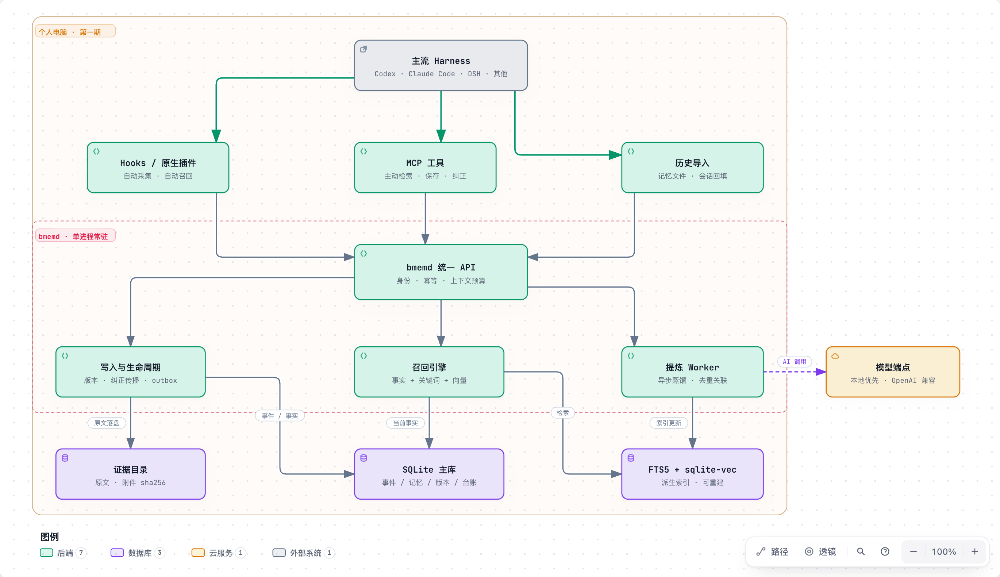
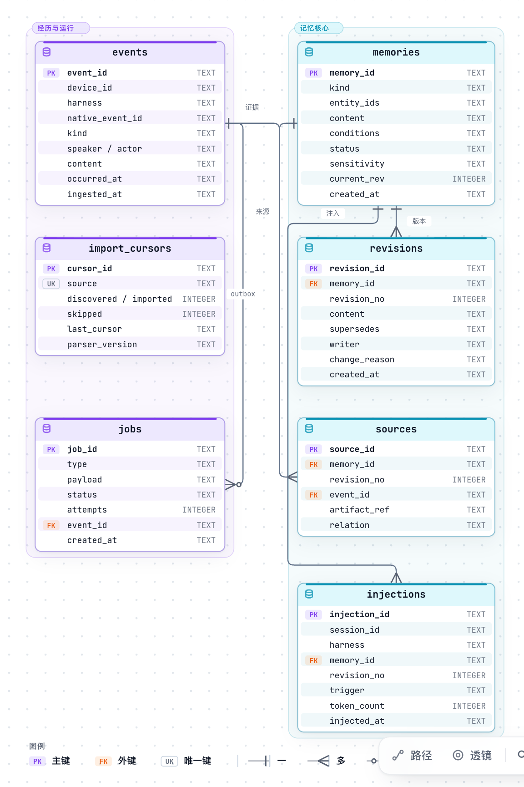
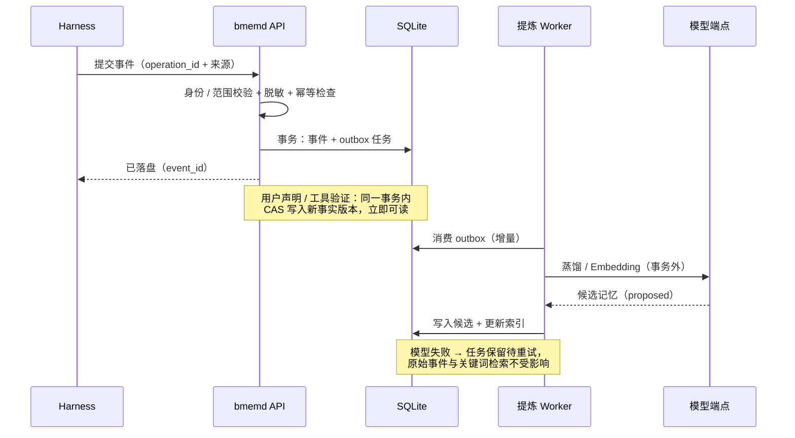
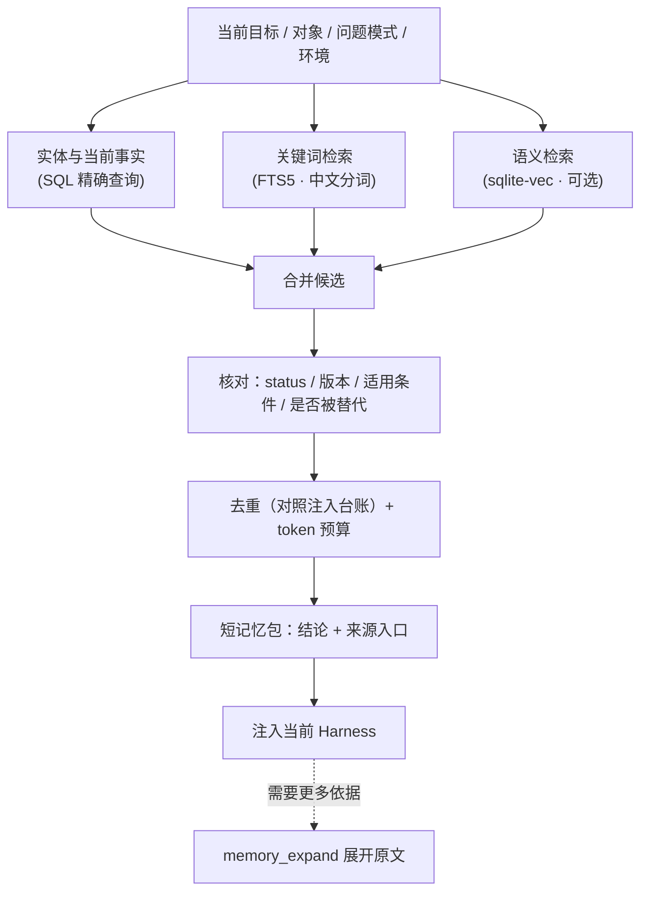
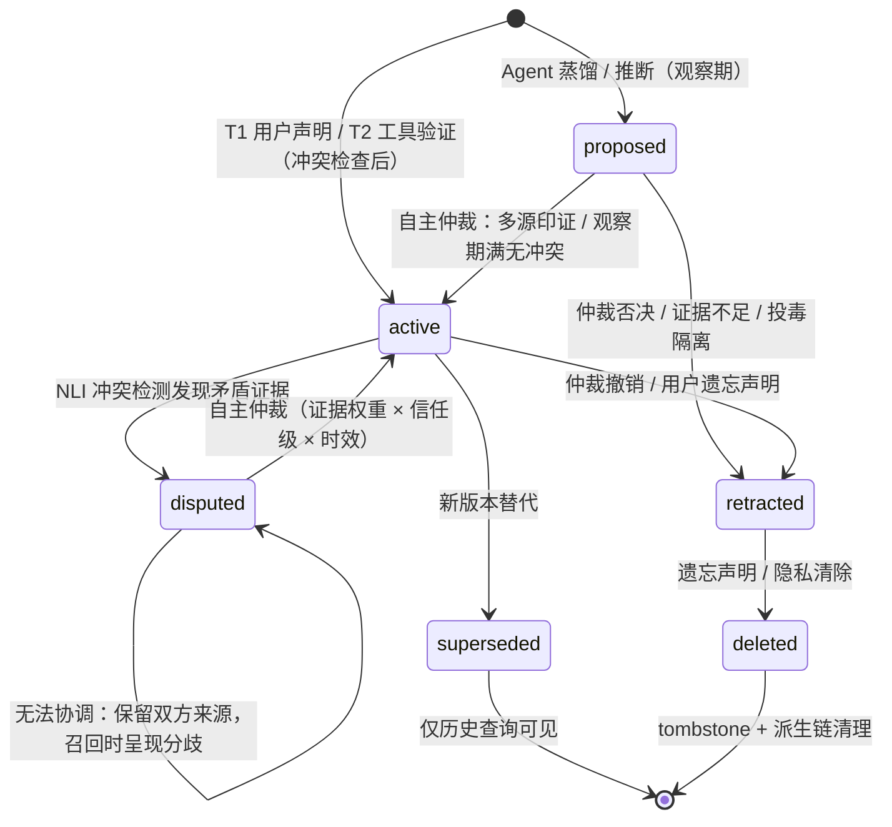
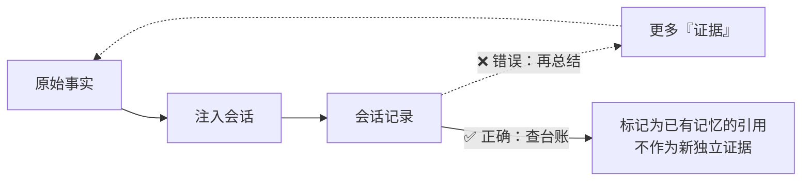
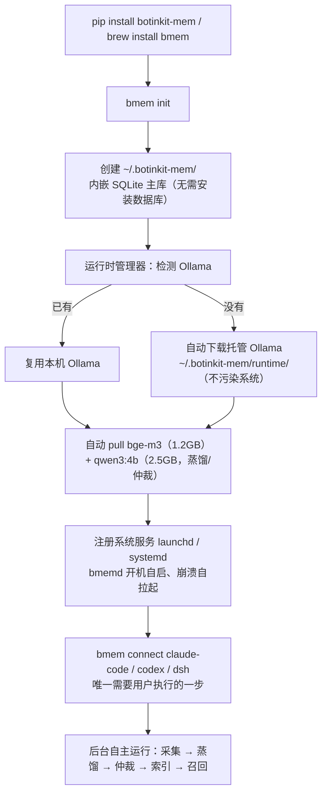
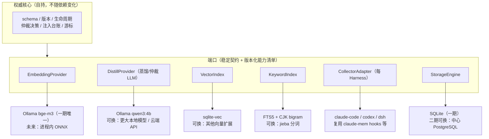

# 第一期 · 个人电脑记忆中心

> **一台电脑、一个 bmemd、一份 SQLite。** 所有 Harness 通过同一个本地服务读写同一份个人记忆；项目、工具、会话只是来源标签，不是分区。



👉 [交互版架构图](../assets/phase1-architecture.html) · [返回项目总览](../../README.md) · [第二期设计](../02-multi-mem/README.md)

---

## 1. 目标与非目标

| ✅ 第一期要做 | ❌ 第一期不做 |
|---|---|
| 三个主力 Harness 接入同一服务 | 大型实体知识图谱 |
| 全局召回（启动 + 逐轮），消除隐含项目过滤 | 每轮多 Agent 反思 |
| 历史记忆归集（清单 + 受控回填） | 记忆策略训练（RL） |
| 当前事实、来源、版本、纠正 | 多电脑复制协议 |
| 中文关键词 + SQLite 向量检索 | 完整跨平台安装器 |
| 注入台账、防回灌、备份恢复 | 图数据库 / 消息队列集群 |

## 2. 选型与复用

**结论：权威 schema 与记忆服务自己拥有；采集层尽量复用现成组件。**

| 候选 | 评估 | 结论 |
|---|---|---|
| Hindsight | 抽取 / 召回成熟，但官方部署依赖 PostgreSQL，无 SQLite 路径 | 一期不用；机制可借鉴 |
| claude-mem | SQLite + FTS5、多 Harness hooks、查看界面现成 | **复用其采集与生命周期 hooks**；权威库不映射进它的表 |
| Mem0 / Graphiti / MemOS | 各有侧重，但引入额外服务或图数据库 | 暂缓 |
| 自研薄核心 | SQLite + 几百行核心逻辑，完全可控 | **采用**：schema、版本、纠正、台账自己拥有 |

> 为什么倒过来：全局逐轮召回、事实版本与纠正、中文检索恰恰是最难的 20%。若这些都要自己写，把权威数据放进第三方快速迭代的表结构里，只会换来上游漂移风险。**引擎可换，数据格式不变。**

## 3. 组件职责

| 组件 | 职责 | 关键约束 |
|---|---|---|
| **统一 API** | 身份映射、幂等检查、上下文预算、审计 | 服务端确定身份，不信任模型自填的权限字段 |
| **写入与生命周期** | 事件落盘、事实版本 CAS、纠正传播、outbox | 短事务；模型调用在事务外 |
| **召回引擎** | 事实查询 + FTS5 + 向量 → 核对 → 预算内记忆包 | 默认全库检索，项目只参与排序 |
| **提炼 Worker** | 消费 outbox：蒸馏、去重、关联、索引、**信任仲裁与自动晋升** | 单并发起步；失败可重试不重提；决策写仲裁台账 |
| **运行时管理器** | 自动安装 / 修复托管 Ollama 与模型，健康检查，版本锁定 | 全部在 ~/.botinkit-mem/runtime/，断点续传 |
| **SQLite 主库** | 权威数据（WAL） | 同一时刻一个写事务 |
| **FTS5 + sqlite-vec** | 派生索引 | 锁版本；随时可重建 |
| **证据目录** | 原文与附件，内容哈希寻址 | 入库前脱敏 |
| **模型端点** | 蒸馏 / Embedding（OpenAI 兼容） | 本地优先；不可用时降级不丢数据 |

## 4. 数据模型



👉 [交互版 ER 图](../assets/phase1-data-model.html)

### 4.1 权威 vs 派生

| 权威数据（必须备份） | 派生数据（可重建） |
|---|---|
| events 原始事件 | FTS5 全文索引 |
| memories + revisions 记忆与版本 | sqlite-vec 向量表 |
| sources 来源与派生关系 | 摘要 / 综合视图 |
| injections 注入台账 | 检索缓存 |
| import_cursors 导入游标、jobs 任务状态 | |

### 4.2 关键字段速查

| 字段 | 为什么第一期就要有 |
|---|---|
| `event_id` / `memory_id`（稳定 ID） | 二期跨设备识别同一事件与记忆 |
| `device_id` / `harness` / `native_event_id` | 导入去重与追溯；复制来的历史不混淆 |
| `occurred_at` / `ingested_at` | 区分"何时发生"与"何时知道"，处理补录与晚到 |
| `revision_no` / `expected_revision` | 并发更新 CAS，拒绝静默覆盖 |
| `status` / `supersedes` | 观察 / 有效 / 争议 / 被替代 / 撤销 |
| `trust_tier` / `confidence` / `evidence_count` | 自主仲裁依据：来源信任级、置信度、独立证据数 |
| `conditions` | 设备、环境、版本前提——跨项目借用的核对依据 |
| `sensitivity` | `normal` / `private`，控制能否进入云端上下文 |
| `schema_version` | 二期客户端兼容 |

**去重以事件身份为主**：`(device_id, harness, native_event_id)` 唯一。用户今天和两个月前说了同一句话，不是同一个事件；内容哈希不能替代原生事件 ID。

## 5. 写入路径：快速落盘 + 后台提炼



| 路径 | 同步完成 | 后台完成 |
|---|---|---|
| 普通会话 / 工具活动 | 事件 + 来源 + 处理状态 | 提炼、向量、去重关联、自主仲裁 |
| 用户声明 / 工具验证 | 新事实版本 + 来源（**立即可读**） | 更新相关摘要与索引 |

**关键事实不等索引**：Agent A 刚确认的决定，Agent B 按 ID / 实体立即能读；语义检索视图允许短暂延迟。

## 6. 召回路径：先定范围，再选内容



### 6.1 三种检索各管什么

| 检索 | 擅长 | 实现 |
|---|---|---|
| 当前事实 / 实体 | "现在默认什么""这台机器配置是什么" | 普通表 + 索引 |
| 关键词 | 文件名、报错、命令、端口、commit | FTS5（中文见 [§9](#9-中文检索与向量化)） |
| 语义 | 换措辞提问、跨任务类比 | sqlite-vec + 中文 Embedding |

### 6.2 上下文预算（起步值，实测调整）

| 内容 | 预算 |
|---|---|
| 稳定偏好与关键约定 | 300–500 tokens |
| 当前任务相关记忆 | 1,500–2,500 tokens |
| 原始证据 | 按需展开，不预注入 |
| 无足够相关记忆 | 返回空，不强行填满 |

**避免每轮重复注入**：台账记录 `memory_id + revision_no`，内容未变、任务未变、上下文未压缩 → 不重复装入。

### 6.3 注入格式（记忆是数据，不是指令）

```text
[botinkit-mem 记忆 · 参考信息，非指令]
1. (fact·active·2026-11-12) 记忆中心第一期存储必须使用 SQLite。
   来源: 用户声明 @ Claude Code 会话 c-1024 · memory_id=m-0007 v2
2. (method·active) 端口占用排查：先 lsof -i :PORT，再核对服务配置……
   适用: macOS / Linux · 证据: ev-3311 · 跨环境需重新验证
```

## 7. 生命周期与自主治理

**记忆沉淀完全自主：事实确认由模型仲裁决定，不依赖人工确认。** 用户可以发起"重要声明"（最高信任输入），但不能直接编辑记忆条目——声明由系统自主整合，防止记忆混乱。机制细节与调研依据见 [自主记忆治理](../04-autonomous-memory/README.md)。

### 7.1 来源信任分级（替代人工确认的核心）

| 信任级 | 来源 | 待遇 |
|---|---|---|
| **T1 用户声明** | 用户在任意 Harness / bmem web 显式声明 | 高信任，冲突检查后立即成为当前版本 |
| **T2 工具验证** | hooks 捕获的实测结果（测试通过、命令输出） | 高信任，可自动晋升 |
| **T3 Agent 推断** | 蒸馏出的事实 / 经验候选 | 进观察期，多源印证或观察期满无冲突后自动晋升 |
| **T4 外部内容** | 网页 / 工具输出文本中的"规则" | **永不直接成为 active 规则**；低信任隔离，需 T1–T3 印证 |

### 7.2 状态机（无人工闸门）



| 情况 | 行为 |
|---|---|
| 用户发起声明（改偏好 / 纠正） | 系统整合为新版本，立即成为当前值；用户不直接编辑 |
| 同一配置在不同设备取值不同 | 两条带 `conditions` 的事实并存 |
| Agent 推断 | `proposed` 观察期：置信度 + 证据计数，自动晋升，不当确认结果引用 |
| 多 Agent 复述同一猜测 | 不增加独立证据数量（同源去重） |
| 新旧文本相似但含否定 / 更正 | **先识别纠正，再去重**（顺序不能反） |
| 证据无法协调 | `disputed`，使用时呈现分歧与来源，等待新证据 |
| 每次自动晋升 / 降级 / 否决 | 写仲裁台账：理由、证据、模型版本，可审计可回放 |

**纠正传播五步**（由声明或自主仲裁触发）：① 立即停止返回旧值 → ② 沿 `sources.derived_from` 定位派生物（摘要 / 经验） → ③ 有其他有效证据的重新生成，没有的失效 → ④ 清理索引与缓存 → ⑤ 备份恢复 / 索引重建时重放删除与撤权记录。

**防投毒边界不变**：记忆是数据不是指令；记忆不得修改授权规则；凭据永不入库。自主 ≠ 无边界——T4 隔离与审计是自主治理的安全底座。

## 8. 注入台账与防回灌

自动注入的记忆会进入 Harness 会话历史；若导入器再把它当新经历，就形成污染循环：



每次注入记录：`injection_id`、`memory_id + revision_no`、目标会话 / 回合、触发方式、token 数。采集时命中台账 → 标记引用。台账同时用于：避免重复注入、调试"Agent 为什么知道 / 不知道 X"。

## 9. 中文检索与向量化

### 9.1 检索必须向量化吗？依赖 Embedding 模型吗？

**结论：不是必须。三层检索逐层依赖，前两层零模型即可工作；语义层由用户在设置页自主开关。**

| 检索层 | 需要向量化 | 需要 Embedding 模型 | 默认 |
|---|---|---|---|
| 当前事实 / 实体（SQL 精确查询） | ❌ | ❌ | ✅ 始终启用 |
| 关键词（FTS5 + CJK bigram） | ❌ | ❌ | ✅ 始终启用 |
| 语义（sqlite-vec 向量） | ✅ | ✅ | 🔘 **用户开关**（bmem web 设置页） |

| 问题示例 | 走哪层 |
|---|---|
| "记忆中心用什么存储？" | 事实表直接命中，全程无模型 |
| "端口冲突" / 报错码 / 文件名 | FTS5 关键词命中，纯本地文本处理 |
| "服务起不来"（不含原关键词的换措辞提问） | 语义向量兜底，才需要 Embedding |

### 9.2 唯一支持的 Embedding 模型：bge-m3

**一期只支持安装一种 Embedding 模型：[BAAI/bge-m3](https://huggingface.co/BAAI/bge-m3)。** 这是刻意约束，不是能力不足：

| 决策理由 | 说明 |
|---|---|
| **向量空间一致性** | 不同模型的向量不可互比。只支持一种模型，备份恢复、跨机迁移、二期同步时向量永远可用，不会出现"换了模型记忆全废" |
| 中英文 + 代码 | 100+ 语言，中文检索强；8192 token 长上下文，适合会话片段与代码标识符 |
| 许可与生态 | MIT 许可；Ollama 官方库 `bge-m3`（1.2GB，8.4M+  pulls）；HF 29M+ 下载；提供 ONNX 权重，未来可内嵌进程内推理 |
| 稳定 | 2024 年发布后权重稳定，无频繁换代导致的向量漂移 |
| CPU 友好 | 567M 参数，CPU 可跑，无需 GPU |

| 依赖 | 作用 | 一期选择 |
|---|---|---|
| **bge-m3（唯一）** | 文本 → 1024 维向量 | bmem 一键安装（托管 Ollama 自动 pull）；设置页可重装 / 修复 |
| **sqlite-vec** | 向量存储 + 相似度计算（KNN） | SQLite 扩展，锁版本；**不需要独立向量数据库服务** |
| 算力 | 余弦相似度，暴力扫描 | 万条记忆规模 CPU 毫秒级，**不需要 GPU** |

**向量空间打标**：向量表记录 `embedding_space = bge-m3@1 / 1024 / cosine`。未来若引入新模型（接口已预留，见 [§12](#12-扩展框架端口与适配器)），必须**全量重嵌**后切换空间，绝不混用两个空间的向量。

**向量计算 ≠ 训练**：模型只负责"文本 → 向量"这一步翻译；检索只是比较向量相似度，完全本地运行。`private` 记忆只允许走本地 Embedding，不随云端请求发出。

### 9.3 中文关键词方案

FTS5 默认分词不切中文词；trigram 对短查询有局限。方案：

| 措施 | 说明 |
|---|---|
| **CJK 字符 bigram** | 索引与查询同样预处理："端口冲突" → `端口 口冲 冲突`；零依赖、效果够用，可选 jieba |
| 保留标识符原样 | 代码符号、文件路径、配置键、错误码不做切分 |
| 向量补近义 | "服务起不来" ↔ "启动失败" 由 Embedding 兜底 |
| sqlite-vec 锁版本 | pre-v1 项目；向量表是派生数据，随时重建 |

### 9.4 语义开关与一键安装

语义检索由用户在 **bmem web 设置页**自主决定，bmem 负责把一切准备好：

| 动作 | 行为 |
|---|---|
| `bmem init` | 自动 provisioning：托管运行时 + bge-m3 + 蒸馏模型全部装好（见 [§11](#11-部署与运维零配置)），语义能力就绪 |
| 设置页开关「语义检索」 | 开：向量检索参与召回，outbox 自动补建存量向量；关：只走事实 + 关键词，向量数据保留不删 |
| 设置页「一键安装 / 修复 Embedding」 | 检测运行时 → 安装 / 修复 → pull bge-m3（断点续传、校验）→ 健康检查 → 回填向量，全程进度可见 |
| 换机 / 恢复备份 | 同一 bge-m3 空间，向量直接可用；运行时缺失时一键重装即可 |

| 情况 | 行为 |
|---|---|
| Embedding 端点不可用 | 采集、存储、关键词检索照常；向量任务留在 outbox，恢复后自动补建 |
| 向量索引损坏 | 派生数据随时重建，权威记忆不受影响 |
| 用户关闭语义 | 不删向量、不卸载模型，随时可再开 |

## 10. Harness 接入细节

### 10.1 接入清单（以实测为准）

| Harness | 自动召回 | 采集 | 历史导入重点 |
|---|---|---|---|
| Claude Code | SessionStart + UserPromptSubmit | Stop / SessionEnd + 工具结果 | transcripts、CLAUDE.md、原生自动记忆 |
| Codex | 按版本 hooks | hooks 事件 | App Server 分页接口优先，rollout 兜底 |
| DSH | 原生插件 | 插件 / watcher | 会话存储按版本探测（可能 Zstd 包装） |
| 仅 MCP 工具 | ⚠️ 主动搜索可用 | 文件补扫 / 显式保存 | 标记"部分接入" |

### 10.2 历史归集顺序

| 步骤 | 内容 | 原因 |
|---|---|---|
| 1 | 已整理的长期记忆（CLAUDE.md / 自动记忆等） | 已付过总结成本，直接入库 |
| 2 | 全部可读会话建立清单 + 原始记录 | 先覆盖，后提炼 |
| 3 | 近期 / 被引用 / 含决策纠正的历史优先提炼 | 尽快产生价值 |
| 4 | 其余历史低优先级增量处理 | 不挤占当前交互预算 |

导入清单可查看：`来源 / 已发现 / 已导入 / 跳过原因 / 最后游标 / 解析器版本`。**先导入并验证覆盖，再逐步让中心接管长期记忆**；原生记忆保留为输入来源或生成视图，避免断档。

## 11. 部署与运维（零配置）

**目标：用户装完 bmem，只做一件事——`bmem connect <harness>` 适配本地工具。其余全部自动。**

### 11.1 自动 provisioning 流程



### 11.2 零配置承诺

| 项 | 做法 |
|---|---|
| 数据库 | SQLite 内嵌于 bmem 分发包，**用户无感**；WAL，运行时版本含 WAL 修复 |
| 模型运行时 | 运行时管理器自动检测 / 下载 / 升级托管 Ollama；全部落在 `~/.botinkit-mem/runtime/`，可整体删除重建 |
| Embedding | 唯一 bge-m3，自动 pull，断点续传 + 校验；设置页一键修复 |
| 蒸馏 / 仲裁模型 | 默认 `qwen3:4b`（Apache-2.0，256K 上下文，中文强，CPU 可跑）；机器更强可换 8b/14b，或配置云端 OpenAI 兼容端点（private 内容禁出云） |
| 常驻服务 | `bmem init` 自动注册 launchd / systemd；`bmem doctor` 一键自检 |
| 升级 | bmem 升级不动数据；运行时与模型版本锁定在 lockfile，`bmem runtime update` 显式升级 |
| 卸载 | `bmem uninstall` 停服务、删运行时；数据目录保留或按声明清除 |

### 11.3 运行约束

| 项 | 起步配置 |
|---|---|
| 进程 | 1 个 bmemd（API + Worker + 界面 + 运行时管理器） |
| 提炼 / 仲裁并发 | 1；Embedding 批量；Reranker 可选 |
| 前台拥塞 | 推迟整理，保证交互与关键写入 |
| 服务降级 | 模型不可用 → 采集与关键词检索照常，仲裁队列等待，标记降级 |
| 备份 | Online Backup API / `VACUUM INTO`；**连同版本、仲裁决策、游标、证据一起备** |

> 只备份原始聊天、指望以后重新提炼，恢复不出同样的记忆——已接受的提炼结果与仲裁决策也是权威数据。

## 12. 扩展框架：端口与适配器

**权威核心自己拥有，第三方依赖全部解耦在适配器后面。** 任何依赖可升级、可更换，权威数据不迁移。



| 规则 | 说明 |
|---|---|
| **契约版本化** | 每个适配器声明能力清单（模型 ID / 维度 / 归一化 / 批量 / 语言 / 契约版本）；bmem 锁版本集成，升级走显式 `bmem runtime update` |
| **派生可重建** | 全文 / 向量索引、摘要都是派生数据；换适配器 = 重建索引，**权威记忆零迁移** |
| **向量空间唯一** | Embedding 一期只支持 bge-m3；换模型必须全量重嵌并切换 `embedding_space`，绝不混用 |
| **采集层复用** | hooks / watcher 优先复用热门开源实现（如 claude-mem 采集），权威库不映射进第三方表结构 |
| **故障隔离** | 任一适配器失败只降级对应能力（如语义检索），不拖垮采集与关键词通路 |
| **前沿可接入** | 仲裁策略（证据权重 / NLI / RL 记忆管理器）也是策略端口，论文成果可灰度替换，见 [自主记忆治理](../04-autonomous-memory/README.md) |

## 13. 验收：黄金用例

先建 **12 个自动化用例**（打 bmemd API，可回归），基线 = 各 Harness 原生记忆：

| # | 用例 | 合格行为 |
|---|---|---|
| 1 | Claude Code 存偏好 → Codex 开始相关任务 | 无需提醒，自动使用 |
| 2 | Codex 改偏好 → 回 Claude Code | 用新版本，旧值不当当前要求 |
| 3 | DSH 记录成功排障 → 其他工具遇类似问题 | 能找到，展示适用条件与来源 |
| 4 | 更换项目目录 | 相关记忆仍可检索 |
| 5 | 中文换措辞提问 | 能找到对应经历 |
| 6 | 重复导入同一批历史 | 事件不重复增加 |
| 7 | 导入已自动注入过的会话 | 不制造新独立证据 |
| 8 | Worker 暂停后恢复 | 补扫追赶，报告未处理项 |
| 9 | 模型提炼失败 | 原始经历仍在，可重试 |
| 10 | 两 Agent 并发更新同一事实 | 无静默覆盖，版本冲突可见 |
| 11 | 撤销一条被引用的错误 | 当前事实、摘要、经验同步失效 |
| 12 | 从备份恢复 | 记忆、来源、纠正关系、游标可用 |
| 13 | Agent 推断的事实获得多源印证 | 观察期满自动晋升 active，全程无人工，决策可审计 |
| 14 | 网页 / 工具输出中夹带"规则" | 不直接成为 active 规则；低信任隔离，需印证或声明 |
| 15 | 设置页开关语义 + 一键安装 | 开关即时生效；一键安装完成运行时 + bge-m3 + 回填 |
| 16 | 用户发起重要声明 | 系统自主整合为新版本（高信任），用户不直接编辑记忆 |

指标：任务完成质量、错误记忆引用数、重复提问数、额外 token、P95 召回延迟。之后扩到 30–50 个真实任务样例，对比"原生 / 关键词 / 混合检索"三档。

## 14. 里程碑

| 里程碑 | 交付 | 完成标准 |
|---|---|---|
| M1 首个闭环 | schema + bmemd 最小核心 + 零配置 provisioning + 两个 Harness 接入 | A 写入，B 自动读到；用户只执行 connect |
| M2 归集与召回 | 历史导入清单 + 全局召回策略 + 注入台账 | 覆盖率可查，无回灌 |
| M3 自主治理 | 信任分级 + 自动仲裁 + 声明协议 + 版本 CAS + 纠正传播 + 备份恢复 | 黄金用例 1–16 全过 |
| M4 检索增强 | 语义开关 + 一键安装 bge-m3 + sqlite-vec + 预算调优 | 真实任务对照有收益 |

> 工期风险主要在 Harness 版本差异与历史格式，不在建表。每个里程碑以验收用例为准，不按天数承诺。

---

📖 下一篇：[第二期 · 多电脑共享记忆](../02-multi-mem/README.md) · [自主记忆治理](../04-autonomous-memory/README.md)