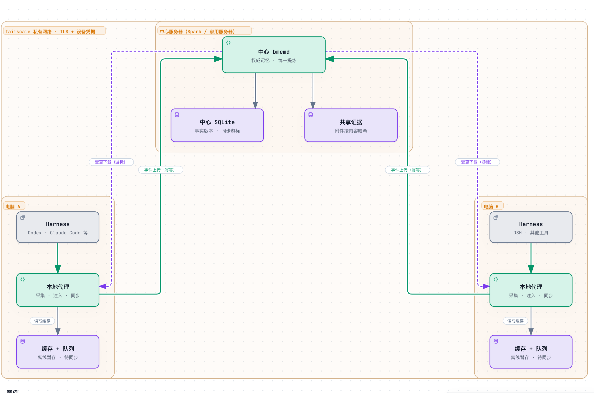
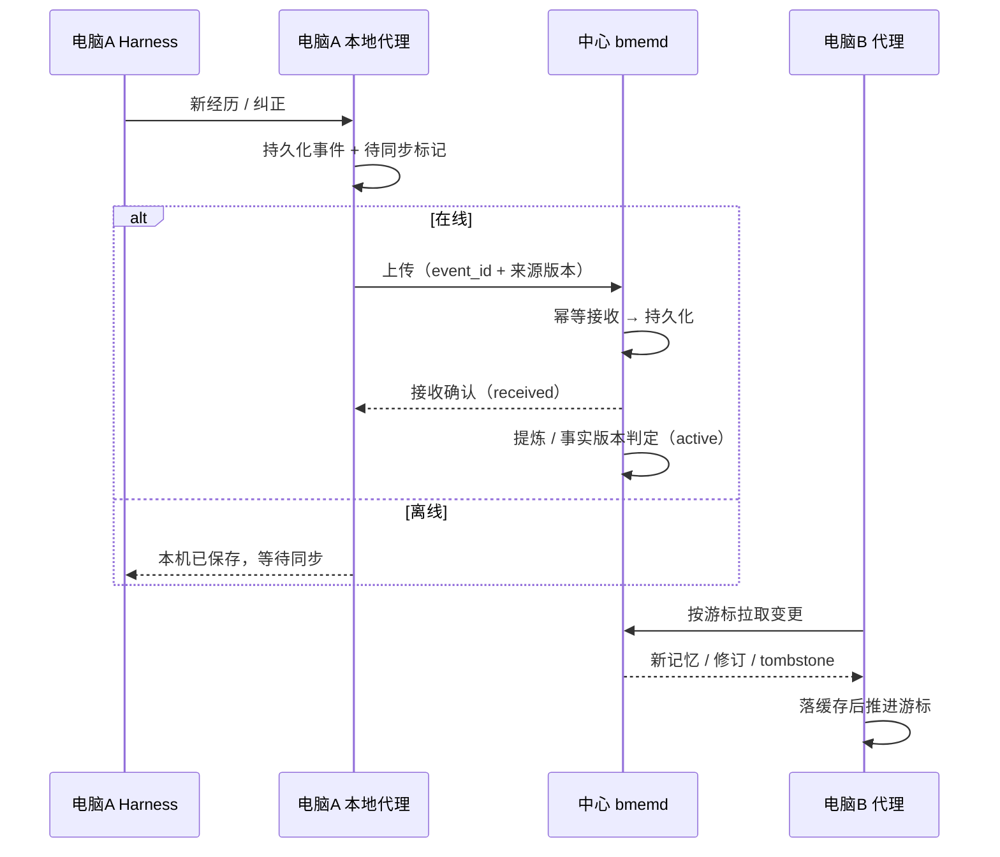
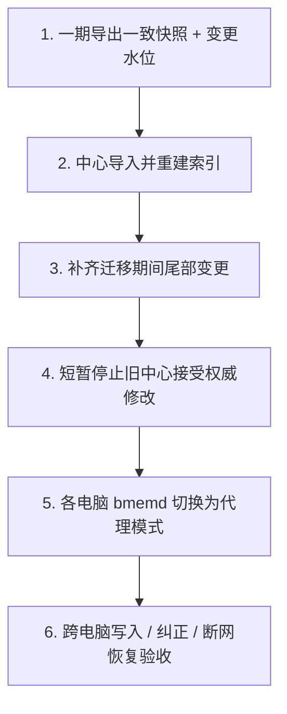

# 第二期 · 多电脑共享记忆中心

> **权威记忆搬到中心服务器，各电脑保留采集代理、缓存与待同步队列。** 记忆格式、Harness 接入方式不变——变的只是"权威记忆的位置"。

👉 [交互版拓扑图](../assets/phase2-topology.html) · [返回项目总览](../../README.md) · [第一期设计](../01-person-mem/README.md)

---

## 1. 什么变了，什么没变

| 设计项 | 第一期 | 第二期 |
|---|---|---|
| 权威记忆位置 | 个人电脑 SQLite | **中心服务器 SQLite** |
| 本地 bmemd 角色 | 完整记忆中心 | **代理模式**：采集 + 注入 + 缓存 + 同步 |
| 提炼 / 纠正 / 索引 | 本机后台 | 中心统一运行 |
| Harness 配置 | 指向 127.0.0.1:8790 | **不变**（仍指向本机代理） |
| 记忆格式与 ID | 稳定 ID + 版本 + 来源 | **不变**（一期已预留 device_id 等字段） |
| 离线能力 | 天然本地 | 读缓存（标注截止点）、写暂存、联网同步 |
| 检索默认范围 | 全部个人记忆 | 全部个人记忆 |

> 第一期就坚持"Harness 通过服务接口访问记忆，不直接读写表"，换来的是二期接入代码基本不动。

## 2. 职责划分

| 中心服务器 | 本地代理（每台电脑） |
|---|---|
| 全部记忆的统一维护与事实版本 | 读取本机会话与原生记忆文件 |
| 冲突裁决、纠正传播、删除传播 | 执行 hooks / 插件回调 |
| 统一 Embedding、提炼、检索 | 为当前请求注入上下文 |
| 发布变更（新增 / 修订 / tombstone） | 缓存中心已确认的记忆 |
| 统一备份 | 断网时保存待同步内容 |

中心部署在常在线机器（DGX Spark / 家用服务器）。**多台电脑不需要各养一套提炼模型。**

## 3. 同步协议：同步事件，不同步数据库文件

❌ 不要用网盘 / Syncthing / 文件复制直接同步 `.db` / `-wal` / `-shm`：一致快照也解决不了两台电脑各自更新事实的业务冲突，跨机器共享 WAL 文件本身就不符合 SQLite 使用条件。

| 同步内容 | 方向 | 方式 |
|---|---|---|
| 新经历 / 用户纠正 / 显式保存 | 客户端 → 中心 | 按稳定事件 ID 上传，幂等接收 |
| 已接受记忆与版本变化 / tombstone | 中心 → 客户端 | 按中心游标增量下载 |
| 大附件 | 双向 | 按内容哈希单独上传、按需下载 |

向量与全文索引是派生数据：中心构建；客户端离线搜索时按统一版本的记忆本地重建。

**中心序号决定同步顺序，不代表"后收到的更真实"。**

## 4. 在线 / 离线行为

| 状态 | 可以做什么 | 返回如何表达 |
|---|---|---|
| 在线 | 读中心最新、提交经历与纠正 | 中心版本 / 处理状态 |
| 离线 | 读缓存、保存经历、提交本地候选变更 | **缓存截止点** + 待同步状态 |
| 刚恢复网络 | 先上传未确认事件，再拉取中心变化 | 区分"上传成功"与"事实生效" |
| 存在冲突 | 保留双方来源，按规则或使用时处理 | 明确标注冲突 |
| 长时间未同步 | 重新获取中心快照，再处理本地未上传事件 | 不把旧缓存恢复成权威 |

## 5. 已接收 ≠ 已生效

| 状态 | 含义 | 例子 |
|---|---|---|
| `received` | 中心已持久化该事件 | 离线电脑上传了"服务换端口了"的**推测** |
| `active` | 中心仲裁其成为当前事实 | 有工具实测或用户声明支持，或观察期满自动晋升 |

离线上传一条推测，中心接收它，**不等于**所有电脑都要认可这个端口。规则类内容依旧走信任分级与自主仲裁（T4 外部内容隔离、观察期自动晋升，一期安全规则在二期完全适用）。

## 6. 冲突处理：保持简单

| 情况 | 规则 |
|---|---|
| 同一事件重复上传 | 幂等接收一次 |
| 两台电脑产生不同经历 | 两条都保留 |
| 同一配置在不同环境取值不同 | 条件化共存（`conditions`） |
| 新观察发生得早、只是晚上传 | 保存为历史，不覆盖当前事实 |
| 用户发起声明纠正偏好 | 中心自主整合为新版本，保留替代关系 |
| 两个离线更新基于同一旧版本且矛盾 | 保留冲突，不静默覆盖 |
| 已删除记忆被旧设备重新上传 | tombstone 阻止复活 |

**完整 CRDT 不是必要条件**：它能帮某些数据结构收敛，但无法判断两条自然语言事实哪个正确。一期保留的稳定 ID / 版本 / 删除记录，二期加上网络传输即可。

## 7. 设备接入与传输安全

| 项 | 方案 |
|---|---|
| 网络 | **Tailscale**（或等价私有网络）；中心不暴露公网 |
| 传输 | TLS；设备间流量加密 |
| 身份 | 每设备独立凭据（device token），可单独吊销 |
| 授权 | 设备凭据决定"能否接入"，不改变"记忆属于同一个人"的可见范围 |
| 审计 | 中心记录上传 / 下载 / 纠正的来源设备 |
| 云端模型 | `private` 标签内容仍禁止进入云端上下文（规则随记忆同步） |

## 8. 权威切换：一次明确的迁移

| 要点 | 说明 |
|---|---|
| 停写窗口 | 第 4 步是短暂停写，不是长期双主 |
| 禁止双权威 | 旧电脑和服务器不得长期各自维护"全局当前事实" |
| 回滚 | 验收失败可切回一期模式（快照仍完整） |

## 9. 中心数据库：先继续 SQLite

中心初始部署 = **一个中心服务实例 + 服务器本地 SQLite + 本地文件存储**。网络上的电脑只调 API，不直接打开数据库文件——这是 SQLite 官方明确支持的访问方式。

| 升级 PostgreSQL 的触发条件 | 不是理由 |
|---|---|
| 写入队列持续积压 | "有多台电脑"本身 |
| 短事务优化后仍达不到延迟目标 | 提前为想象中的规模设计 |
| 需要多个服务实例同时写库 | |
| 需要更复杂的高可用 / 运维能力 | |

## 10. 验收：在一期之上增加

| # | 用例 | 合格行为 |
|---|---|---|
| 1 | 电脑 A 保存新要求 → 电脑 B 开始任务 | 看到中心已生效版本 |
| 2 | A 离线工作后恢复网络 | 经历只上传一次 |
| 3 | A、B 对同一旧事实分别修改 | 无静默覆盖 |
| 4 | A 删除记忆 → 长期离线的 B 再接入 | 旧内容不复活 |
| 5 | 中心暂时不可用 | 本地可读缓存、可保存新经历 |
| 6 | 设备缓存过旧 | 显示截止点，按规则重新同步 |
| 7 | 吊销某设备凭据 | 该设备立即无法读写，其余不受影响 |
| 8 | 离线上传推测 | received 但非 active，不影响其他设备当前事实 |

## 11. 里程碑

| 里程碑 | 交付 | 复用一期 |
|---|---|---|
| P1 中心部署 | 相同记忆核心部署到中心 | 存储 / 检索 / 提炼 |
| P2 代理模式 | 本地 bmemd 改为中心访问 | Harness 接入全部保留 |
| P3 增量同步 | 事件上传 + 变更下载 | 事件 ID / 版本 / 游标 |
| P4 离线能力 | 缓存 + 暂存队列 | SQLite |
| P5 传播与安全 | 删除传播 / 冲突回传 / 设备凭据 | 纠正与版本规则 |
| P6 验收 | 跨电脑用例 1–8 全过 + 中心备份监控 | 黄金用例框架 |

---

📖 返回：[项目总览](../../README.md) · [第一期设计](../01-person-mem/README.md)