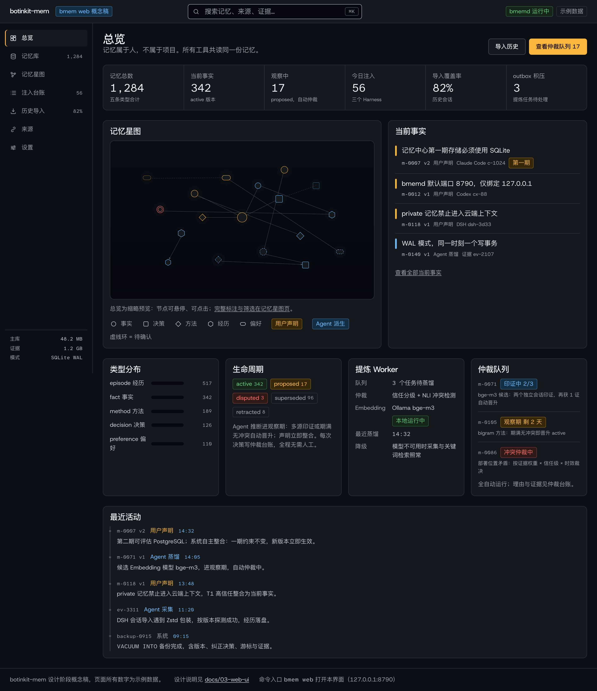

# Web UI · bmem web 记忆仓储管理台

> **`bmem web` 打开本地管理台（127.0.0.1:8790）。** 记忆属于人，不属于项目——界面不按项目分区，类型、状态、来源只是筛选视图。炫酷但克制：暗色仪器台底色，语义色只表达含义。

👉 [打开交互概念稿（可点击演示）](../assets/web-ui-concept.html) · [整页预览](../assets/web-ui-concept-full.png) · [参考项目调研笔记](research-notes.md) · [返回项目总览](../../README.md)

> ⚠️ 概念稿中所有数字均为**示例数据**，取自本项目设计文档中的黄金用例；产品尚未实现，界面为 v0.1 目标形态的高保真设计。

---

## 1. 设计目标与原则

| 原则 | 含义 | 界面体现 |
|---|---|---|
| **记忆属于人** | 统一存储，无项目分区 | 全局检索默认全库；项目 / 设备 / Harness 只是来源标签与筛选器 |
| **来源即可信度** | 用户声明与 Agent 推断必须一眼可分 | 琥珀 = 人（用户声明），蓝 = 仪器（Agent 派生），全局一致 |
| **生命周期可见** | 过期信息停止使用，声明立即整合 | 五态统一着色；版本轨迹 + diff；观察期自动晋升，仲裁台账可查 |
| **完全自主** | 事实确认由模型仲裁，无人工闸门 | 无"确认"按钮；仲裁队列展示自动决策与理由；用户只发声明 |
| **数据密集、扫读优先** | 管理台是工作界面，不是营销页 | 表格优先于卡片；等宽字体呈现 ID / 版本 / 时间 / 数字 |
| **每个数据区四态** | loading / empty / error / full | 记忆库内置四态演示切换；骨架屏与表格同形 |
| **状态写在 URL** | 筛选、页签可分享、可回退 | `#/memories?kind=fact&status=active` |
| **炫酷但克制** | 微光只落在签名可视化上 | 星图节点光晕 + 待确认呼吸；其余界面无渐变无阴影 |

## 2. 信息架构：七个目的地

| 页面 | 解决什么 | 核心组件 | 对应后端数据 |
|---|---|---|---|
| **总览** | 一眼掌握记忆库健康度 | 指标行、记忆星图、当前事实、类型分布、生命周期、Worker 状态、**仲裁队列**、最近活动 | memories / revisions / jobs / injections / arbitration 聚合 |
| **记忆库** | 浏览、检索、筛选、管理 | 筛选 chips、可排序表格、详情抽屉、四态演示 | memories + revisions + sources |
| **记忆星图** | 看见记忆之间的派生与替代 | 全屏交互图谱、来源 / 状态筛选、图例 | memories + sources.derived_from |
| **注入台账** | 为什么注入 / 没注入，防回灌 | trace 表、可展开注入明细、去重命中 | injections |
| **历史导入** | 覆盖率可查，先覆盖后提炼 | 按来源覆盖率表、游标、解析器版本、归集顺序 | import_cursors |
| **来源** | 各 Harness 接入状态 | 接入矩阵卡片、最近事件、部分接入提示 | adapters 状态（bmem doctor） |
| **设置** | 语义开关、模型、安全、备份 | **语义检索开关 + bge-m3 一键安装**、端点表、三条硬规则、备份面板 | config.toml + 运行时管理器 |

顶栏常驻：全局搜索（⌘K）、bmemd 服务状态、示例数据标记（实现后为实时状态）。

## 3. 视觉系统（Console 主题 · graphite）

设计令牌已落地为 [`ui/tokens.css`](../../ui/tokens.css) + [`ui/base.css`](../../ui/base.css)，概念稿与未来实现共用。

### 3.1 色彩语义

| 令牌 | 色值（OKLCH） | 语义 | 用在哪里 |
|---|---|---|---|
| `--color-paper / -2 / -3` | 17% / 21% / 13.5% L，hue 250 | 石墨底三级 | 背景 / 面板 / 最深层（代码、星图画布） |
| `--color-accent` | 82% L，hue 80 | **琥珀 = 人** | 用户声明的记忆、主按钮、纠正者 |
| `--color-cool` | 77% L，hue 245 | **蓝 = 仪器** | Agent 派生、版本、时间戳、读数 |
| `--color-ok / --color-bad` | 绿 / 红 | 只用于状态与 diff | active / disputed、版本增减 |
| `--color-ink / -2 / --color-muted` | 95% / 83% / 71% L | 正文三级 | 标题 / 正文 / 标签 |
| `--color-chart-*` | 蓝 / 冰 / 琥珀 / 绿 / 品红 | 五类型图表色 | 类型分布条（兼靠直接标签区分） |

**规则**：琥珀与蓝的含义永不互换；语义色不做装饰；星图画布允许同色相明度渐变（void ramp）与节点微光，其余表面无渐变无阴影。

### 3.2 字体与排版

| 角色 | 字体 | 用法 |
|---|---|---|
| 正文 / 标题 / 标签 | Host Grotesk 400/500（中文回退 PingFang SC / Microsoft YaHei） | 标题 500、-0.03em；标签小一号、句首大写、不加字距 |
| 仪器读数 | Atkinson Hyperlegible Mono 400/500 | ID、版本、时间、token 数、SQL——一切"系统写下的"，tabular 数字 |

### 3.3 表面与动效

| 项 | 规则 |
|---|---|
| 面板 | 1px 发丝线分割，同一表面切出；圆角 10px（控件 6px）；无投影 |
| 控件 | 32–40px 高、44px 命中区；每屏一个琥珀主按钮；八态齐全（含 :active / :focus-visible） |
| 动效 | 只表达状态：待确认节点呼吸微光、抽屉滑入、toast 浮现；120–220ms；`prefers-reduced-motion` 全量降级 |
| 滚动条 | 侧栏 / 抽屉滚动条用主题色（rule-2 滑块、paper 轨道） |

## 4. 签名可视化：记忆星图

**一颗节点一条记忆。** 这是 bmem web 被人记住的那一个物件。

| 编码通道 | 含义 | 取值 |
|---|---|---|
| **形状** | 记忆类型 | 圆 = fact，方 = decision，菱 = method，六边 = episode，胶囊 = preference |
| **颜色** | 来源可信度 | 琥珀 = 用户声明，蓝 = Agent 派生，红 = 争议 |
| **环态** | 生命周期 | 实线 = active，虚线 + 呼吸微光 = proposed，双环 = disputed，淡出 = superseded / retracted |
| **边** | 关系 | 实线箭头 = 派生（derived_from），虚线 = 替代（supersedes） |

| 交互 | 行为 |
|---|---|
| 悬停 / 键盘聚焦 | 高亮该节点的派生链，其余淡出（总览预览与星图页同样可用） |
| 点击 / Enter | 打开记忆详情抽屉；全部 18 颗示例节点均有详情 |
| 筛选 | 按来源（人 / Agent）与状态过滤，边随节点隐藏；筛选状态写入 URL |
| 可读性 | 总览为无标注缩略预览（节点可点，图例在下方）；星图页完整标注，画布最小 880px，窄屏左右滑动；节点带扩大命中区与原生 tooltip |
| 演进（v0.2） | Graphiti 式时间滑杆：回看"某时刻什么是真的"（见[调研借鉴清单](research-notes.md#10-借鉴清单按对-bmem-web-的价值排序)） |

## 5. 核心交互模式

| 模式 | 设计 | 参考来源 |
|---|---|---|
| **记忆检查器** | 表格 → 右侧抽屉：正文、类型 / 版本 / 敏感级 chips、适用条件、版本轨迹（diff 着色）、证据引文、派生链 | Letta ADE 三栏 + letta-oss-ui 版本回滚 |
| **声明闭环（不直接编辑）** | 抽屉内"发起声明"→ 内联表单 → 系统按 T1 高信任自主整合：冲突检查、表格版本 +1、活动流置顶、派生链传播；旧版本转历史。用户不直接改记忆 | 一期文档 §7 + [自主治理](../04-autonomous-memory/README.md) |
| **遗忘声明可反悔** | 遗忘 → 系统执行 tombstone + 派生链清理；限时"撤销"toast | 隐私权利 + WebApp 惯例 |
| **仲裁队列可见** | 总览展示观察期 / 印证中 / 冲突仲裁中的候选与进度；每次自动决策有理由与证据，可审计 | Mem0 activity + Langfuse 可解释性 |
| **语义开关 + 一键安装** | 设置页开关语义检索（即时生效）；bge-m3 唯一模型卡片 + 一键安装 / 修复（运行时→下载→校验→回填，进度可见） | 用户决策点 1 + 零配置承诺 |
| **注入台账 = trace** | 一次注入一行，可按 Harness 筛选；展开看注入的记忆 chips（含版本与"引用"标记）、token、去重命中 | Langfuse trace 瀑布（v0.1 先做列表级，span 级随后） |
| **渐进式检索** | 全局搜索 → 记忆库紧凑行 → 抽屉详情；行内标注 token 量（v0.1 迭代） | claude-mem 三步检索 |
| **四态契约** | 每个数据区：骨架屏（与表格同形）/ 空态（说明 + 一个填充动作）/ 错误（原因 + 重试 + doctor 提示）/ 完整 | Hallmark app-screen 规则 |
| **抽屉焦点 containment** | 打开详情时背景 inert + 滚动锁定，Escape 关闭并归还焦点；窄屏表格在面板内横向滚动，页面本身不溢出 | 无障碍惯例 |
| **证据面板** | 引文 + 出处 + 时间；disputed 并排冲突证据（v0.1 迭代） | Hindsight observations |

## 6. 公开参考来源（官方截图，仅作设计参考）

完整调研见 [research-notes.md](research-notes.md)（含横向对比表、12 条落地建议与素材出处）。

| 参考 | 公开来源 | 一句话借鉴 |
|---|---|---|
| Letta ADE | [Letta ADE 截图](https://raw.githubusercontent.com/letta-ai/letta/0.6.27/assets/example_ade_screenshot.png) | 三栏记忆检查器 + 版本历史回滚；"Web UI 连本地服务"与 bmem web 同构 |
| Langfuse | [Langfuse trace 截图](https://github.com/user-attachments/assets/8f6995b7-285f-441a-b52f-1331d13ceb45) | 注入台账 = trace：列表 → 详情 → span 三级下钻 |
| Mem0 | [Mem0 Activity 截图](https://raw.githubusercontent.com/mem0ai/mem0/main/docs/images/platform/activity.png) | 首页 = 记忆操作事件流 + 指标卡 |
| Mem0 Graph | [Mem0 Graph 截图](https://raw.githubusercontent.com/mem0ai/mem0/main/docs/images/graph-platform.png) | 图谱作为检索增强视图 |
| Hindsight | [Hindsight 图谱配图](https://raw.githubusercontent.com/vectorize-io/hindsight/main/hindsight-docs/static/img/memory-graph.jpg) | fact 证据面板：引文 + 支持 / 反对计数 |
| claude-mem | [claude-mem viewer 动图](https://raw.githubusercontent.com/thedotmack/claude-mem/main/docs/public/cm-preview.gif) | 场景最像：记忆 / 会话 / 注入 / 设置 IA + 渐进检索 |
| Graphiti | [Graphiti 时间图谱动图](https://raw.githubusercontent.com/getzep/graphiti/main/images/graphiti-graph-intro.gif) | 生命周期着色 + 时间滑杆 + 失效不删除 |
| Khoj | [Khoj 首页截图](https://raw.githubusercontent.com/khoj-ai/khoj/master/documentation/assets/img/khoj_web_app_home.png) | 个人工具气质：自然语言检索入口 + 来源过滤 |

## 7. 概念稿使用说明

| 项 | 说明 |
|---|---|
| 打开 | 浏览器直接打开 [`docs/assets/web-ui-concept.html`](../assets/web-ui-concept.html)（自包含单文件；字体走 Google Fonts，离线时回退系统字体） |
| 数据 | 全部为示例数据，取自设计文档黄金用例；顶栏与页脚均有标注 |
| 已实现交互 | 七页路由（URL hash，含筛选状态）、全局搜索（⌘K）、类型 / 状态 / Harness 筛选、四列排序、详情抽屉（焦点 containment + 信任级 chips）、**声明→新版本自主整合闭环**、遗忘声明 + 限时反悔、仲裁队列入口、**语义检索开关 + bge-m3 一键安装进度演示**、星图双画布交互（悬停高亮 + 键盘可达 + 18 节点全详情）、台账 trace 展开、四态演示切换 |
| 质量验证 | Hallmark sloplint 静态 + 渲染双档 0 FAIL / 0 WARN；独立 finish review 8 项发现全部修复；两轮共 45 项次 puppeteer 运行时断言全过（含 375px 移动布局、面板内滚动、inert 焦点约束）；无运行时错误 |
| 替换点 | 实现时把示例数据对象替换为 bmemd API 返回；字体可自托管；星图布局由前端力导或后端预计算 |

## 8. v0.1 实现映射

**先落**：注入台账（#1）、记忆检查器（#3）、总览首页（#4）、暗色数据密集骨架（#9）；**紧随**：生命周期着色与时间图谱（#2）、证据面板（#5）、三级溯源（#8）；**迭代**：渐进检索、注入预览、自然语言入口等（[#6–12](research-notes.md#10-借鉴清单按对-bmem-web-的价值排序)）。

| 层 | 方案 |
|---|---|
| 服务 | bmemd 直接托管静态 UI（`GET /` 管理台），无独立前端服务器 |
| 前端 | v0.1 无框架或轻量渐进增强（概念稿已验证原生 JS 可承载全部交互）；设计令牌从 `ui/tokens.css` 继承 |
| API 对应 | 总览 → `GET /api/stats` + `GET /api/arbitration`；记忆库 → `GET /api/memories`；抽屉 → `GET /api/memories/{id}` + `POST /api/declarations`；台账 → `GET /api/injections`；导入 → `GET /api/imports`；星图 → `GET /api/graph`；设置 → `GET/PUT /api/settings/semantic` + `POST /api/runtime/embedding/install` |
| 安全 | 仅绑定 127.0.0.1；无"直接编辑记忆"入口，一切变更走声明与自主仲裁；private 条目在 UI 打标 |

## 9. UI 验收清单

| # | 用例 | 合格行为 |
|---|---|---|
| 1 | Claude Code 保存偏好后打开 bmem web | 总览活动流与记忆库立即可见，来源标注正确 |
| 2 | 在 UI 发起一条声明 | 系统自主整合为新版本，旧版本进历史，派生链提示传播；无直接编辑入口 |
| 3 | 查看注入台账 | 能回答"这次会话注入了什么、为什么没重复注入" |
| 4 | 导入已注入过的会话 | 台账命中标记为引用，不产生新证据 |
| 5 | 断开模型端点 | 界面标记降级，关键词检索与浏览照常 |
| 6 | 键盘走查 | Tab 可达全部控件与星图节点，Enter 打开，Escape 关闭 |
| 7 | 375px 宽度 | 无横向溢出，表格保留命名列表述 |
| 8 | prefers-reduced-motion | 所有动效降级为静态，内容完整 |
| 9 | 设置页关闭 / 开启语义检索 | 即时生效；关闭不删向量，开启自动回填 |
| 10 | 一键安装 Embedding | 运行时检测 → bge-m3 下载 → 校验 → 回填，进度可见，失败可重试 |

---

📖 相关：[第一期设计](../01-person-mem/README.md) · [第二期设计](../02-multi-mem/README.md) · [调研笔记](research-notes.md) · [项目总览](../../README.md)
