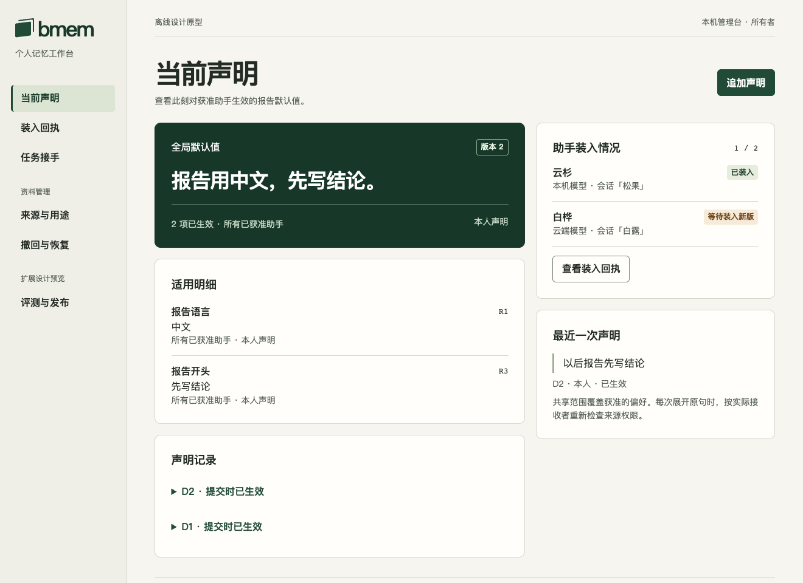

# Botinkit Memory V2 重建设计

**2026-11-19 · 架构已冻结，技术方案按三平台首发要求修订。** V2 从空库起步，使用本机 `bmem` 命令，在 macOS、Windows 或 Linux 的用户目录 `~/.bmem` 维护一份个人记忆。用户明确说出的偏好能随任务交给获准助手，普通对话与工具回执也能自动形成有出处的记忆。首轮真实接力验收使用 **Claude Code 和 Codex**。

实际安装、常驻启动与历史同步见[项目入口](../../README.md)。冻结资料中指向旧版实现、用例及依赖的路径，可在历史提交 `ae2c06b` 中按仓库路径查阅。

| 从这里开始 | 可以解决的问题 |
|---|---|
| [架构冻结记录](baseline.md) · [研究原文](../../research/README.md) | 哪些架构决定已定？哪些历史实测只说明现版存在的问题？如何校验冻结输入？ |
| [产品功能设计](product/README.md) · [验收场景](product/acceptance.md) | 哪些人和宿主可以做什么？12 项功能怎样分期？纠正、撤回和恢复后用户应看到什么？ |
| [技术方案](technical/README.md) · [技术路线比较](technical/runtime-route.md) | 三平台如何交付一个原生程序，六域 18 模块如何共用权威状态，如何验证性能？ |
| [Claude Code 技术评审记录](reviews/technical/README.md) | R3 已通过独立设计评审，可进入实施。可逐轮查看修改意见、作者处理和最终 21 个文件的指纹 |
| [子命令与 Web 对照](technical/command-catalog.md) · [扩展接口](technical/extension-contract.md) | 同一项设置、声明或权限怎样在两端修改与回读，如何新增连接器或命令？ |
| [领域实施与集成](technical/module-integration.md) | 开发者从哪个目录开工，模块之间交什么数据，怎样用同一组输入独立验收和合流？ |
| [安装与配置](technical/cli-and-platform.md) · [三档压缩](technical/compression-and-performance.md) | 用 CLI 或 Web 配好连接器、生成模型和可选向量模型。比较三档在磁盘、实际上下文和原文回查上的行为 |
| [UI 交互设计](ui/README.md) · [打开离线原型](ui/prototype.html) | 从当前声明查到某个助手实际装入的版本，再查看任务证据、共享范围及治理结果。原型使用虚构数据，可直接在浏览器打开 |
| [并行计划与集成验收](delivery-plan.md) | 各线交付什么、依赖谁，什么时候合流？哪条端到端路径先进入实现？ |

## 先评审哪条路径

从原型的「当前声明」开始，查看“用中文、先列行动项”如何成为两项偏好。进入「装入回执」，比较本机助手云杉与云端助手白桦。追加“以后报告先写结论”后，再看开头的修订、继续有效的语言，以及不同助手确认装入的时刻。白桦可以收到获准共享的偏好；声明原句只在有原文权限的本机查看。

**首发有两条必通的路径。** 先跑通「本人声明 → 跨助手装入 → 结果回执」。随后在 Claude Code 的普通任务中留下对话和工具回执，让后台自动提炼并仲裁，再由 Codex 接手，核对其实际收到的结论、适用条件和原文依据。这一过程无需输入“记住”，也无需逐条审核。两条路径连同词法接手、撤回和恢复构成 P0 日用版本。

P1 用 P0 的错例比较跨案例方法归纳、语义与关系检索。P2 在有获准样本、独立评测和可回退版本时引入离线学习与发布。

## 首轮产品与原型设计验证

| 检查对象 | 方法与结果 |
|---|---|
| 冻结输入和文档 | 从仓库根运行 `shasum -a 256 -c docs/v2/research.sha256`，10 个文件均一致。本地文档路径、锚点及原型资源链接均可解析。已对照 18 个模块、12 个功能、12 组阶段验收，8 个 JSON 示例通过解析 |
| 原型代码 | `node --check docs/v2/ui/prototype.js` 通过。以 OCR 委托模式选取并逐一审读 HTML、CSS、JavaScript 三个文件，重点复核版本变化、证据可见性、单项采用及回退 |
| 离线操作 | Chrome 直接打开 `docs/v2/ui/prototype.html`，使用 Playwright 操作真实控件。75 项断言通过，其中 42 项检查六页在七种宽度下的横向溢出。走查包括提炼前后两个时点、跨接收者补读、撤回、隔离预览及发布回退。未观测到对外网络请求或 JavaScript 异常 |

本轮验证的是设计稿和固定样本。真实模型的提炼质量、Claude Code 与 Codex 的实际装入及任务结果、受管副本的清理和恢复，均在实现后按产品验收执行。
