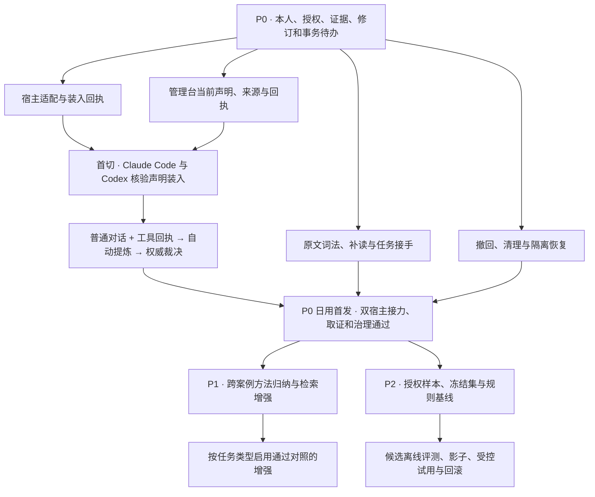

# 从设计走到第一条可验收的交接

先集成 **一条本人声明如何改变两个助手的下一次任务**，再集成 **从普通对话与工具回执自动提炼，供另一助手接手**。两条路径都属于首发。第一轮使用 Claude Code 与 Codex，分别验证输入进入系统的来源、真正装入宿主的内容和任务结果。

## 设计如何并行

| 工作线 | 可独立决定 | 给另外两线的输出 | 合流时检查 |
|---|---|---|---|
| 产品 | 用户任务、优先级、成功与失败的可观察结果 | F01–F12 的能力范围、案例和验收口径 | 一项操作的生效时刻、作用域、结果说明一致。见[产品设计](product/README.md) |
| 技术 | 模块数据所有权、事务、查询、宿主和运维契约 | 同一案例的请求、身份、修订、投递与操作回执 | 每个 UI 状态都能用一个权威结果或宿主观察解释。见[技术设计](technical/README.md) |
| UI 交互 | 导航、控件、回读、确认和异常恢复 | U1–U6 页面与离线原型，可逐步走查第一条交付 | 用户能预判谁收到什么，能解释“生效”“已装入”和“已采用”。见[交互设计](ui/README.md) |

三线在功能与界面设计阶段使用固定合成输入。进入代码实现时，把选定切片的验收、实现计划和工作项落在项目 `specs/<feature>/` 的同一套 Spec Kit 产物中。本页只描述依赖关系、责任和阶段准入。

技术开发者从[模块并行实施与集成](technical/module-integration.md)进入六域分册。该文列出每个工作面的首个可独立交付产物、共享数据的提交方、联调输入和放行证据。CLI 与网页的开发者共用[命令目录](technical/command-catalog.md)及[动作描述符](technical/extension-contract.md)。

三平台发行与配置贯穿 P0。先在干净账户把 `bmem init`、`doctor`、`web` 及配置共用打通，验证已有 API 和本地 Ollama 两条生成路径，再合流到以下两条首发链路。默认关闭向量的词法路径、显式开启后的嵌入路径，以及三档的证据等价、磁盘与上下文成本分别验收。[平台验收](technical/cli-and-platform.md) · [压缩验收](technical/compression-and-performance.md)

## 实现顺序与可并行工作

| 交付顺序 | 责任与并行关系 | 取什么作为结束证据 |
|---|---|---|
| **P0 首切** 声明、装入和反馈 | 权威写入先定追加声明及可见快照。宿主线接入 Claude Code 和 Codex，前端线用同一契约做 U1/U2，验证线准备获准与受限的接收端、失联及无关键词任务 | 同一声明在两端的有权读取中返回正确维度。分别取得两款真实宿主的装入凭证，核对各自输出。缺失回执要可见。仅查询客户端另作能力对照 |
| **P0 日用首发** 自动提炼、可追溯接手和治理 | 声明链路跑通后，对获准普通对话、工具事件接上真实提取器与权威仲裁。同时接手/搜索、来源采集、撤回/恢复三组并行。由第一款宿主自然留下任务材料，第二款在新会话接手 | 同一任务含计划、实际回执和失败边界。无需“记住”或人工建条目，Codex 能读到 Claude Code 留下的有效结论，并回到原始依据。关闭模型时可收证据，恢复后继续自动提炼。撤回后旧句柄立即禁读，空目录恢复展示截止点，无关合法记录仍能读 |
| **P1 有条件增强** 方法归纳与复杂阅读 | 基于首发提取器比较跨案例经验与反例、复杂维度与适用条件；读取侧按失败类型分别试原文窗口、语义、有限跳和主题归纳。沿用 P0 读权限与同一批证据 | 记录配对任务的得失、证据完整率、错误注入、时延和成本。对无可辨收益的请求类型沿用 P0。模型或增强索引退回时仍能完成首切 |
| **P2 离线学习与受控发布** | 有独立任务结果和用途授权后可先构造版本化清单、分组与基线。选定候选才运行冻结评测；有合格对照和回退目标才试用。样本不足时止于规则和回放 | 保留数据与工件血缘、试用范围、任务结果和回滚记录。能撤销训练用途、定位停用受影响产物，回滚后仍返回最新个人声明 |

## 三线贯穿走查

以下均为待执行的合成验收。所有者仅授权云端接收**共享偏好值**，声明原句留在本机。云杉是本机助手，白桦通过本机适配器调用云端模型。它们只代表测试角色，正式接入时以每一款宿主实际声明并验证过的能力为准。

| 步骤 | 操作与预期 | 产品 → 页面 | 技术交界和要看的证据 |
|---|---|---|---|
| 1 | 在管理台追加“所有助手的报告用中文，先列行动项”。一次收录产生两个可确定维度，展示生效结果 | F01/F02 → U4、U1 | `POST /v2/statements` 返回原话对应的声明及两个维度的修订，重复投递不产生第二组修订 |
| 2 | 给两个助手同一个无偏好关键词任务。都可得到获准共享的值。云杉可展开原句，白桦不能取得本机原句 | F03/F05 → U2、U1 | `POST /v2/context/load` 分开交付声明与任务包。核对各自接收路由、可见修订和 `delivery_id` |
| 3 | 仅云杉确认装入。白桦保持“已提供”，直到它自己的宿主回执抵达。检视是否采用及任务结果时分别给出依据 | F03/F11 → U2 | `POST /v2/deliveries/{delivery_id}/receipts` 与 `POST /v2/attempts/{attempt_id}/outcomes` 分属两类观察。模拟一条任务通过回执，不能据此给包内所有条目标为已采用 |
| 4 | 追加“以后报告先写结论”。对同一适用范围仅开头发生取代，语言仍为中文。压缩后重装或离线重连应取得最新可见版本 | F02/F03/F05 → U1、U2 | 比对修订前后及两个宿主下一次装入。若宿主只有追加能力，公开旧消息仍在上下文的限制 |
| 5 | 在“溪桥／导入超时”的普通对话中说“准备复验”，随后工具回报“解析通过、入库仍超时”。云杉可核对这次自动提炼的结果与原句，白桦无权读该任务。实际在 Claude Code 留下输入，再让 Codex 接力时，另用双方均获准的合成任务材料 | F04/F09/F11 → U3 | 从 `POST /v2/events` 接收、后台提炼到权威修订，逐项核对提取版本与依据。用 `POST /v2/search` 定位并通过 `POST /v2/evidence/expand` 补读。保留另一同仓任务作反例 |
| 6 | 撤回包含执行回执的来源，在清理尚未结束时重试旧句柄并再次装包；再用删除前备份预览恢复 | F06/F07/F08 → U5 | `POST /v2/operations` 取得单据并查询。分别检查立即禁读、剩余独立证据、清理覆盖、已发送副本、恢复可证明的截止点 |

## 放行时看什么

1. **正确性与可见性。** 固定合成输入，逐项核对当前/历史值、权限、合法对照和禁读对照。未授权字段出现在最终内容或派生标题、计数中即为该用例失败。报告样本和出口数量。
2. **跨宿主是否带来收益。** 在 Claude Code 与 Codex 之间用同一任务起点做接力，分别跑关闭记忆、宿主文件、原文词法、完整方案；给金标证据作为诊断上限。锁定模型、任务断言、可见历史、token 和时间预算。单列无历史和无关历史任务。
3. **人是否看得懂。** 让使用者找到偏好的原始依据、判断白桦可收到什么、只修改一个维度，再解释一次遗忘的范围。记录完成与否、预测正确数和误读点；原型演示只能检查交互可行性。
4. **增强是否值得启用。** 在看结果前确定任务类型、权重、成本上限与可接受退化，按根来源和任务族分组留出。配对报告新增成功、退化和不确定区间，另报 p50/p95、最老待办年龄及每个成功任务成本。影子结果可判检索差异，任务收益需获准试用验证。[研究评测协议](../../research/reassessment-2026-11/evaluation.md)
