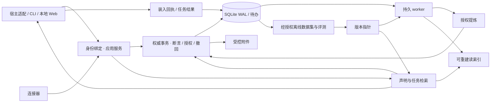

# bmem v2 技术方案

**推荐路线是 Rust 原生 `bmem` + SQLite WAL/FTS5 + 内嵌 Web。** macOS、原生 Windows 和 Linux 分别安装本机发行件，运行 `bmem init` 建立 `~/.bmem`。连接器、模型、向量开关和压缩档位可以通过命令行或 `bmem web` 配置。一次明确纠正提交后，另一个获准的助手应在下一次任务拿到新值，即使生成模型停机或索引正在重建。跨平台是本轮确认的首发要求，Rust 是建议验证的工程选型。[架构依据](../../../research/reassessment-2026-11/architecture.md)

| 设计入口 | 实现者能据此决定什么 |
|---|---|
| [技术选型与执行模型](runtime-route.md) | Rust、Go 和保留 Python 的取舍，进程、内存、SQLite 写入、生成与向量两条模型通路，如何验证性能 |
| [安装、命令与配置](cli-and-platform.md) | 三平台安装、`init/update/doctor/web`、连接器和模型管理、工作目录、升级与恢复 |
| [子命令与 Web 对照](command-catalog.md) · [命令登记及扩展](extension-contract.md) | 每个入口的语法、HTTP、操作 ID、返回状态和分期；如何让命令与页面改同一对象，如何接入新能力 |
| [模块并行实施与集成](module-integration.md) | 拟建 Rust workspace、六个领域的开发分册、跨域事务、共同夹具、并行启动条件与两条首发链路的验收 |
| [三档压缩与性能验收](compression-and-performance.md) | 完整、紧凑和按需补读的上下文，磁盘编码与切档，如何检查原文可逆、任务准确率和总成本 |
| [权威数据与事务](authority.md) | 稳定 ID、表约束、来源资格、事实身份、双时态查询、当前授权与事务提交顺序 |
| [服务接口与宿主协议](contracts.md) | HTTP/CLI/MCP 的同一语义、声明与接力样例、路由身份、重试、收件回执、治理和控制台读模型 |
| [运行、替换与验收](operations.md) | 单机部署、后台任务、投影水位、可选增强、学习发布、撤回清理与隔离恢复 |

## 设计决策

| 状态 | 决策和理由 | 代价与重议条件 |
|---|---|---|
| 架构冻结 | 单所有者、一个本地服务、SQLite WAL、受控附件目录。短事务保存权威状态与 outbox，能在同次提交中证明接受了什么、接下来要做什么 | 单写者串行提交。持续积压且优化后仍越过测定的服务预算，或引入多设备主动写需求时，评估替换权威存储 |
| 架构冻结 | 全局声明直读、来源与事实修订可互查、接收端按用途授权。词法、向量与社区返回的候选都回到权威记录取正文 | 交付前有一次权威读取成本。索引水位落后时允许任务搜索少召回，现行声明仍须立即可见 |
| 技术选型建议 | 三平台各发布原生 `bmem`。以 Rust、内嵌 SQLite/FTS5、一个本地服务和持久待办替代先前的 Python/FastAPI 服务提案。Web、CLI、宿主调用同一应用层 | 发布制品逐系统核验安装、升级、凭据、后台运行及 FTS5 能力，性能与现行 Python 在同硬件配对测量 |
| 用户确认 | 生成模型可接已有 API，或通过本地 Ollama 安装模型。向量相似检索默认关闭，仅开启后配置已有嵌入 API 或下载嵌入模型。三档同时作用于磁盘和模型上下文 | 切档与向量开关分开。保留获准的原文、来源和修订，任务准确率不降才采用更紧凑的交付方式 |
| 后续增强 | P1 做语义融合、跨案例归纳、限跳导航与社区的收益对照，P2 独立评测和发布规则或训练工件 | 保存版本、输入水位、部署范围和评测关联，按固定任务和预算决定启用范围 |

## 六域和十八个模块

下表的每一行是一个可单独验收的模块。权威域拥有唯一的事实写端口，其余模块只持有自己的运行状态或投影。实现时按领域分册领取工作面，各分册逐模块给出状态、端口、算法、故障与独立验收。[D1 接入与采集](domains/ingestion.md) · [D2 证据与权威写入](domains/authority.md) · [D3 提炼与巩固](domains/extraction.md) · [D4 检索与上下文](domains/retrieval.md) · [D5 反馈与学习](domains/feedback.md) · [D6 运营与治理](domains/operations.md) · [冻结模块依据](../../../research/reassessment-2026-11/modules.md)

| 域 | 模块 | 输入 → 产物、持久状态 | 落地顺序 |
|---|---|---|---|
| 接入与采集 | 助手与应用适配 | 注册客户端及宿主事件 → 带真实说话者和会话的信封、能力登记 | P0 固定 Claude Code 与 Codex，各自实测采集、装入与回执 |
| 接入与采集 | 连接器与历史回填 | 已授权来源账号、变更页 → 事件与采集游标、回填/撤回/对账能力 | P0 以一条可重放连接器链路验收；具体覆盖逐来源列明 |
| 接入与采集 | 身份、去重与任务关联 | 来源对象版本、任务/工件锚点 → 原回执、任务归属或多个可选任务 | P0 |
| 证据与权威写入 | 证据保管 | 规范信封、附件 → 稳定根、证据版本与片段位置 | P0 |
| 证据与权威写入 | 本人声明、经历与断言仲裁 | 原话/候选及依据 → 声明、事实时间段、经历、裁决理由 | P0 |
| 证据与权威写入 | 关联、授权与失效 | 依据、用途和撤销命令 → 有向版本边、授权水位、读取屏蔽 | P0 |
| 提炼与巩固 | 提取与模型路由 | 授权片段、策略和预算 → 有证据位置的提案或零条提案 | P0 在声明链路通过后接真实获准模型，自动提炼普通对话和工具回执 |
| 提炼与巩固 | 按事实维度归并 | 提案、已有事实键/条件 → 归并候选与理由，交权威域复核 | P0 确定性声明和普通事件候选的自动裁决；P1 对照改进复杂匹配 |
| 提炼与巩固 | 经历归纳、方法与重算 | 实际回执、反例、依赖变化 → 限定版本的方法或暂停服务的旧摘要 | P0 从对话、执行回执自动形成有据经历；P1 跨案例归纳可复用方法 |
| 检索与上下文 | 索引与关系投影 | 已提交修订 → FTS 词频/扩展词、关联表、输入水位 | P0 默认词法与出处，显式开启时增建向量投影；P1 社区 |
| 检索与上下文 | 检索、融合与补读 | 查询、接收域、时间、预算 → 候选与受控证据窗口 | P0 精确/词法、可选基本向量相似检索；P1 受控比较融合、限跳和窗口 |
| 检索与上下文 | 全局声明装入、任务证据包装与回执 | 当前声明、任务线索和宿主能力 → 两套预算、投递明细 | P0 |
| 反馈与学习 | 投递和使用反馈 | 投递 ID、宿主观测、独立结果 → 尝试级记录及归因缺口 | P0 |
| 反馈与学习 | 数据集与评测 | 任务、根来源、许可和断言 → 冻结输入与配对结果 | P0 合成回归与两宿主真实联调；P1 提炼/检索对照；P2 用途限定数据集 |
| 反馈与学习 | 策略试验与离线训练 | 合格样本、规则基线 → 候选策略/权重与可复算报告 | P2 |
| 运营与治理 | 来源设置、隐私和审计 | 本人命令 → 权威事务与分位置操作进度 | P0 |
| 运营与治理 | 健康、积压、回放与发布 | 能力、水位和工件 → 诊断、试验记录和生效版本 | P0 运行诊断；P1/P2 对照与发布 |
| 运营与治理 | 可移植导出、备份与恢复 | 授权快照、附件、撤回清单 → 可核对的导出及恢复预览 | P0 权威格式、快照与隔离恢复；P2 纳入数据集/工件依赖 |

## 服务边界

P0 先在空库用 **Claude Code 与 Codex** 跑通声明 → 跨宿主装入 → 独立结果回执，再给同一对宿主接入基础自动提炼。第二步要求普通对话和工具回执经获准的真实模型输出带原文定位的候选，权威服务自动裁决，另一宿主能查到已验证的结果和仍未解决的问题。首发验收还包括来源撤回、独立恢复、模型中断及恢复后的补提炼。SQLite 事务、模型端口和现有测试是可利用的构件；旧 schema、宿主调用参数、已产生的旧索引均不构成 v2 交付约束。历史实测与 v2 的验收结果分别记录。[调研实测](../../../research/reassessment-2026-11/local-evidence.md)
