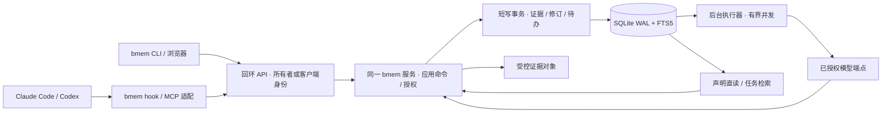

# bmem 跨平台技术路线

**2026-11-19 · 推荐进入实现验证的路线：Rust 原生 CLI 与本地服务，内嵌 SQLite/FTS5，浏览器管理台随程序分发，模型通过独立端点调用。** 用户安装与操作的入口统一为 `bmem`，每台机器有自己的 `~/.bmem`。冻结研究里的一份本地权威库、可撤回的证据和两款助手接力，在三个操作系统上使用同一套语义。[首发需求与冻结记录](../baseline.md) · [CLI 与发布](cli-and-platform.md)

## 为什么选这条路线

| 候选 | 安装和执行形态 | 对 bmem 的具体取舍 |
|---|---|---|
| **Rust 原生程序** | 把 CLI、服务入口、Web 静态资源和 SQLite 编入各平台发行件。用户无须准备 Rust、Python 或 Node 工具链 | 短命令可以在建立网络运行时之前返回。服务端可精确控制读写队列和流式压缩缓冲。代价是重写 Python 权威逻辑，发布侧还要构建 C 依赖、签名并测试六种原生制品。[Rust 目标支持](https://doc.rust-lang.org/rustc/platform-support.html) · [rusqlite 构建说明](https://github.com/rusqlite/rusqlite#notes-on-building-rusqlite-and-libsqlite3-sys) |
| **Go 原生程序** | 同样能内嵌 Web；可用 modernc SQLite 构建无 cgo 版本，或带 C 工具链使用原生 SQLite | 是可行备选。Go 的运行时提供 GC、内存限制与分析工具。若 Rust 路线在目标平台的签名发布或内存/时延验证受阻，用同一 SQLite/FTS 配置、相同输入和请求测 Go，再作决定。[modernc SQLite](https://pkg.go.dev/modernc.org/sqlite) · [Go GC 指南](https://go.dev/doc/gc-guide) |
| **保留 Python 服务，分平台打包** | 最能复用 V1 的 Python/FastAPI、MCP 接入和既有测试。PyInstaller 可连解释器一起分发；其 one-file 形态启动时需把支持文件解包至临时目录，one-folder 可免去每次解包 | 工程改动最少，适合作行为和性能对照。此路线需要为三端维护解释器、原生扩展和发布包。现有测试语料、时态/授权反例和回放断言可继续从公开入口检验 Rust 实现。V1 依赖见 `git show ae2c06b:pyproject.toml`。[PyInstaller 运行方式](https://pyinstaller.org/en/stable/operating-mode.html) |

选 Rust 的理由是分发形态和资源控制。**速度需要实测。** 本轮在 macOS 26.3 arm64、Python 3.12.13 的现有开发环境，仅测旧版 `.venv/bin/bmem --version`。预热一次后串行拉起 31 个新进程，墙钟 p50 **19.82 ms**、p95 **20.87 ms**。另用 `/usr/bin/time -l` 测三次，峰值 RSS 在 **18.86–18.98 MiB**。空临时数据目录没有写入，未启动服务或模型。该结果给未来原生制品提供本机、热文件缓存、短命令的对照，跨平台与整机冷启动应另测。

## 进程、库和数据流

| 部件 | 实现选择及责任 |
|---|---|
| 命令行与管理台 | 用 clap 解析子命令。`--help`、`--version` 只走 CLI。需要权威数据的命令与本机 Web 调用同一应用服务，注册身份、阶段状态、错误码和授权语义一致。管理台静态资源在发布时嵌入，由用户已有浏览器显示。初次安装和缺失配置的恢复流程见[命令设计](cli-and-platform.md)。[clap](https://docs.rs/clap/latest/clap/) |
| 本地通信与宿主 | 用 Tokio/axum 提供回环 HTTP。宿主具备生命周期回调时由薄适配器调用声明快照/任务包；仅支持 MCP 的宿主可主动查询。使用官方 Rust MCP SDK，stdio 子进程可转发到同一本地服务，标准输出专供协议；需要 HTTP 的宿主可通过同一服务接入。宿主能否回报模型输入由真实联调确定。[axum](https://docs.rs/axum/latest/axum/) · [Rust MCP SDK](https://github.com/modelcontextprotocol/rust-sdk) |
| 权威数据库 | 用 rusqlite 的 bundled 构建固定 SQLite 版本，开启 FTS5 与备份能力。发布机带 C 工具链。以每个成品实际创建 FTS5 表、插入/检索中文与技术标识符、在线备份恢复为验收。授权、双时态修订、撤回水位和 outbox 用普通表与约束维护。[SQLite 编译选项](https://sqlite.org/howtocompile.html) · [权威事务](authority.md) |
| 本地对象与查询 | 小而常查的身份、版本、时间、权限和原文位置保留可索引列。较大正文与附件采用可独立寻址的对象；预处理后的证据有稳定标识，物理重打包不改公开句柄。FTS 查询先取得获准范围内的候选，再按最新权限读取原文。三档策略和全库字节口径见[表达与性能](compression-and-performance.md)。 |
| 模型与连接器 | 服务内维护统一来源信封、游标、实际接收路由和任务。模型提供者通过适配器接受获准的证据并返回结构化候选；本地运行时和远程 API 可各自检测、停用和替换。模型处理可能由独立进程或外部端点执行，核心不静态链接整套推理软件和模型权重。每个连接器单独登记其来源范围、回填/编辑/撤回能力以及宿主端依赖。[宿主与模型契约](contracts.md) |

## 生成模型和向量模型分别配置

| 路径 | 用户如何启用 | 服务如何验证和降级 |
|---|---|---|
| **生成／提炼** | 在 `bmem init` 中选已有模型 API，或选本地 Ollama。后者优先连接已有运行时，缺少运行时或模型时显示所需下载并按选择安装。向导使用可验证的模型标识、大小、可用空间和许可信息 | 用合成原话和工具回执验证结构化候选及定位。保存模型版本、模板和测试结果。模型离线时继续接受声明和授权事件，未完成提炼保留待办。[Ollama 结构化输出](https://docs.ollama.com/capabilities/structured-outputs) · [模型下载](https://docs.ollama.com/api/pull) |
| **嵌入／相似检索** | 首装默认关闭。用户明确开启后，才引导选嵌入 API 或从本地 Ollama 下载嵌入模型。单独选择哪些来源允许用于嵌入及目的地。生成模型和向量模型分别绑定、分别计费 | 用合成文本检查返回条数、维数和数值，登记模型身份及索引版本。显示「待配置」「建索引中」「可检索」与覆盖水位。服务不可用或索引未覆盖时回到精确/词法并展示原因，任务照常可获取声明。[Ollama 嵌入接口](https://docs.ollama.com/api/embed) |

**首版 API 适配范围。** 生成端建议实现 OpenAI 兼容 Chat Completions、Anthropic Messages 和 Ollama 本机协议，复用仓库已有的合成输入与错误用例。嵌入端建议实现 OpenAI 兼容 Embeddings 和 Ollama Embed。向导按用途列出协议，保存用户选择的端点与模型 ID。每个组合用合成输入验证能力，提炼响应必须能解析并通过候选结构校验，失败原因显示在 `bmem doctor`。更换接收端需重新确认授权范围。[模型接口契约](contracts.md) · [Chat Completions](https://platform.openai.com/docs/api-reference/chat/create) · [Messages](https://platform.claude.com/docs/en/api/messages/create) · [Embeddings](https://platform.openai.com/docs/api-reference/embeddings/create) · [Ollama Chat](https://docs.ollama.com/api/chat)

**首版向量基线。** 启用后以授权域、模型标识及版本、维数、切块规则、距离度量建立独立投影。投影位于 `indexes/`；类型化 ID 指向权威修订。实现先在可见范围内按块读取 float32 向量、计算精确余弦相似度并维护有界 top-k，作为三平台可复算的正确性基线。扫描开销随候选数和维数增长，大库超过延迟预算时回退词法并报告降级。后续按同一批请求比较原生向量索引或近似近邻的召回和开销，再决定是否替换。Ollama 输入超长时显式分块并保留原文位置，避免静默截断遗漏证据。关闭功能停止查询、嵌入调用与建索引作业；更换嵌入模型需在新空间重建。压缩档位不触发模型下载、向量量化或变换向量空间。

## 性能从哪些地方取得

1. **先保障前台延迟。** 声明提交、当前快照和受限补读优先于批量回填与重打包。写入只走一个短事务写者；持久证据、修订和待办一同提交后才向用户回执。采用 WAL 和满足已回执持久性的同步策略（起始设为 `synchronous=FULL`）。读端复用少量连接、短时间持有读快照；观察长读、checkpoint 及 WAL 峰值。数据根位于本机磁盘，网络共享目录的 WAL 条件不成立。[SQLite WAL](https://www.sqlite.org/wal.html) · [同步策略](https://www.sqlite.org/pragma.html#pragma_synchronous)
2. **给后台工作设上限。** 单台工作站先以一个活动提炼作业为起点。按批次提交来源页，按需读受授权原文窗口；模型调用、解压、分词均在数据库写事务之外。同步 SQLite 操作与耗时压缩交给有上限的执行线程，避免长期占用异步网络线程。队列满时延迟领取或返回可重试结果，显示最老待办年龄。实测处理能力后再调并发。[Tokio 阻塞任务](https://docs.rs/tokio/latest/tokio/task/fn.spawn_blocking.html)
3. **让空闲服务真正空闲。** 服务在到达事件或重试期限时唤醒。配置/版本查询不加载模型；展开证据才读取相应片段；响应分页或流式输出，限制单任务占用的内存。记录空闲 CPU、服务内存、模型运行时内存和后台处理峰值。云模型的耗时与 token 另计；本机推理在资源报告中同时列单项与整机总量。
4. **按用户任务选实现。** 固定同一数据、授权、宿主、提炼模型和回答预算，先以三档都正确为门槛，再报告每个成功接手的耗时、token 和存储成本。版本、标签、路径和错误码等信息的恢复必须可核对。P0 默认以同一词法检索器比较三档。在单独的实验中，把 P0 可选的向量检索、后续的重排策略分别与词法基线比较，以区分检索与压缩各自的影响。[检索研究基线](../../../research/reassessment-2026-11/local-evidence.md)

## 下一次实施的技术验证顺序

| 顺序 | 交付到什么程度才作下一项决定 |
|---|---|
| 1 · 分发与配置 | 从三个操作系统的干净用户环境安装原生制品，验证 `bmem init`、`doctor`、Web 与 CLI 双向配置、停止和升级。检查各目标 FTS5、数据库和凭据存取，记录包大小、冷/热启动、空闲 CPU/RSS。按各制品实际验证的平台和最低系统公布支持范围 |
| 2 · 首发链路 | 跑通 Claude Code 和 Codex 的声明、装入与结果回执，再接普通对话/工具事件的真实自动提炼。复验迟到、复述、授权收窄及模型离线后的补提炼，记录每条失败的断点。[首发脚本](../product/acceptance.md) |
| 3 · 三档及压力 | 在同一输入上对账修订、权限、证据、召回、最终上下文和真实任务结果。增加批量回填、索引重建和切档期间的交互查询，按平台与负载分别报告收益和退化。质量证据不足的优化走保真回退路径。[测试口径](compression-and-performance.md) |

本文记录 Rust 实现前的技术选型。当时的基线为 Python 版。当前 Rust 程序的构建与验收入口见 [V2 快速开始](../../../specs/004-bmem-v2/quickstart.md)。
