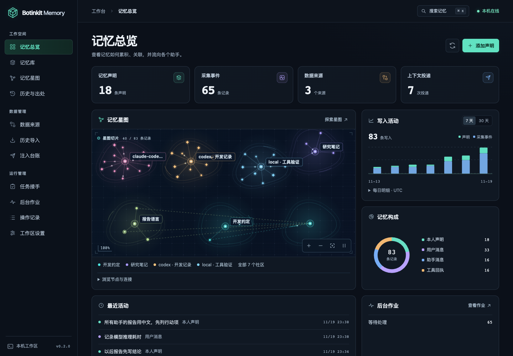

# Botinkit Memory 工作台 · UI 与交互设计

## V2 本机工作台

运行 `bmem web` 打开 Botinkit Memory。日常操作可以从总览开始，按 ⌘K（Windows/Linux 为 Ctrl+K）搜索，或点击「添加声明」记录本人原话。应用、样式、图标和图谱渲染器随原生程序分发，浏览器通过本机所有者会话读取数据。[构建与启动](../../../specs/004-bmem-v2/quickstart.md)

| 入口 | 可完成的工作 | 数据与交互 |
|---|---|---|
| 记忆总览 | 检查声明、事件、来源、投递和作业 | 写入活动可切换 7 天或 30 天，按 UTC 统计当日接收的声明和事件。构成图与最近活动使用同一份总览查询。 |
| 记忆星图 | 选择社区、缩放、平移，沿一条边查看相邻节点 | 记录连到实际来源、项目范围或声明维度。预览取最近 40 条，完整页取最近 120 条，切片标明与全库记录数的关系。可从有事实标识的声明打开历史。 |
| 记忆库与检索 | 追加声明，核对项目例外、原话和历史修订 | 关键词或已配置的向量检索可以查询声明与采集证据。点「查看原文」才请求事件正文。 |
| 数据来源与历史导入 | 登记来源、控制采集、预览并确认提炼和向量用途授权、导入 V2 JSON 事件批次 | 确认前检查来源身份和游标。连接中断后可用同一提交重试，从回执核对结果。 |
| 注入台账、任务与作业 | 区分已提供和已观察的回执，查看交接证据与后台处理进度 | 作业可筛选、翻页，失败项可以重新排队。操作记录包含本地备份创建和恢复预检入口。 |
| 工作区设置 | 配置压缩档位、向量开关、模型及用途绑定 | 与 CLI 共用版本化配置。设置页可见时每 3.2 秒检查变化，回到窗口时立即刷新。外部更改与草稿冲突时，由用户读取最新版本后决定是否保存。 |

星图把稳定的节点、边和社区边界绘在底层 Canvas，把节点脉冲、沿边粒子和社区轮廓上的移动亮弧绘在上层。动效表达连接方向，事件发生时间在活动图和记录详情中查看。切换页面、标签页隐藏、图谱滚出视口时停止动画。系统启用「减少动态效果」时显示静态图。每个社区和相邻节点也可以通过选择器浏览。空库的关系示例有独立标识，可手动隐藏；计数与趋势始终来自当前工作区。

## 离线交互原型

管理台首先回答两个问题：我现在让助手记住了什么？另一个助手实际装入了哪一版？所有者通过日常对话即可完成声明与纠正，管理台提供同等的追加入口、可读的修订差异与接收回执。[离线交互原型](prototype.html) · [产品功能](../product/README.md) · [技术契约](../technical/README.md)

## 首发先验证声明，再接基础自动提炼

打开原型可直接查看预填的声明。在页脚选择「从空白声明开始」可完整重演。「云杉」「白桦」是虚构接收者，分别演示本机可补读原话、云端只可读共享偏好。首轮真实验收指定 Claude Code 与 Codex：先以实际宿主回执核对两条声明的装入和纠正，再接入获准普通对话与工具回执，自动产出可交接的经历。分别登记两个宿主的实际模型路由、会话与用途；复验时可交换任务发起与接手角色。原型在浏览器内存中运行，刷新可还原。样稿实现 U1–U6 的下列操作。U3 演示固定的后台提案与权威回执，U6 使用独立的合成图书目录。

| 操作 | 页面应出现的证据 |
|---|---|
| U1 追加「所有助手的报告用中文，先列行动项」 | 版本 1 的两项默认值分列为「报告语言 / 中文 / R1」和「报告开头 / 先列行动项 / R2」。两项同源，修订独立。两个助手均为待提供。 |
| U2 对云杉和白桦分别点「模拟提供当前快照」，再点「模拟宿主装入回执」 | 提供后仍待回执。收到宿主回执的会话显示已装入。各行列出实际模型路由和最近版本；点「查看依据」，云杉可见本人原句，白桦仅见获准的共享值。 |
| U1 再追加「以后报告先写结论」 | 版本 2 保留语言 R1，开头 R3 取代 R2。展开 D2 可见被取代项，D1 仍可回溯。U2 显示两个助手最近装入的仍是版本 1。 |
| U2 仅让白桦取得新版并回执 | 两个助手的装入进度不同。云杉的「查看依据」并列最近装入与当前可提供的两组值。 |
| U2 给白桦记录「任务通过」，再单独记录「报告开头的采用凭据」 | 首次操作只改变任务结果。第二次可定位样本输出首段、开头 R3 与所用版本；语言 R1 没有因此获得采用凭据。 |
| U3 选云杉，在「自动提炼记录」回放到片段 8 后补读，再切到片段 9 | 只有本人普通对话时，提案 P8 留存计划，执行结果未知。工具回执到达后，P9 经权威核验自动产生经历修订 H1，接手卡分别显示「重放解析与写入」「解析通过，入库仍超时」。每条都能按说话者、源对象 I7、片段和消息版本补读。 |
| U3 切换白桦，再回云杉 | 白桦只得到无可交付材料及恢复路径。接收者无权时，经历正文、提案状态、修订号、来源定位和原文入口均收起。云杉在仍获授权时可看自动提炼结果。U1 的个人声明继续保持原有修订。 |
| U4 停止采集后回 U3；再在 U5 预览并确认模拟上游撤回 | 停采后已有记录仍可授权补读。撤回提交后云杉也无法再展开；可分别看到新读取已阻止、索引清理待回报、历史已投递。 |
| U5 切换隔离恢复样本 | 仅旧孤本时显示可证明水位 18，普通读取关闭。加入后续撤回清单后显示已核对至 21 及仍待检查的附件、来源与接收域。 |
| U6 展开四项配对结果，再模拟影子运行、确认限定试用并回退 | 固定预算的冻结回放中 A 通过 2/4、B 通过 3/4。可逐题核查 1 项改善和 0 项退化。影子仅有 1/3 顺序变化；限定试用的两项新任务有 1 项通过、1 项未知。回退至规则 A 后核对权威声明及修订。 |
| U6 预览并撤回独立目录的训练用途 | 数据 T1、运行 J1、工件 B 的依赖可查。新训练、发布及 B 的试用被停止，运行端确认基线 A；回到 U1 或 U3 可查看与训练来源独立的资料。 |

## 页面和归属

| 编号 / 阶段 | 首要问题与页面结构 | 控件、状态变化及下一步 | 功能 |
|---|---|---|---|
| U1 当前声明 · P0 | 先显示适用范围与当前确认值，再列维度、修订、依据及每个助手装入进度。历史记录按追加顺序展开。 | 「追加声明」保存原话。表单注明生效范围、共享对象与原话补读范围。回执按维度展示生效、待归并、争议、未来生效和历史。由声明记录进入出处或 U2。 | F02、F03、F05、F09 |
| U2 装入回执 · P0 | 一行一个宿主、会话及上下文重建批次，显示接收模型、读取用途、当前应取、最近提供、最近装入、可观察的采用与任务结果。 | 详情比对快照的维度和修订。限定接收者查看投递原因及可补读证据。宿主仅支持搜索时标「按需查询」；支持追加但无法替换时标「已追加更正，旧消息仍在会话」。 | F03、F05、F11 |
| U3 任务接手 · P0 基础自动提炼；增强 P1 | 先展示读取方与适用任务。任务内列出自动提炼的经历、处理状态和依据。接手卡包含目标、已执行、计划、失败或待验证部分、适用项目/版本及原文位置。 | 命中多个任务时给出可见的项目、分支和时间以供选择。词法命中后点「补读原文窗口」读相邻回执。P1 可按错例评估跨案例方法归纳、关系路径或社区主题；每个要点回源，缺失的环节标记未知。 | F04、F05、F09、F10 |
| U4 来源与用途 · P0 | 按来源账号与连接器区分采集能力、最后游标、上游编辑/撤回通知覆盖；按接收模型呈现在线使用、原句补读及离线训练许可。 | 选择来源 → 查看当前授权 → 预览修改会影响的发送/补读/后续采集 → 提交。停止采集、收窄授权、删除受管数据各自有独立的操作文案和结果。连接失效时提供重新授权入口。 | F01、F06、F08、F11 |
| U5 撤回与恢复 · P0 | 操作详情分「立即生效」「受管位置的处理进度」「系统外副本」三组。恢复另有隔离预览。 | 按操作目标显示受影响范围与无法验证项。提交后返回可再次打开的操作号；清理针对失败位置重试。恢复须展示清单、缺件、撤回水位及未知期间，全部前置条件通过才可开放普通读取。 | F06、F07、F08、F12 |
| U6 评测与发布 · P1/P2 | P1 比较相同任务与预算的检索策略；P2 查看训练授权、根来源分组、数据/策略版本和发布范围。 | 选择基线与候选 → 看配对结果、分子分母、切片退化与证据 → 对照门槛 → 影子运行或限定试用 → 发布/回退。撤权详情显示受影响的数据和模型及处理回执。 | F10、F11、F12 |

侧栏按「当前声明、装入回执、任务接手、资料管理」组织一期入口，U4 与 U5 在资料管理下。正式产品在 P1/P2 获准启用后显示「评测与发布」。离线原型将其单列在「扩展设计预览」，可直接评审。U1 启动时显示从权威服务取得的当前视图；本机、云端、路由未知分别展示。未知路由使用该注册身份可到达的最宽接收范围判权。目的地受限或无权读取时，用户可回到获准的本机界面继续。

## 控件怎样解释状态

| 可观察状态 | 界面文案、允许操作与恢复 |
|---|---|
| 声明 active / scheduled / historical | 依次显示「已生效」「将于〔生效时间〕生效」「当时有效」。详情并列表达发生/业务生效与系统知晓时间。「当时已知」和「依现在证据回看当时」分别查询并复核当下读权限。 |
| pending / disputed | 已持久收录原话时显示「待归并」或「依据冲突」。指出尚待确定的维度和有关修订；疑似冲突时保留新声明及不确定性，避免并列两个确定默认值。可追加澄清或等待系统自动归并。 |
| provided / loaded / used | 「已提供」对应 bmem 的送出记录，「已装入」对应目标会话、批次、快照的回执，「已采用」需定位到有证据的具体修订。任务结果单列「通过 / 失败 / 未知」。断线、未回执、欠缺采用信号分别保留最后证据；重连/压缩后可查到新的完整装入。 |
| 证据窗口加载、受限、已撤回 | 加载时保留当前任务位置。补读失败留在原处，可重试；权限变化立即清除正文、引用和可泄露的标题/计数。无权读的接收视图统一显示「没有可交付的任务材料」。所有者有治理权时可从 U4 查看原因。 |
| 新库、检索无结果、来源缺口 | U1 引导「追加声明」；U3 允许换任务范围或使用获准词法查询。上游无法通知历史编辑时在 U4 写明覆盖到的时间/游标。只取得计划时卡片写「执行结果未知」。 |
| worker/模型不可用或索引滞后 | U4 显示受影响的任务、最老待办年龄、最近成功水位；在 U1 仍可确认可确定的本人声明，U3 仍可词法查询。降级结果标明可用的检索路径和范围。 |
| 删除已生效，清理失败 | U5 保留「新读取已阻止」和逐位置进度。已发往第三方、用户保管的旧导出、来源侧副本分别给出可核实范围。失败位置可重试并追加回报。 |
| 授权变化或训练用途撤回 | 新读取按新范围重算。U6 标「禁止新训练/发布」，列出受影响数据版本、模型、启用范围；展示切回干净版本或重训的结果。新声明仍按当前修订生效。 |
| 服务不可达、提交结果未知 | 表单保留草稿；提交按钮显示「正在提交」。恢复连接后凭原请求标识查回执或重送，避免一次输入生成两次变更。服务恢复前，涉及实时权限的原文保持关闭。 |

全局声明和任务证据使用各自的版本与预算。从 U2 跳往 U3 时保留同一接收者、项目与用途。后台自动提炼的记忆标明「从工具回执提炼」或「从对话提炼」，以来源与适用前提支持质疑；所有者可通过普通新消息纠正。任务中的一次性要求可在当次接手卡或上下文中标示，到期后恢复已有默认值。

## 读写与治理细节

- **纠正范围。** 初次表单可选全局、项目或本次任务，展示将收到结果的宿主/模型和有效期。纠正入口仍是「追加声明」，提供新原话与范围预览。项目条件变化时，预览分别列出变更的项目和未覆盖的通用维度。并发或其他宿主先写入时返回服务仲裁结果及实际替代修订。
- **为什么助手知道。** 从某一宿主的最近装入回执展开「快照与装入依据」，先看当次实际提供/装入的字段及版本，再看按当前目的地仍可读的原话。共用一个根来源的转述合并显示。历史回执仍可查到投递状态；撤回后其正文、引用标题及片段在所有读面一并收起。
- **首发基础提炼。** 获准的普通对话与工具回执通过后台提炼形成带证据的提案，再由权威服务裁定。U3 将「本人普通对话」「工具回执」「系统自动提炼」写在对应记录上；U1 单列「本人明确声明」。接手卡跟随已核准的经历修订，证据不足时可见计划、未知结果和缺失的回执；后台恢复后自动继续。样稿的片段切换只改变回放时点，生产流程无需用户点击批准。跨案例寻找可复用方法、语义/关系/主题检索增强在 P1 通过对照后启用。
- **补读到哪一步。** P0 按项目、任务、版本或时间查找获准材料；原文窗口标说话者、源版本、定位和相邻回执。P1 的关系路径逐跳展示谓词、方向、时间和依据。社区页展示主题覆盖范围、成员水位与可读引文；无法核验的关联不会显示成事实边。
- **遗忘与停止。** U4 停止采集只更改连接状态。收窄用途时 U5 说明受影响接收者、后续调用与已传出副本；遗忘预览逐项列出原文、仅依赖它的修订、索引、附件和受管备份。另有独立证据的结论进入重算，清理中的旧内容先停止新读。毁损性动作在影响预览内确认，取消回到发起控件。
- **隔离恢复。** 先展示快照时间、校验状态、附件缺件、已掌握的最新撤回水位、需重新授权的账号，以及每项阻塞的恢复步骤。缺更新撤回清单时有「仅查看历史快照」入口；预览持续标示可证明截止点，普通助手入口关闭。清单一致、撤回应用、权限和接收域核验通过后才开放新库。
- **评测与发布。** U6 的比较表保留任务族、样本量、基线预算、两方向成败变化及不可判定切片。影子请求仅展示检索差异。限定真实试用后再显示任务效果。回退记录策略的前后版本及作用范围，撤权造成的停用与评测退化造成的回退各给出原因。

## 版式与可达性

桌面使用左侧导航、主任务区、右侧证据与装入摘要；先看当前值，再沿证据查细节。760 px 宽度保留侧栏并让内容按阅读顺序纵排。640 px 及以下使用可展开导航，页内先显示主操作，再显示版本明细与回执；320 px 时每个字段和值允许换行，页面无需横向滚动。撤回预览与原文窗自动控制高度，可滚动全文。

底色米白，当前声明使用深绿背景，琥珀底配「待回执/待归并」文字。事务状态、采用与权限均有明文。字体优先本机可用的 Inter 或中文系统字体，修订号使用等宽字体；表单在小屏上保留 16 px 字号。键盘从「跳到主内容」进入标题和主操作，原生对话框支持 Escape、Tab 及焦点归还。提交后的状态由礼貌播报区读出；倒退到过期回执仍可读到具体版本。启用减少动态效果时可完成全部动作。

## 设计评审怎样复核

1. 在两个不同的接收者视图做首切。核对具体维度、修订、适用范围与接收域。试验只成功装入其中一个、回执在更正之后迟到、重建上下文和仅能搜索的宿主。
2. 先在 Claude Code 与 Codex 完成声明回执首验，再以获准的合成普通对话和工具回执验证系统能够自动产出经历：只输入计划时查不到已执行结果，回执到达后另一获准宿主可读修订与逐项依据。
3. 让参与者从回执解释「白桦知道偏好，却无法打开原句」；换成任务接手卡，判断哪些动作执行过，哪些只出现在计划中。
4. 从同一初始状态分别停采、撤权和遗忘；执行期间从旧原文链接和新查询复查。已投递副本与未核验位置要能被参与者指出。
5. 保持任务焦点，分别操作窄屏菜单、表单、证据窗、危险动作取消及浏览器后退；检查键盘焦点、视图顺序、字号放大和读屏状态播报。

原型覆盖固定的两条全局声明及待归并录入、两个可替换上下文的虚构宿主、首发基础自动提炼的两时点回放、单个词法接手样本、停采、上游撤回和两种隔离恢复预览，以及固定目录样本的配对结果、影子运行、限定试用、回退与训练撤权。实际授权联动、首发提炼器的运行与准确性、项目条件、未来生效、深度检索、真实备份、真实宿主回执、训练及发布管线待研发及验证。[声明生命周期](../../../research/reassessment-2026-11/memory-lifecycle.md) · [治理与验收](../../../research/reassessment-2026-11/architecture.md) · [学习与发布](../../../research/reassessment-2026-11/feedback-learning.md)
