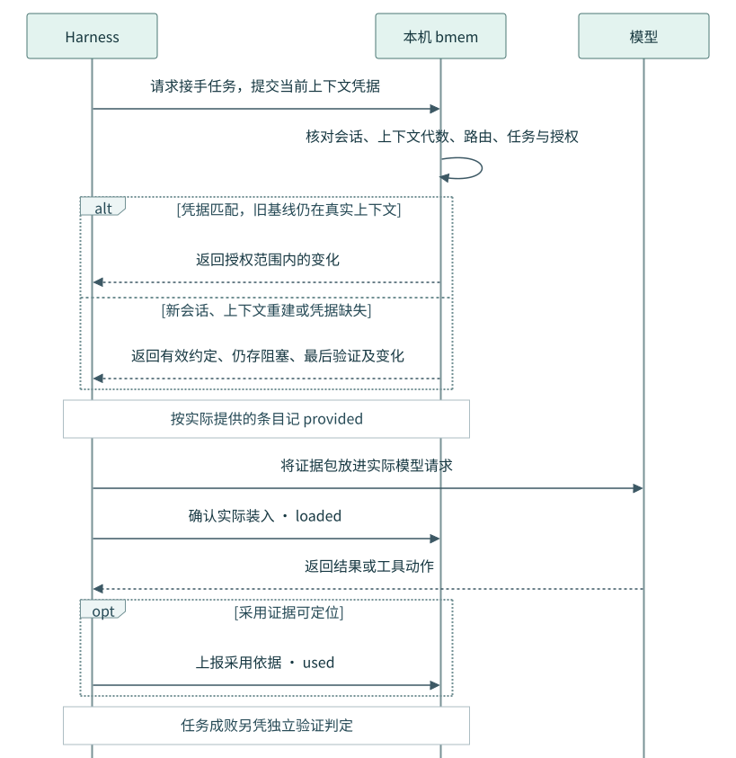

# Botinkit Memory 升级技术设计

2026-11-26 · 方案评审稿 · 适用范围为单所有者、本机部署的 Rust `bmem`，包括接入自建 Harness。

**建议沿用一个本地服务和一份 SQLite 权威库。** 首版优先补齐分句级声明和宿主证据回执。前者让同一句原话里的默认值与项目例外独立生效、到期，后者让宿主能证明当前上下文还保留哪些任务证据。这两处直接决定用户改完约定能否生效、换助手能否接对上次的工作。

| 需要决定什么 | 建议 | 查阅 |
|---|---|---|
| 先做哪几项 | 首批交付约定试算、跨助手接手。复用现有导入、工具回执和权限检查 | [七项产品定义](../PRD-memory-upgrade.md) · [本文交付顺序](#交付顺序与放行条件) |
| 改哪些接口和表 | 在现有读取与回执协议上增加可选能力，给旧数据保留可解释的读取路径 | [接口、数据与迁移](contracts.md) |
| 哪些组件值得直接复用 | 继续用 rusqlite/FTS5、rmcp、现有模型 HTTP 客户端。具名时区复用 chrono-tz。融合算法可用 Hindsight 的实现校对 | [开源复用选型](reuse.md) |
| 社区出了新的记忆系统，怎样快速采用 | 先定位它改进的记忆环节。能拆的算法接到所属域，整套系统可以先做隔离对照。涉及正式事实或存储事务的变化走核心迁移 | [社区算法接入与复现](community-integration.md) · [已运行的上游算法对照](replay-example.md) |

## 服务边界与数据归属

[打开架构大图](figures/01-architecture.svg) · [可编辑图源](figures/01-architecture.mmd) · [V2 原有六域十八模块](../../docs/v2/technical/module-integration.md)

下表按状态归属划界。首版可在现有 crate 内通过 Rust 函数、类型和事务落实边界。只在出现第二种实现时引入 trait。这六个域都运行在同一服务内。

| 域与现有代码入口 | 谁保存什么 | 跨域交付的最小结果 |
|---|---|---|
| D1 接入与采集 · [ingestion.rs](../../src/v2/bmem/src/ingestion.rs)、[history_tasks.rs](../../src/v2/bmem/src/history_tasks.rs) | 连接器负责原生对象、版本、说话者和游标。导入作业记录每个输入的处理去向 | 规范事件、来源版本与受理回执。提交一页时一起保存受理结果、待办和游标 |
| D2 证据与权威 · [authority.rs](../../src/v2/bmem/src/authority.rs) | 服务掌握原文根、修订、支持关系、有效时间、现行授权和撤回状态 | 对给定读者、任务、时刻返回适用的修订及可读依据。试算与正式读取共用裁定逻辑 |
| D3 提炼与归并 · [providers.rs](../../src/v2/bmem/src/providers.rs)、[ingestion.rs](../../src/v2/bmem/src/ingestion.rs) | worker 记录领取、重试和提案。随提案保留原文版本、位置及用途，确有零产出时单列 | 候选分句、经历或方法。D2 再检查来源资格、依据和条件并提交裁决 |
| D4 检索与交付 · [retrieval.rs](../../src/v2/bmem/src/retrieval.rs)、[vector.rs](../../src/v2/bmem/src/vector.rs)、[context.rs](../../src/v2/bmem/src/context.rs) | FTS5、可选向量是可重建投影。交付账本保留实际提供的句柄、声明快照、预算与宿主身份 | 排序器给出候选引用。组包器回查当前可见证据，交付声明快照和任务包，分别跟踪装入 |
| D5 反馈与评测 · [context.rs](../../src/v2/bmem/src/context.rs) | 已有按尝试记录的装入、使用及独立结果。拟增加单独授权的纠错用例与冻结集 | 成对任务结果、缺少判断的样本、禁止项与退化清单，供发布人判断 |
| D6 治理与发布 · [retrieval.rs](../../src/v2/bmem/src/retrieval.rs)、[archive.rs](../../src/v2/bmem/src/archive.rs)、[settings.rs](../../src/v2/bmem/src/settings.rs) | 所有者控制治理操作和设置。拟按作用域保存启用策略、评测依据与上个可用版本 | 权限动作提交后立即影响读取。后台进度、策略回退和备份预览各有自己的回执 |

## 七项功能落在哪里

| PRD 特性 | 复用与实际缺口 | 建议实现 | 最能区分成败的验收例 |
|---|---|---|---|
| 1 · 试算工作约定 | 已有报告语言、开头两维和修订查询。兼有默认值及项目例外的一句原话需要逐分句表达 | D2 复用原话与修订，增加 `code_example.language`、分句作用域和有效窗。按任务当次要求 → 项目 → 全局取适用值。同级沿现有修订关系裁决。缺少影响结果的时区或范围则待澄清 | 周五项目 Python、周六回到 Rust，其他项目一直 Rust。任务临时要求 Go 随任务结束退出，两个宿主的原有报告格式仍生效 |
| 2 · 接着上次的工作 | 已有声明快照、任务绑定、交付及宿主回执。现有任务包按时间正序截取 50 条，长任务可能丢失最近工具结果 | D4 先选本任务最后一次实际检查、未解阻塞和现行约定，再分预算取邻近记录。新增任务证据保留凭据，控制全量或差量 | 第 51 条是“写入仍超时”，第 50 条是“准备重跑”。新助手获得失败回执。同仓另一任务的成功记录进不了这张卡 |
| 3 · 查导入去向 | 已有来源版本、导入作业、outbox 与重试。同一来源版本会重投，一次提炼也可能得到零条 | D1 按导入作业关联到来源版本，D3 记录阶段和终态，D2 回链到既有或新增裁决。接受、重投、零产出、待处理与失败分别可查 | 对同一页重跑两次能对账。转发同一原文可多处观察，独立支持数仍为一。来源不明保留“未证实独立” |
| 4 · 用错误码或改写找证据 | 已有 FTS5、自定义中英文分词、可选向量和离线词法回退。今天选一路搜索或回退，两路结果尚未合并 | D4 先在可读范围内各自召回，再并集、去重和按名次融合。给精确标识留证据名额，按剩余预算补同次运行的工具结果 | 唯一错误码只被词法找到、改写只被向量找到，两者均有资格入选。向量断线仍能交付错误码和原句。无证据题允许空包 |
| 5 · 比较两个助手的可见性 | 已有治理预览、确认、授权与撤回。缺少按指定读者逐项对照的结果 | D6 在所有者可读快照上模拟动作，让 D2 用同一裁定规则分别算两位读者的变化。确认前验证影响范围，事务提交后再做后台清理 | 仅收窄 A 时，A 的旧句柄当即失效，B 仍可读。撤回根后再读派生方法，独立支持仍充分的部分保留 |
| 6 · 方法带前提和反例 | 已有原话、尝试与工具回执。跨案例的独立性、适用条件和反例需要建模 | D3 建方法候选，附工件版本、前提、各自的支持组及反例。D2 裁定适用性，D4 对版本不明或反例命中的请求只交付事实与待验证步骤 | v1 有两次独立成功，v2 有一次失败。查询 v2 优先展示失败条件。复制一次总结不会变成第三次成功 |
| 7 · 纠错与长期优化 | 已有即时修订、尝试与独立验证。评测许可、冻结用例和策略版本尚须贯通 | D2 先完成当次纠正。D5 仅将用途获准的错误转为写明必现证据、禁现证据和判定规则的用例。D6 关联候选策略、对照结果与回退目标 | 关闭评测许可仍能立即纠错。候选检索策略退回上一版后，用户刚纠正的项目约定保持现值 |

### 一条搜索怎样找回正确的工具回执

以“昨天的 `ERR-WRITE-17` 为什么又出现”为例，分四步记录结果，便于定位问题发生在召回、排序还是交付。

| 步骤 | 输入 → 输出 | 实现要点 |
|---|---|---|
| 限定读者 | 读者、用途、任务和当前授权 → 可读范围 | 在每个通道截取前 K 条之前应用限制。受限读者使用共享 FTS5 时，词项匹配可走索引，词法排名只依赖获准文本。全库 BM25 的文档统计会随不可见资料而变化。[FTS5 的 BM25 定义](https://sqlite.org/fts5.html#the_bm25_function) |
| 并集与去重 | 词法、精确标识命中，以及开启时的语义命中 → 版本和片段引用 | 校验带连字符的完整错误码，防止只命中 `WRITE`。同一片段被两路命中只占一个位置，保留两路名次。RRF 取各路 `1 / (k + rank)` 之和，同分按稳定引用排序。[融合实现与候选选型](reuse.md) |
| 有预算地补证 | 命中原句、同次运行的工具调用标识 → 结果及其来源 | 分配精确命中名额后，用剩余预算补同次运行的结果。只有相近时间或一条“准备重试”时，显示“结果未知”。禁止片段的标题、数量和邻文都不发给宿主 |
| 核对最终输入 | 提供的句柄 → 实际装入的片段 → 独立结论 | 记录在哪一层丢了哪条必要证据。候选找对但装包没放进去，应先调组包预算。证据已装入而任务仍失败，查独立执行结果 |

## 接手时，怎样判断只发变化

[打开时序大图](figures/02-handoff.svg) · [可编辑图源](figures/02-handoff.mmd) · [现行装入与回执协议](../../docs/v2/technical/contracts.md)

| 服务端能核对的事实 | 任务包的处理 |
|---|---|
| 首次接手、换宿主、另开会话、上下文重建、缺少完整证据回执或读取范围不匹配 | `package_mode=full`。交付最小完整包，包括当前适用约定、阻塞及最后一次验证的可读依据。预算不足以装下必需项时标记缺口。可另标出比上次多了什么 |
| 同一读者、路由、任务、会话和上下文代次。宿主证明仍保留 `retained_delivery_id` 对应证据，服务复核版本与当前授权 | `package_mode=delta`。根据已确认基线计算新增、更正和移除。以回执推进已装入基线。丢包、重投或错序均不能把未装入的包算作已装入 |
| 仅有 `known_snapshot_id` 或旧版 `loaded.complete` | 沿用 `snapshot_mode` 的声明语义。任务证据走完整路径。旧宿主无需升级就能接手 |
| 已发内容撤权或被替代，宿主只能追加且无法移除旧内容 | 复用 `fresh_session_required`。重开干净上下文，按现行授权加载。服务据此标记需要重新装入 |

**自建 Harness 接口。** 调度器掌握任务、尝试和模型调用。薄适配器负责在构造真实模型输入时调用受信任的本机 `POST /v2/context/load`，装入后写 `/v2/deliveries/{id}/receipts`。有合适来源授权时经 `/v2/events` 提交观察，由独立验证身份写 `/v2/attempts/{id}/outcomes`。普通 stdio MCP 客户端当前只得到获准的共享全局声明搜索，不能假设具备任务装入或装入回执能力。更广的 Agent 接口仍在 005 规格阶段。[服务入口](../../src/v2/bmem/src/server.rs) · [宿主适配](../../src/v2/bmem/src/host.rs) · [005 规格](../../specs/005-agent-mcp-interface/spec.md)

## 撤权、淘汰与证明失效

[打开治理大图](figures/03-revocation.svg) · [可编辑图源](figures/03-revocation.mmd)

| 动作 | 何时改变读取 | 数据与后台处理 |
|---|---|---|
| 降温、到期 | 降温减少主动交付。例外到期后在指定时区边界回到有效默认值 | 保留来源与历史修订。显式历史查询仍按当前权限裁剪 |
| 收窄读者授权 | 确认提交后，该读者立即失去对应证据、摘要、补读与旧句柄 | 重新检查交付资格。其他读者各自按授权求值。比较报告留在所有者页面 |
| 撤回来源根 | 遍历依赖并按当前有效支持组裁定，失去充分证明的派生项立即退出交付 | 若方法依据为 `(A 且 B) 或 C`，撤 A 后只有 C 能独立支撑。C 也撤回即停用。依赖尚未重新验证的项先屏蔽 |
| 遗忘、处理历史备份 | 确认后按对象范围禁读，重导旧版本继续受撤回或遗忘记录约束 | 分位置记录正文、索引和派生物的清理进度。旧备份仅在隔离预览做比对，实际恢复切换另行验收 |

现有授权以“来源 × 客户端”为粒度。要实现“这个助手别再读这段讨论”，需让“接收端 × 用途 × 根资料”的拒读规则优先于来源级许可。服务可证明下一次查询、旧句柄和本机缓存的处理结果。已经交给外部宿主的副本，只有在接收端能核验清除时才标为已清除。[治理接口及数据变更](contracts.md)

## 替换一个组件要改什么

拿到新项目时，先找出一个能独立检验的主张。例如“新证据到来时能修订旧方法的适用条件”，可以单独比较修订提案、依据和反例。整套项目可以同时作为基准，在同一批任务上衡量单独接入这个算法保留了多少收益。

[打开接入决策图](figures/04-community-integration.svg) · [可编辑图源](figures/04-community-integration.mmd) · [全生命周期的接口、实施步骤和实例](community-integration.md)

| 替换对象 | 对接方式 | 故障边界与上线凭据 |
|---|---|---|
| 新来源或新 Harness | 复用规范事件、身份绑定、原生版本和游标。宿主声明能否观察装入、重建和独立结果 | 重投不重复受理。缺回执记未知。通过真实宿主输入核查后才启用差量 |
| 新切分、去重或提炼算法 | 切分器标记原文位置，去重器建议同源，提炼器提交带片段的候选。域内适配器把上游类型转为本地引用 | 以同一原文被转发、两个独立运行文字相同、采集页重试为反例。去重建议通过裁定后才能改变独立支持计数 |
| 新存储算法或后端 | 分块、压缩、时态图及索引先做可重建的派生实现。完整替换权威数据库需覆盖采集事务、回执、治理和备份 | 派生库可以丢弃重建。权威迁移要对账、验证撤回和新写后的回迁；不能只换驱动或还原旧快照 |
| 新淘汰或自进化算法 | 间隔衰减只产生默认交付优先级，笔记演化产生有依据的修订候选，策略学习产出待评测的版本 | 验证低频但仍生效的约定、撤去依据后的方法和新失败反例。分别回退排序、派生版本或策略 |
| 新检索器或重排器 | 输入读者可用候选、查询与预算，输出有序的稳定引用和来源通道。新召回器独立产生候选。重排器仅排序已入选候选 | 超时退回原排序。门槛同时检查候选召回、最终包必需证据和禁现项。无需为只重排的组件重建索引 |
| 新 embedding 或向量索引 | 在已获嵌入用途许可的来源上，独立记录模型标识、维度、预处理与输入水位。检索分支核对指纹后才查相应投影 | 当前换 route 会使旧投影失效并重新排队。对照期使用隔离投影。采用后若要在线快速回切，才增加双版本指针和保留窗口 |
| 新评测器或归纳策略 | 为判定器、用例集、数据许可、策略和发布范围各留版本。协议有破坏性变化时，经已有能力目录声明新版本 | 先在获准冻结集上回放，保存逐题收益与退化。回退算法指针后，来源、事实修订和撤回记录仍取现行值 |

**一个已经跑过的例子。** Hindsight 的排名融合函数可以单独取出复现。不同通道的两条证据同分时，上游会先交付先遍历到的一条。如果预算只容一条，交换通道顺序就会影响答案。拟议适配器按稳定引用打破并列，原有采集、事实存储和 Harness 协议都可以继续使用。[固定版本、合成样本和一键重放](replay-example.md)

另一种有状态的替换示例：换用新嵌入模型

两个嵌入模型即使维度相同也可能属于不同空间，替换时需要独立投影。[当前投影实现](../../src/v2/bmem/src/vector.rs) · [现有扩展契约](../../docs/v2/technical/extension-contract.md)

| 步骤 | 工程动作 | 可作出的决定 |
|---|---|---|
| 1 · 登记 | 固定模型、端点、参数和用途，用合成探针检查维度、响应、超时。外部实现仅接收获准输入 | 协议兼容可沿用 HTTP provider。若探针失败，旧路由继续处理 |
| 2 · 并行对照 | 用独立命名空间或隔离测试库从同一获准快照重建。记录覆盖率、输入水位及撤回水位。查询分别生成旧、新模型向量 | 能区分索引未追平与模型质量下降。影子结果仅供评测 |
| 3 · 定范围启用 | 固定宿主、任务与阅读预算，比较错码、改写、无答案、撤权和正向可读样例。同时看冷启动、p95 与成本 | 只在通过预登记门槛的范围切换。小样本结果保留未知 |
| 4 · 回退 | 指针切回仍合格的旧投影，重新核对当前授权与水位。旧投影不可用时回到词法，按待办重建 | 显式纠正和撤回持续有效。旧投影重放时仍须过滤已删除或已失权版本 |

## 交付顺序与放行条件

| 顺序 | 第一件可联调的事 | 放行条件 |
|---|---|---|
| 一 · 声明与接手（1、2） | 在隔离副本执行增量迁移，给旧修订读取默认语义。同一应用入口供 CLI 和 Web 试算。接通 Claude Code、Codex 之间的双向接力 | 到期和任务例外正确。长任务保住最后验证。压缩后能补齐基线。丢回执能重试。一旦撤权仅交付当前可用内容。逐次核对实际模型输入、服务回执及独立结果 |
| 二 · 导入、搜索、治理（3、4、5） | 同一页重投并核对去向。同一问题用错误码和改写检索。所有者对 A、B 预演权限变化，随后确认并重查 | 形如 `ERR-WRITE-17` 的精确标识即使被分词也保得住。加入不可见资料后，读者看到的结果、次序与解释不变。旧句柄禁读且合法对照仍可用。备份预览拒绝复活旧状态 |
| 三 · 方法与纠错（6、7） | 在有不同根来源、工件版本和失败回执的任务族上做方法卡。仅将获准纠错纳入回归 | 在关闭记忆、等长无关证据、系统自动证据和标注证据四组间配对回放。按任务族与根来源做时间留出。列出新增成功、退化、未知、成本及回退结果 |

**发布指标。** 首版分别统计必记项正确生效比例、最终输入拥有全部必要证据的比例、无需用户补背景且经独立验证成功的接手比例。接手结果未知时单独计数。预先登记可接受的 p95、每成功任务成本和最小有用收益。禁止项出现即阻断发布。线上对照以获准的日常任务为准，目前没有本次升级的收益实测。[产品验收口径](../PRD-memory-upgrade.md#怎样排期与决定发布) · [现有性能与压缩协议](../../docs/v2/technical/compression-and-performance.md)

**本次核查。** 在现有本机 release 二进制上重跑 8 项测试，全部通过。覆盖声明纠正与作用域、合成宿主回执与撤权、导入与 outbox、过滤后截断、旧版本在根撤回后重到、遗忘后备份预览、任务证据预算和仅追加宿主、可选向量与词法回退。三批升级的实际宿主行为和性能仍须按上表验证。[基础集成用例](../../tests/v2/test_integration.py) · [任务交付用例](../../tests/v2/test_task_delivery.py) · [向量回退用例](../../tests/v2/test_vectors.py)

图稿由 Claude Code（`qwen4-max`）参与起草、复核，使用 Vivid 架构图技能和 Mermaid CLI 11.12.0 渲染。各图下方均可打开 SVG 或修改同名 `.mmd` 后重新生成。
