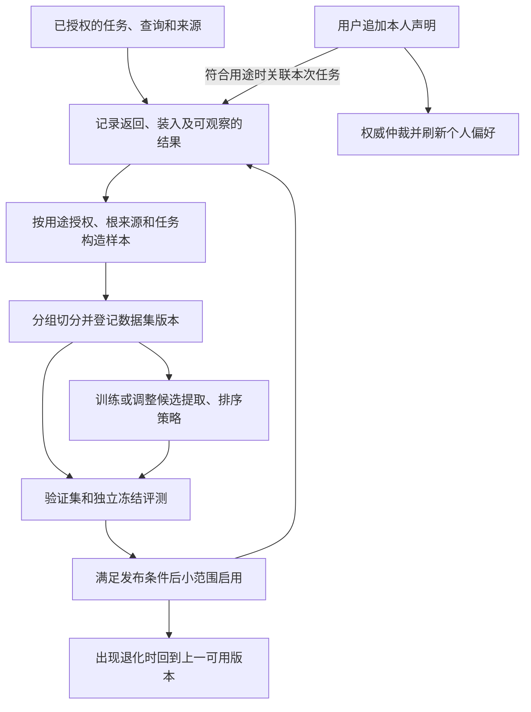
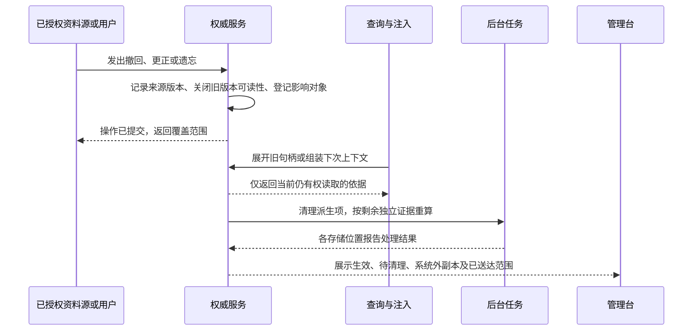

# bmem 产品架构总纲

**一期采用一个本地服务，多个助手共享一份有来源、有版本的个人记忆。** 服务从已授权资料中自动提炼经历和事实，把适用的记忆交给正在工作的助手，再用可核验的反馈改善下一次的选择。权威记录由 bmem 管理。数据库、提取器、检索器、图算法和训练工具分别接在明确的输入输出上。本文为 2026-11-19 的重建设计，现行组件和待建能力在各节标明。

| 总纲主线 | 关键决策 | 详细设计 |
|---|---|---|
| 模块拆解与数据流转 | 18 个细分模块归入六个职责域，共用一个本地事务核心。耗时模型在后台运行，各类算法独立替换 | [模块、接口与开源接入矩阵](modules.md) |
| 记忆知识系统 | 源证据、实体、经历和断言修订构成可追溯的知识图。按查询选择精确事实、原文、有限跳关系或主题社区 | [知识图与查询路径](knowledge-graph.md) · [自动提炼与声明生命周期](memory-lifecycle.md) |
| 反馈数据闭环 | 一次纠正可以立即改变个人偏好，经授权的多次任务结果可以形成训练和评测样本。学习组件通过对照后独立发布 | [反馈、数据集与模型改进](feedback-learning.md) |

**产品要兑现什么**

| 用户的具体任务 | 用户应该得到什么 | 后端必须保证什么 |
|---|---|---|
| 在 Claude Code 中修到一半，第二天换 Codex 接手 | 一张接手卡，列出目标、已执行步骤、结果、最后验证状态、未解决问题及出处 | “打算执行”与“已执行成功”分开。原任务可按项目、组件、版本和时间找回 |
| 今天改了要求，马上在另一助手里继续 | 新值、适用范围和生效时间。问“上周为何如此”时仍能看当时依据 | 按主体、事实键和条件确定身份。支持业务有效时间与系统知晓时间。明确纠正提交后即可读 |
| 碰到一个换了说法的旧问题 | 相关经历、当时为何有用、适用前提，以及一个已知失效条件。无足够依据时少说 | 检索既能返回相似文本，又能从实体和证据链补材料。方法必须区分成功、失败和未验证 |
| 让三款工具共用自己的偏好，同时把一个会话留在本机 | 每款获准助手在任务开始前装入适用偏好。用户能查看各助手最近装入的版本 | 按所有者、来源账号、调用客户端与接收模型确定可见范围。全局声明有独立的版本和投递回执 |
| 撤回聊天资料、用新声明改变长期偏好或恢复备份 | 能区分“新的默认值已生效”“停止继续采集”“删除由本系统保管的副本”和“哪些已发送副本无法收回” | 每个动作有结果和覆盖范围。恢复带上撤回依据，重新导入不能重新激活同一旧对象 |

业务输入来自[个人记忆规格](../../specs/001-personal-memory/spec.md)、[外部资料规格](../../specs/002-feishu-memory/spec.md)及[事实时间与来源规格](../../specs/003-memory-relations/spec.md)。跨宿主任务效果与用户控制的验收口径见[评测方案](evaluation.md)。

## 1. 模块拆解与数据流转

**六个职责域可以部署在同一个本地服务中。** Mac 一期用 SQLite WAL 保存权威事实、证据关系与持久待办，大附件存本机受控目录。一次短事务记录来源版本和待办，完成后即可向宿主回执。模型及外部服务在事务以外调用。SQLite 支持读写并行，同一时刻只有一个写者。[SQLite WAL §2.2](https://www.sqlite.org/wal.html#concurrency)

```mermaid
flowchart TB
  H["助手、应用与资料源"] --> A["接入与采集"]
  A -->|"事件与声明"| B["证据与权威写入"]
  B -->|"原文与待办"| C["提炼与巩固"]
  C -->|"带证据的候选"| B
  B -->|"授权与当前修订"| D["检索与上下文"]
  B --> V["词法、向量与图视图"]
  V -->|"候选与原文位置"| D
  H -->|"任务查询"| D
  D -->|"声明与证据包"| H
  D -->|"送出版本"| E["反馈与学习"]
  H -->|"使用与结果"| E
  E -->|"候选模型与评测"| G["运营与治理"]
  G -->|"提取策略"| C
  G -->|"检索策略"| D
  G -->|"授权与撤回"| B
```

| 职责域 | 组成与产物 | 现阶段的集成或借鉴 |
|---|---|---|
| 接入与采集 | 宿主插件、主动 API、授权日志/导出、第三方连接器 → 带说话者和版本的源事件。每个来源独立维护回填与撤回能力 | 已用 MCP Python SDK 与宿主 hooks。飞书走其官方接口。借鉴 OpenClaw 按来源适配 |
| 证据与权威写入 | 证据保管、声明、冲突仲裁、修订和撤回 → 当前值、历史、可见范围与待办。只有该域可提交有效事实 | 已用 SQLite WAL 和文件目录。借鉴 Graphiti 事实边的来源与时间字段，事实身份和替代规则归 bmem |
| 提炼与巩固 | 从原文生成实体、事实或经历候选，按证据归并方法与反例 → 带出处、条件和版本的提案 | 已有本地生成与可配置端点。可对照 LangMem 的后台抽取、Mem0 的更新策略，统一输出候选 |
| 检索与上下文 | 构建词法/向量/关系索引，按意图排序、原文补读、声明快照加载 → 可用证据包和装入结果 | 已有 FTS5、sqlite-vec。主题聚合可试接 graspologic-native 的 Leiden 算法。补读和汇总分别借鉴 Claude-Mem、GraphRAG |
| 反馈与学习 | 关联候选、实际投递、任务结果与后续纠正 → 反馈样本、数据集、评测报告及候选策略 | 现有记录能追溯服务选中的修订。可用 Hugging Face Datasets 读写本地样本，按需用 Sentence Transformers 训练排序器 |
| 运营与治理 | 来源授权、运行状态、遗忘与恢复、版本发布与回滚 → 受控命令、处理进度及生效版本 | 复用现有管理台和备份入口。模型登记、评测关联与版本别名可借鉴 MLflow |

表中“已有”指当前仓库具备对应入口或组件。“可用”表示可通过接口试接，“借鉴”表示采用其设计思路。分册按模块列出代码依据、上游许可、依赖、替换成本及验收条件。[模块详表](modules.md) · [现版依赖](../../pyproject.toml)

相同数据既要落库又要触发后台处理，事务内记录待办可避免一边成功另一边丢失。消费者按来源版本及任务类型幂等，耗时模型调用置于事务外。此处采用同库待办，个人工作站无需单独部署消息服务。[AWS 事务 outbox 指南](https://docs.aws.amazon.com/prescriptive-guidance/latest/cloud-design-patterns/transactional-outbox.html)

## 2. 记忆知识系统

**知识写入有两条入口。** 普通对话和执行回执由后台自动抽取，本人明确说“记住”直接记录声明。权威写入按主体、事实维度、适用条件和证据资格自动仲裁。可信的新冲突只取代相应的旧值，其他维度仍然有效。用户通过追加声明改变偏好，全程无需人工审稿。有效偏好即使多年未提也继续适用。[声明与冲突决策表](memory-lifecycle.md)

### 节点、边与社区

| 图中对象 | 在 bmem 中表示什么 | 用于什么决策 |
|---|---|---|
| 节点 | 实体有稳定身份，例如某项目、工具或人。证据片段绑定来源版本，事实的每次修订单独标识，任务经历记录实际动作及结果 | 同名项目先消歧。事实值、适用条件、来源和修订一起回读 |
| 带类型的有向边 | 例如“新修订 → 取代 → 旧修订”“修订 → 有据于 → 原文片段”“方法 → 适用于 → 软件版本”。记录与修订绑定的来源和时间 | 查当前值、解释历史、从撤回来源反向找到受影响的摘要和方法 |
| 可重建的关系投影 | 从已获准的材料产生共现、相似或跨任务关联。多个助手复述一段原话，只贡献一次根来源 | 扩大搜索候选，发现换了说法的旧问题。相似度只用于排序 |
| 社区与摘要 | 在同一可见范围的实体关联图上，把内部连接相对紧密的节点归为一个主题。每个社区报告保存成员、生成版本和证据句柄 | 回答“几次故障反复涉及哪些环节”。小图直接聚合，主题复杂时可试 Leiden 分区和分层汇总。答案回到源证据验证 |

**按问题选读法。** “我现在偏好什么”直接读适用的当前修订，个人全局声明另在会话启动、上下文重建及版本变化时加载。“上次怎么解决”先做词法或语义定位，再补相邻原文。“哪些任务依赖这次改动”沿指定类型、限定跳数的边读取。“几个项目共通的问题”才读取社区摘要，并回到成员证据。关闭社区和向量之后，声明、原文搜索和证据追溯仍应可用。[知识图数据模型与示例](knowledge-graph.md) · [GraphRAG 全局查询](https://microsoft.github.io/graphrag/query/global_search/)

### 访问范围如何随知识流转

- **本人声明。** 本人明确共享的通用偏好可交给所有已获准的助手。范围更小的项目例外只覆盖相应任务。保留事实自己的有效时间与系统获知时间，迟到的旧消息可以补历史。
- **外部资料。** 导入内容先留在来源账号获准的范围，记录谁说了什么。相同原话被多个助手复述只计一份根证据。综合多条来源的摘要要求接收者能读全部必要依据。撤回部分依据后，有独立来源的结论可重新生成。[W3C 来源、引用与修订语义](https://www.w3.org/TR/prov-o/#expanded-terms-at-a-glance)
- **实际接收者。** 本机插件可能把上下文转给云模型。服务按客户端注册身份、实际路由和用途判定能交付什么，并在补读原文及拼装上下文时复核授权版本。仅限本机的证据只进入可控制的本机阅读或推理链。[MCP 基础协议](https://github.com/modelcontextprotocol/modelcontextprotocol/blob/main/docs/specification/2026-07-28/basic/index.mdx)

### 一次故障经历怎样接续

| 时点 | 写下或读出什么 |
|---|---|
| Claude Code 排查导入超时 | 同仓另有一个通知文案任务。按任务、分支和会话记录“准备复验”的计划，以及后来“解析通过、入库仍超时”的实际回执。方法候选只声明已验证的部分 |
| 次日换 Codex | 适配器加载通用声明，用任务线索搜到经历，补读对应的原文窗口，给出已验证步骤、仍待解决的环节及出处。若两个任务无法区分，保留两个候选 |
| 用户改变要求 | “这次先把上限改小”只作用于当前任务。“以后该项目都采用新的批量上限”产生有范围的新声明，自动取代同一条件中的旧值 |

本地公开数据复验解释了为何要补读。在有消息标注的 438 道题中，按消息检索可在前五个会话找全来源的有 369 道，选中的消息在每个金标会话上都带标注的只有 203 道。因此接口同时返回源位置与可展开的邻近片段。中文两字实体、技术标识符、英文原词和窗口宽度需按本地语料分别验证。[实测分母与中文样例](local-evidence.md) · [MAPE 原文窗口消融](https://arxiv.org/html/2611.17068v1)

## 3. 反馈数据闭环与模型改进

**产品从两种反馈中学习。** 本人追加声明后，下一次读取即可采用新的个人偏好。跨任务的使用与结果能进一步训练提取器或排序器，改善何时取哪条材料。事实保存在可修订、可撤回的外部记忆中，模型可以单独更新和回滚。[反馈详设与样本示例](feedback-learning.md)

| 环节 | 如何做 | 如何判断学到了什么 |
|---|---|---|
| 收集反馈 | 串联任务 ID、查询、候选与修订、实际装入、接收宿主、所用策略、可验证结果及用户后续陈述。内容保留与离线训练分别按用途授权 | 分开记录“曾返回”“确实装入”“明确采用”“任务通过”。仅有点击、沉默或测试整体通过时，不能给某条记忆标为正确 |
| 形成样本 | 从明确纠正或可定位的证据构造正例、错用或过时的负例。缺乏归因的保留为未知。按根来源、同一任务族和时间切分，登记样本来源、许可和生成规则 | 同一原文、它的摘要、另一个宿主的转述进入同一分组。冻结集留出后续任务，答案、未来修订和同源改写不得进入训练输入 |
| 学习与验证 | 日常先更新个人记忆或轻量规则。样本充足时独立优化检索重排、原文窗口选择或事实维度抽取。在验证集选策略，用冻结集与当前版本配对比较 | 看跨宿主任务成功率、稳定偏好遵循率、旧值错用率和每个成功任务的成本，分语言、任务和宿主查看退化。小样本同时报告分子分母与不确定性 |
| 发布与回流 | 登记数据集、基线、模型或策略版本，先在隔离回放与影子请求比较，再对预定范围启用，同时记录命中的策略版本与真实结果 | 影子运行只能观察检索差异。实际任务效果由获准试用产生。改善可复现且关键切片达标才扩大使用，回退只切换策略版本，个人最新声明继续生效 |

**贯穿示例。** 假设一次跨宿主接手任务中，搜索命中了上次导入故障的会话，送给助手的却是“准备复验”那句，遗漏随后“解析通过、入库超时”的执行回执。若任务要求和回执能定位，可生成一对排序样本，使带验证结果的片段排在仅有意图的片段之前。该故障及其所有改写留在一个数据划分中。候选排序器要在另一个留出的故障上送对证据，才能计作泛化收益。若该来源仅获准在线使用，任务可当场补读取证，训练集不包含该记录。

**当前落点。** 工作树已有按宿主、会话和任务记录的注入与逐条修订明细，已有公开数据检索回放。一期设计还需接通结果归因、按用途导出、训练/验证/冻结评测分组及版本发布。起步可用本地文件与清单保存样本，用授权的合成或公开数据验证整条路径。训练量足够时接入可替换的训练器与登记服务。[现有表结构](../../src/bmem/schema.sql) · [已运行的基线](local-evidence.md) · [本地数据处理组件](https://huggingface.co/docs/datasets/en/index) · [模型发布与版本别名](https://mlflow.org/docs/latest/ml/model-registry/workflow/)

**如何检验“越用越懂我”。** 选一组留出的后续任务，固定任务难度、助手版本和上下文预算。分别提供零段、少量和更多发生在任务之前的授权历史，另设“只给本人明确声明”的对照。按历史数量画出偏好遵循率、重复纠正率与任务成功率，同时记录把一次性要求错当通用偏好的次数。若增加历史只改善熟悉任务，却让新项目误用旧习惯，就应收窄条件或调整排序。

## 4. 撤回、备份与已发出的内容

| 用户动作 | 立即生效 | 后续责任 |
|---|---|---|
| 追加新声明，取代仍需留档的旧值 | 新查询采用新值。历史查询带有效区间 | 旧摘要和方法依据失效后重算。向获准助手投递变化，展示前后版本 |
| 停止连接或缩小读取范围 | 停止新增采集。按撤销的使用权阻止继续注入和补读 | 向用户提供已有数据的保留/删除选择，显示最后对账位置 |
| 收到上游撤回 | 对该外部对象的旧正文及依赖它的内容停止普通读取 | 清理索引与缓存，有独立来源的结论重新评价。来源不能通知历史编辑时显示覆盖缺口 |
| 用户要求遗忘 | 当前事实、来源原文及仅靠它生成的内容退出读取和重放 | 处理受管索引、暂存文件及备份，报告已完成和不可验证范围。已发送的第三方上下文单独列示 |
| 用户撤回训练用途 | 含该样本的数据集版本停止用于新的训练或发布，在线交互依据其独立授权继续裁定 | 按数据集到模型的依赖清单查找受影响产物。需要移除其训练影响时，停用相应模型，切回无该样本的版本，或用清理后的数据重新训练，分别报告处理结果 |
| 从备份重建 | 先在隔离区应用备份对应的撤回记录和能取得的更新，再开放普通查询 | 受管备份记录快照及撤回水位。可移交独立保存的最新撤回清单。若整机丢失且仅存删除前的孤本，将其标为历史快照，恢复预览显示可证明的截止点，不能声称已反映后来的遗忘 |

- **先停止读取，再完成清理。** 发送摘要、社区报告或排队的模型请求前核对来源与授权版本。即使清理任务暂停，已撤回的证据也应退出新查询和补读。已发出的上下文在回执中另列。
- **备份与证据一致。** 大附件先在受控目录持久化，再提交其引用。备份固定数据库快照、附件清单及撤回记录水位，恢复先检查缺件与可取得的后续撤回，再开放查询。同一源的 OCR、缩略图和向量同样在清理范围内。
- **已有实测。** 隔离回放观察到上游撤回后原文仍可搜到，同一旧备份在有无后来墓碑的环境中分别返回零和一次命中。上表是重建应兑现的行为。[撤回与备份回放](local-evidence.md#3-撤回与备份恢复) · [SQLite FTS5 清理语义](https://www.sqlite.org/fts5.html#the_secure_delete_configuration_option)

## 5. 组件替换与选型边界

**替换沿数据所有权进行。** 所有外部组件交换 bmem 定义的输入输出，采用稳定的对象与修订 ID。连接器交付源事件，生成模型只交付候选，图与向量后端返回带 ID 的候选，训练器交付带数据版本的工件。宿主无需理解 SQLite 表名、图数据库内部 ID、向量维度或模型厂商格式。各端口的替换用例在[模块详表](modules.md)中列出。

| 换什么 | 切换办法 | 验收与回退 |
|---|---|---|
| 生成模型或提取器 | 用同一批事件并行生成候选，新版本先只记录差异 | 比对维度、否定、适用条件与原文定位。停止候选版本即可退回。已发布事实若有错误，按证据追加修订 |
| 向量模型、索引或社区算法 | 从同一权威快照建新索引，登记模型、维度、输入水位和权限版本，补齐期间变更后切换 | 用相同查询、预算、权限和源撤回用例做对照。保留可读的旧索引或退回词法与关系表 |
| 权威存储 | 导出事件、修订、关系、授权、墓碑、游标与附件清单，在隔离库恢复并补齐变更。短暂停写后切换单一写入者 | 比对现值、历史、权限和撤回后禁读。新库已接受写入后，回退前须回放期间变更，避免回到过期状态 |
| 排序策略或训练工具 | 固定数据集、样本定义和冻结评测，只换训练器或策略版本 | 先比较任务级结果，再按接收范围发布。回退指向合格版本，个人记忆按当前修订读取 |

**何时值得改变默认选型。** 单机短事务持续积压或多设备主动写成为核心要求时，再比较独立同步与 PostgreSQL。多跳或主题问题在真实任务中占有可测收益时，再启用专用图读层。向量、重排或更大模型须在相同预算下改善中文与跨宿主任务，且可接受冷启动和内存代价。对所有方案保留“用户可读的文件＋原文搜索”作为低成本对照。[组件取舍与替换验收](modules.md#替换验收与导出边界)

## 6. 部署、契约与产品验收

- **用户入口。** 对话、CLI 和管理台提交带出处的新声明。服务返回各维度的生效、替代或待判结果，用户可追溯旧值、改变共享范围或要求遗忘。系统自动维护正文与修订。
- **助手入口。** 分别获取当前声明快照与任务证据包，记录本次装入的版本。只有搜索接口的宿主只承诺按需查询。跨宿主“都已读取”要以各宿主回执验证，“已经遵循”要看最终任务结果。
- **运行指标。** 前台计量声明、精确查询和含补读查询的 p50/p95。后台计量最老待办年龄、索引重建时间、每成功任务的模型用量和资源。后台端点停机时，采集、声明、授权检查和词法查询仍需可用。

| 决策验收 | 比较与判据 |
|---|---|
| 能否交接工作 | 三种宿主中至少两种在同一冻结样本接力，关闭记忆、宿主文件、原文检索、完整方案盲测。用任务断言判成功，并记录返工、错误动作及无历史时的回归 |
| 是否值得启用复杂阅读 | 比较原文、原文＋经历卡、加向量、加限长证据补读、加图。固定阅读模型、token 与候选预算。按类型看找全证据、回答有据、正确留空和时间成本。包含给定金标证据的上限组 |
| 能否信任纠正与自主提炼 | 同一主体先改口再迟到，跨主体同名、同一消息多份转述、一个环境的例外、失败尝试。按可观察事实逐项判分，要求明确更正下一次有权查询立即可见 |
| 能否用一次声明改变所有获准助手的默认行为 | A 声明两项，B 首次启动，C 使用已有会话。让用户只改其中一项，随后不给任何偏好关键词。核对每个助手实际装入的版本、两项组合及最终输出，再测压缩后重载、断线重连和一年静默。全程无人工编辑、审核或清库 |
| 图和社区是否值得启用 | 同预算分组比较精确/词法、有限跳关系和社区汇总。测多跳证据链完整率、聚合回答的原文支持、撤回后禁读、更新成本。社区关闭时精确和历史题仍需通过 |
| 越用能否越好 | 固定留出的后续任务和任务断言，对照无个性化、仅个人声明、加排序学习三组。核对遵循偏好是否减少重复纠正、交接是否减少返工，再检查错误注入及资源开销。覆盖从样本撤权到停用相关模型、从候选版本回滚到稳定版本的过程 |
| 能否履行保留与遗忘 | 对真实可控制的每个出口验证撤回后禁读。测试重导、原机恢复和全新目录恢复。能合法读取的对照也必须仍然可用。把历史已送达、用户持有的旧导出和无法核实的上游列明 |
| 是否真的给用户控制 | 让用户解释一次跨宿主读取、收窄用途、纠正临时偏好、核对删除范围。记录操作完成和对接收者的预测是否正确。数据看板和日志不能代替这几项用户任务 |

**一期集成顺序。** 先用本机事务库、词法检索和现有宿主入口跑通“声明 → 跨助手装入 → 结果回执”，同时落下可追溯的证据关系。再用积累的错例比较语义补读、关系遍历和社区摘要。离线学习从可复跑的数据快照与规则基线开始，达到训练与发布判据后才启用相应模型。[对照与判据](evaluation.md) · [本轮检索实测](local-evidence.md)
