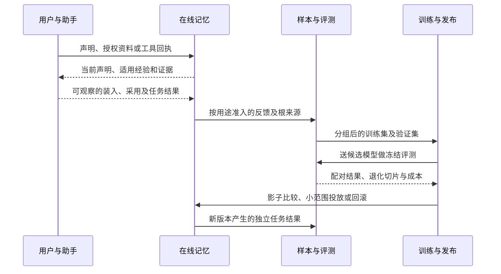

# 反馈如何形成数据集，进而改善下一次任务

**设计与取证日期为 2026-11-19。** 一次真实任务可以留下三种价值。用户的新声明改变已授权助手下一次读取的当前事实。可验证的结果给经验补上适用条件或反例。积累了足够多、获准学习且彼此独立的案例后，可以改进检索、排序或提炼模型。前两项在关闭训练、样本不足或模型回滚期间仍须正常工作。[产品架构总纲](architecture.md) · [声明与冲突取代](memory-lifecycle.md)

**当前证据。** 仓库已有来源、修订、仲裁以及 `injections` / `injection_items`。当前 `Store.recall` 在服务端选定记录、写入明细后才把结果返回调用方，这能说明服务选了哪些修订。要证明某个宿主把它们装入指定模型调用、该调用采用了哪条、操作结果如何，还需要下文的回执。数据集版本、训练和受控发布是本分册的设计，本文没有执行训练或线上实验。[现行 SQLite 定义](../../src/bmem/schema.sql) · [现行回注实现](../../src/bmem/store.py)

## 一次任务怎样走完整个闭环



| 环节 | 应如何工作 | 可核验的输出 |
|---|---|---|
| 归集与生效 | 对声明、工具结果和第三方说明标明来源。用户更正走新证据→自动修订，同一事实维度的冲突旧值退出当前态，其余维度继续生效。 | 来源版本、事实修订、适用域和生效时点。后台提炼不设人工标注或审批步骤。 |
| 交付与使用 | 每次任务尝试有独立 ID，绑定宿主、读者、上下文版本、记忆与策略版本。服务选出、宿主实际装入、输出或行动引用、独立验证器回执分别记录。宿主没有相应观测能力时标“未知”。 | 一次任务可有多条证据，一条证据可经多个助手转述。用根来源与投递链连接，按尝试归并重试。统计每层的缺失，不拿时间接近的记录硬配。 |
| 学习候选 | 先检查来源是否授权该学习用途、接收方和计算环境，再通过确定性验证器、明示纠正或可重放任务自动标记正、负、未知。只保留必要字段或可撤回的引用。 | 候选记录、标签所针对的目标、打标方法/版本、独立根来源、用途授权及版本。证据不足的记录进入观察集，日常作业持续运行。 |
| 数据集与候选产物 | 按同源簇与时间构建训练、验证、冻结评测。选择可解释个人规则或训练局部模型，并给产物绑定唯一输入和基线。 | 数据清单、划分、内容摘要、训练与运行参数、父模型/适配器/索引版本、许可证、允许部署范围。 |
| 发布与再采样 | 同预算离线比较通过后，影子运行，再在获准的任务范围投放。运行时记录实际版本、成功失败和未观测情况。新增独立任务进入下轮候选。 | 冻结评测结果、上线判据、回滚目标、受影响任务与后续检查结果。上轮评测题留在隔离区。 |

## 信号强弱取决于想学的东西

| 来自系统的信号 | 可自动标记的目标 | 不能据此推出什么 |
|---|---|---|
| 用户明确表示“以后所有报告先列风险”，之后声明只改项目乙 | 对该主体、维度和范围是强证据。可生成精确读取/冲突处理的正例及越范围反例。 | 声明可用于在线服务，不自动授予模型训练用途。某个确定偏好无需在权重中另学一次。 |
| 工具的独立测试回执显示任务通过，且可核验输入与目标工件版本 | “此次任务通过”是强结果。若轨迹能核实助手执行了经验中的步骤，可另标“已使用该步骤”。 | 同一次装入的其他记忆不因此都成为正例。任务有无该记忆都会成功时，增量贡献可以为零。 |
| 可复验的证据精确支持目标，或验证出同名参数在该版本已经改义 | 对该查询、候选和版本，这是有依据的排序正例或难负例。需要多个片段才充分时标明证据集合。 | 不在金标集合的其他候选未必错误。重复引述同一记录只形成一个来源簇。 |
| 用户明确指出“这里误用了上个项目的做法”，并给出正确适用条件 | 可标这一次使用的适用性为负。用户新的声明进入正常归并，产生相应范围的正例。 | 不能把整条旧经历在所有项目永久标负，也不能把纠错之前尚未发生的新事实补给旧任务。 |
| 点击详情、点赞、没有投诉、助手自评成功、回复复述了摘要 | 分别记录可观察行为。用于发现需回放的样例。仅有这些信号时，任务贡献标未知。 | 未点击、未被旧排序器展示、任务取消、宿主未回报均不可充当“无用”负例。强弱信号各报占比。 |

**归因实例。** 甲的经验写有“先加载测试夹具”，乙收到含三条经验的上下文。测试通过只能为乙的这次尝试记一次成功。若断言能核对乙确实加载了哪个夹具，可为该项标“已使用”。要估计它能额外解决多少任务，应在同一代码快照、模型和预算下，配对重放有无这项经验，并对随机性做重复。若旧策略从未展示某类候选，历史日志欠缺该选择的对照，只能另做离线试验或受控投放。有已知选择概率且各被评估动作可被观测的日志，才有条件使用相应的逆概率评估方法。[Wang 等，ICML 2017，离策略评估](https://proceedings.mlr.press/v70/wang17a.html)

## 数据记录、版本与划分

以下是一个**完全合成**的候选样本。该行仅用于评估或训练个人重排器。任务通过记录和该条记忆的因果增益使用不同字段。示例中的引用均为虚构 ID。

```json
{
  "sample_id": "synthetic-rank-004",
  "objective": "rank_evidence",
  "task_family": "fixture-loading",
  "attempt_id": "attempt-08",
  "features_as_of": "2026-10-12T09:00:00Z",
  "query_ref": "q8",
  "context_ref": "repository-A@v2",
  "candidate_ref": "method-6@3",
  "root_source_ids": ["source-42@2"],
  "exposure": {"policy": "lexical-2", "rank": 3, "host_loaded": true},
  "label": {"relevance": "positive", "basis": "verified_fixture_mapping", "validator": "fixture-check@1"},
  "outcome": {"test": "passed", "incremental_effect": "unknown"},
  "grant": {"id": "synthetic-grant-2@1", "purposes": ["personal_rank_train", "personal_eval"], "compute": "local"},
  "split_group": "synthetic-workflow-family-4"
}
```

1. **可回溯的清单。** 数据集版本保存样本 ID、根来源与版本、查询时点、标签依据、纳入/排除原因、训练用途、许可、构建代码与种子、成员哈希。数据集 ID 和生成文件的校验值各自保留。敏感文字以受控引用连接，训练需要实体化时，在许可环境中产生可定位、可清理的派生物。文件指纹描述内容或变换，无法替代当前授权检查。
2. **切分单位。** 原会话、重述、截图/OCR、派生经验、同一目标补丁、同一任务的多次尝试，以及与其共用答案的合成改写全部按相关关系归到同簇。先按簇分，再按可获取时间切分。训练只见历史可知输入。后续纠正可当结果标签，禁止作为当时模型输入。泛化到新项目或新用户的说法分别需整项目或整用户留出。公开集另记训练阶段可能已经见过的样本，关键决策再用新构造的未见场景交叉验证。
3. **各集合有不同用途。** 训练集供拟合参数。验证集供选择方案、超参和阈值。冻结评测集在选定候选后比较一次。反复根据冻结集改模型会消耗其独立性，对外结论改用新的留出批次，并保留旧版本的变更记录。撤权优先于冻结：移除受影响成员、生成新快照、记录样本和分母变化，旧结果标注适用的旧版本。
4. **用谁的数据改善谁。** 当前助手可读、所有已授权助手可读、本人本地训练、跨用户通用训练、外部供应商处理分别检查。个人适配产物只路由给相应所有者。跨用户样本须另有该用途许可并符合资料来源条件。把姓名换成 ID 仍不等于可共享。选择退出训练后，照常完成事实归并、自动加载共享声明和已许可的在线任务。

## 个性化与模型自提升可以分开部署

后台按新增的独立任务簇、标签覆盖和可用计算预算决定是否开启一次实验。达到预设条件后自动构建快照、训练候选、跑验证并登记结果。数据不足、没有训练授权或候选无收益时，系统照常用既有规则工作。这里的“自主”指在已授予的用途内执行整条流程，首次启用训练及扩大数据用途仍由所有者决定。

| 产物 | 怎样学、什么会改变 | 怎样对照或撤销 |
|---|---|---|
| 个人事实和明确偏好 | 新记忆按来源、范围和有效时间自动取代冲突维度。沉默、访问变少或时间经过都不改变事实。 | 直接按修订与来源回查。正常会话应在没有提示关键词时装入适用的共享声明。模型版本切换不改用户事实。 |
| 个人任务路由或排序 | 利用获准的任务类型、经验证的成对相关性及成功/失败证据，调整来源优先级或可选经验的排序。开始可用版本化规则。有足够独立样本再试独立重排器。 | 与固定规则、仅词法和当前版本在相同候选、时延与上下文预算下比较。强制读取的共享声明单独传递，不能被学习到的排序压掉。 |
| 可选模型改进 | 重排器学习“哪个授权证据更相关”。提炼器可用去标识且获准的正反例学习抽取、匹配和冲突处理。两类产物分别命名、训练和放行。可先离线比较候选动作，再让权威服务核验写入。 | 不同模型使用独立的任务标签。提炼器重点测漏提炼、错主体、误覆盖和未覆盖，不能靠回答流畅度放行。模型输出不能授予读权、训练权或改写原证据。Memory-R1 表明学习管理策略可以在问答基准上获益，作者的 152 个训练问答并非 BMEM 的样本门槛。 [Memory-R1，ACL 2026](https://aclanthology.org/2026.acl-long.583/) |

## 何时发布，何时回滚

**预先冻结判据。** 各方案用相同授权过滤、候选预算、模型/工具版本、测试起点和时间限制。下表保留分子分母，按助手、任务类型、来源、改口/撤回、语言和冷启动状态分层。分母为零记“无观测”。

| 指标 | 分子 / 分母或测量单位 | 用来判断什么 |
|---|---|---|
| 归因覆盖 | 有独立结果回执的已结束尝试 / 全部已结束尝试。能确认实际装入的尝试 / 服务组装过上下文的尝试 | 分母外另报仍运行、取消和回执缺失数。覆盖差异较大时比较可观测子集与全体差异。 |
| 任务效果 | 冻结集上实际通过 / 全部被分配任务。并列各臂失败、超时、结果缺失和空注入数 | 逐任务比较成功→失败和失败→成功，按根任务簇算配对区间。线上随机投放按原分配统计，不能只挑装入成功者。 |
| 检索与写入 | 所需全部证据均在最终输入的任务 / 有可授权充分证据的任务。误覆盖 / 应保持原值用例。漏覆盖 / 应更新用例 | 可区分召回、重排和写入失误。只测重排时另报首阶段漏召回，候选池中不额外塞金标。 |
| 硬约束 | 未授权披露 / 受限读取机会。已撤回内容复活 / 撤回后读取机会。遗漏适用共享声明 / 应装入的任务 | 任一可验证违规即停止候选投放。零观察同时报告机会数和独立簇数。高平均分不能抵消一次确定性越权。 |
| 成本 | 每次任务输入/输出 token，冷/热 p50/p95、训练与重建耗时和峰值内存。每完成一项任务的总成本 | 连同诊断性评测成本和正常运行成本分别报告。通用或个人模型能承担的预算由实际设备和工作方式决定。 |

**放行规则。** 先冻结业务上有意义的最小增益及可接受退化、配对任务清单、资源上限和停止条件。离线须通过全部硬约束，主要目标达到预设的改善条件，关键切片的退化在预设容忍范围内，再进入不影响用户输出的影子阶段。影子运行能测候选和时延，不能观察其真实使用效果。小样本逐簇列出成败和区间，样本不足或结论受个别项目支配时继续收集独立任务，维持原策略。一项 2026 年 11 月预印本在同一编码助手上做配对实验，扩大样本后的总体协助效果仍不确定。任务数和重复运行的波动都会影响判断。[One Run Is Not Enough，v1，§2–5](https://arxiv.org/html/2611.19359v1)

**受控投放。** 对合格任务按稳定的任务/项目簇分配候选与基线，记录分配单位、版本和观察窗口。单用户任务量很小时可跨独立任务分阶段验证。如重用同一库会让上一阶段的模型写入影响下一阶段，应在隔离副本做写入对照。读路径先试可选重排。提炼器先只产旁路候选。进入真实写入后，每次发布留下写入的来源与模型版本。停用模型只改变未来计算，若它已误发事实，还须由系统根据原始证据追加纠正修订，保留用户此后合法提供的新记忆。

## 撤权与训练产物恢复

按“来源版本 → 样本/快照 → 训练运行与父产物 → 模型/索引/适配器 → 部署”维护依赖。如果用户只撤回训练许可，立即阻断该用途下的新取样和在途发布，按其许可约定处理已生成的副本。在线使用若仍获准可以继续。若要求撤销已训练用途并移除影响，则停用受影响的版本及其后继、清理对应缓存与运行副本，将流量指向一份**从未使用该来源**的已验证产物或规则基线。普通的上一版也可能已使用同一来源，回滚前必须查依赖。用干净的基础模型和剔除相关样本的快照重训，重新跑冻结评测后再放行。

删除样本文件只改变存储，已训练权重的处理要单列。切换活动版本也不能清除已经导出的模型副本或远端供应商持有的产物。无法列清受影响产物、没有干净基线或供应商不支持相关处理的路线，不接受带此撤回承诺的数据进入训练。系统分别报告“停止后续使用”“受控副本已处理”“重训替代已生效”“外部副本状态未知”。机器反学习研究展示了预先隔离训练数据可降低部分重训成本，具体算法的保证与前置条件不能移作本系统的默认保证。 [Bourtoule 等，Machine Unlearning](https://arxiv.org/abs/1912.03817)

**再采样。** 新一轮按近期独立任务簇、低覆盖来源、合法却被过度拒绝、成功与失败样例分层抽取。保留自然运行分布的独立监测样本，难例增强的训练分布单列。用回归修复生成的样例标为派生，不拿其变体再报“未见泛化”。重新核验用途授权、来源撤回和重复根来源后，才生成下一版本。

## 可替换的开源组件

以下是可落地的组件边界。所列版本用于固定许可证据，不代表必须安装这些版本。本轮查验了官方文档、发布标签指向的提交和 LICENSE。未运行集成。开源软件的代码许可不会替所加载的权重、训练集或用户记录授予用途。

| 需要解决的问题 | 可用组件与可替换边界 |
|---|---|
| 生成可比的数据快照 | 小批量用本地 JSONL＋显式清单即可。需要批处理时可接 Hugging Face Datasets，从本地加载并缓存变换。Arrow 是可选列式表示。业务自己保存根来源、授权、哈希与划分，删除时覆盖缓存和物化文件。Datasets 3.6.0、Apache Arrow 18.1.0 的主许可均为 Apache-2.0，Arrow 文件另列随附第三方许可。 [Datasets 缓存与指纹](https://huggingface.co/docs/datasets/v3.6.0/en/about_cache) · [Datasets 许可](https://github.com/huggingface/datasets/blob/3.6.0/LICENSE) · [Arrow 格式](https://arrow.apache.org/docs/format/Columnar.html) · [Arrow 许可](https://github.com/apache/arrow/blob/apache-arrow-18.1.0/LICENSE.txt) |
| 训练一个可评估的局部重排器 | Sentence Transformers 提供查询-候选对和相应标签的训练、重排评估接口，可将输出作为同一授权候选池的一条可关支路。核对评估器是否自动加入正例，端到端测试必须使用真实候选池。可换为本地规则或另一个模型，无需迁移权威记忆。所核 v5.1.2 代码许可为 Apache-2.0。 [官方训练与评估](https://sbert.net/docs/cross_encoder/training_overview.html) · [许可](https://github.com/huggingface/sentence-transformers/blob/v5.1.2/LICENSE) |
| 关联实验、模型版本与当前投放 | 可先用本地表格化清单与事务内的活动版本指针。多人、多实验后可接 MLflow 的数据集追踪、版本和可变别名。发布日志须保留不可变版本 ID，服务进程要实际加载且回报目标版本。改别名本身不能证明所有副本完成切换。所核 v3.5.0 代码许可为 Apache-2.0。 [数据集追踪](https://mlflow.org/docs/latest/ml/dataset/) · [注册与别名](https://mlflow.org/docs/latest/ml/model-registry/workflow/) · [许可](https://github.com/mlflow/mlflow/blob/v3.5.0/LICENSE.txt) |

核查使用 `Datasets Apache 2.0 fingerprint Arrow local`、`Sentence Transformers CrossEncoder training reranking evaluation`、`MLflow model registry aliases dataset tracking`、`off-policy evaluation bandit feedback`、`Machine Unlearning Bourtoule` 等主题查询，并回到官方原文。和[产品评测分册](evaluation.md)配套使用时，应将学习候选统计、冻结任务结果、线上归因覆盖与实际放行状态分行报告。
