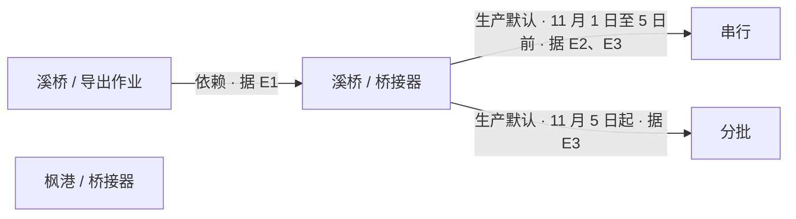
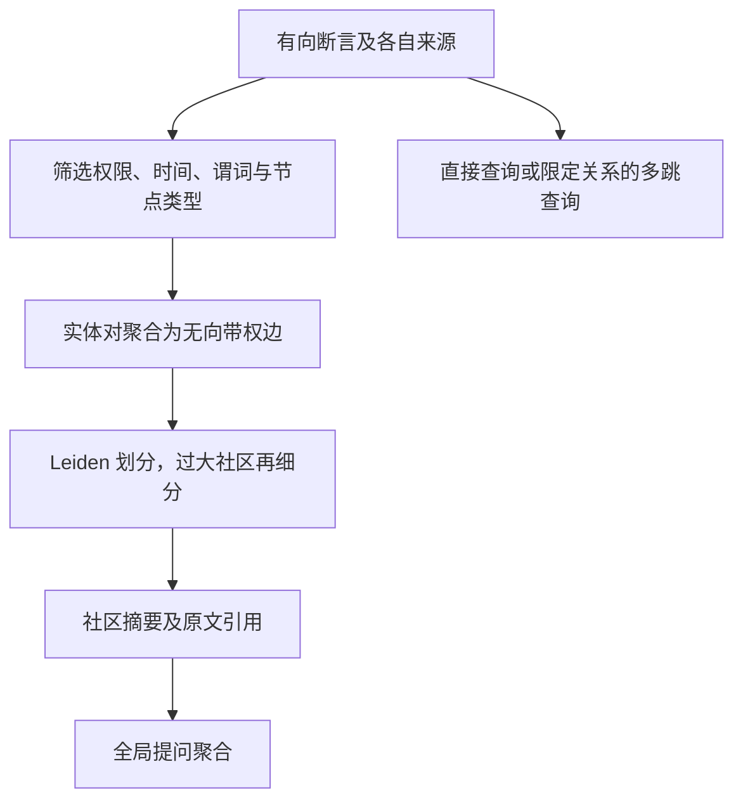

# 记忆知识图谱如何构建、更新和检索

**先让每条关系能回答“谁说的、何时有效、对谁可见”。** BMEM 可以先用 SQLite 保存实体、断言修订和原文依据，回答“这个作业依赖什么”“设置为什么改了”。当用户经常问“最近几个项目有哪些共同变化”，再根据已授权的实体关系构建社区。关闭社区后，日常提炼、冲突取代、全局声明加载和带证据的局部查询都能工作。

本分册细化[产品架构总纲](architecture.md)中的节点、边、社区和读取。下例的项目与事件均为虚构。实体消歧、多跳和社区的产品收益仍待实测。

## 从三份来源取得一个有时效的答案

“溪桥”和“枫港”各有一个叫“桥接器”的组件。某助手要回答“11 月 6 日，溪桥导出作业依赖的组件默认用什么模式？”设该助手获准读取下列三份材料。

| 来源 | 服务收到的时间 | 能由原文支持的内容 |
|---|---|---|
| E1，溪桥作业清单 | 11 月 1 日 | 溪桥生产导出作业依赖本项目的桥接器 |
| E2，溪桥配置清单 | 11 月 1 日 | 生产桥接器从 11 月 1 日起默认串行 |
| E3，溪桥发布记录 | 11 月 8 日 | 生产桥接器已在 11 月 5 日起改为默认分批 |

11 月 6 日当天，系统掌握的答案是“串行，据 E1、E2”。11 月 8 日以后回看 6 日，答案是“分批，据 E1、E3”。这两问使用同一业务日期、不同的**知晓日期**。若问的是“6 日那一次实际怎么跑”，还要看运行记录，作业可能覆盖默认设置。把“枫港”的同名组件合并进来，会令两个问题都出现看似合理的错误答案。

## 自动写入与实体消歧

1. **保存可定位的来源。** 每个输入事件保存原生 ID、发生时间、接收时间、项目、说话者或原系统、访问范围和可定位的段落或字段路径。同一份配置被三个助手转述时，沿派生记录回到同一根来源。根相同的转述至多计为一份佐证。
2. **抽取原子断言。** 后台把 E3 解析成“主体＝溪桥桥接器，谓词＝默认模式，取值＝分批，条件＝生产，有效起点＝11 月 5 日”，并指向原文。“计划更改”“测试时使用”“已经生效”要保留各自的语气、环境和状态。缺失的生效日标记未知。模型提出候选，服务按来源类型、证据片段、谓词约束和适用范围决定是否进入当前视图。
3. **将提及映射到稳定实体。** 优先使用所属项目、类型、原系统 ID，随后使用同范围内有依据的别名。名称规范化、全文和向量检索只负责列出候选。“桥接器”重名时，依赖清单内的组件 ID 或路径提供判据。未决提及可以查到原文，暂缓跨记录连边。发现误并时拆开映射，重算引用该映射的断言、路径和社区。
4. **在具体维度上自动取代。** 对取值冲突，要求主体相同、谓词为单值、条件与有效期重叠且新依据足以解释变化，再结束旧值的相应区间。项目例外与全局默认可并存，多值“依赖”通常可并存，也可由明确的移除记录终止某一项。较晚导入的旧配置、模型重复转述、无人再提，都不足以淘汰有效记忆。同等可信且无从裁决的冲突带争议状态，等新证据自动重算。
5. **显式声明直接进入声明加载路径。** 例如，假设所有者说“所有助手给建议时先列依据”，服务记录原声明、适用主体、范围和修订。每个获准的助手建立或刷新上下文时主动取当前声明，不依赖提问包含“依据”、某个节点排名或社区摘要。用户只需追加声明或改口，后台维护状态。[自动提炼、取代与声明加载](memory-lifecycle.md)

### 一条断言的最小记录

| 对象或关系 | 方向和限定 | 如何使用 |
|---|---|---|
| 实体与提及 | 原文位置 → 提及 → 稳定实体 ID。别名携带命名空间、范围和依据 | 区分同名实体，保留当初为何合并及如何拆分 |
| 语义断言修订 | 主体 → 有类型的谓词 → 客体实体或字面值。保存断言 ID、修订、极性、适用条件和状态 | “导出作业依赖桥接器”可以逆向查询依赖者。逆向遍历仍按原方向解释 |
| 时间与出处 | 每个修订记录有效区间、知晓区间、来源角色和原文位置。独立依据、联合前提分别记录 | 区分业务状态变化、来源迟到和系统改正判断。推导所需的每个前提都能回查 |
| 修订与派生 | 新修订 → 取代 → 旧修订。派生结论 → 依据 → 原文片段或上游修订 | 更新索引、追踪为什么变更、限制受撤权影响的输出。同一来源被多次引用仍只计一次 |

对示例，11 月 1 日的知晓版本认为“串行”自 1 日起、终点未定。11 月 8 日保留该旧判断的知晓区间，再登记当前判断“串行在 5 日前有效”“分批从 5 日起有效”。用左闭右开区间判定两条时间轴，同时对历史提问施加**今天**的读取权限。Graphiti 的事实边保存来源事件和两组时间，Zep 也明确这些有效时间属于系统对来源的推断。W3C PROV-O 的修订和派生关系可用于交换出处。[Graphiti 边模型，固定提交](https://github.com/getzep/graphiti/blob/4ef979c74e1e68d08217cf0af4022ddbc89c257f/graphiti_core/edges.py#L198-L235) · [Zep 四种时间的定义](https://help.getzep.com/v4/facts) · [W3C PROV-O](https://www.w3.org/TR/2013/REC-prov-o-20130430/)

经验也可以带有方向和条件。例如“办法 A → 适用于 → 软件版本 V”还需列出目标、前置条件、观察到的结果和原始运行记录。一次成功首先证明“这一次成功”，跨任务推广需新的可核案例。社区共现不能补齐缺少的结果证据。

## 落到现有代码

| 工作树能复用什么 | 建议补什么 |
|---|---|
| `events` 有原生事件 ID 和发生、生效、摄入时间。`memories` 有 `fact_key`、条件、状态及现行修订。`revisions` 有前版、来源事件和原因。`sources` 以记忆和根来源去重。[现有表定义](../../src/bmem/schema.sql) | 增加稳定实体、别名及提及定位，记录谓词的允许端点、取值类型和基数。按**断言修订**关联证据片段、来源范围及支持方式。现有 `sources` 的关联粒度是记忆，单靠它无法证明历次修订的所有字段 |
| `Store.graph` 按需查询 SQLite，输出记忆、共同根来源、最近一个已保存前版，以及证据、派生、取代边。`/api/graph` 的视图参数是 local/cloud。[构图实现](../../src/bmem/store.py#L3646) · [API](../../src/bmem/api.py#L775) | 可复用现有构图代码。其 `supersedes` 画的是**前版 → 后版**。转成本文“新取代旧”语义边时，按修订号或前任记忆 ID 映射端点。补实体关系和修订级授权过滤，避免把图中所有历史边当成当前事实 |
| 已有 FTS 查询分词及可选语义合并、后台任务表。[词法实现](../../src/bmem/store.py#L176) · [语义合并](../../src/bmem/store.py#L2028) | 在同一数据库给（范围、主体、谓词）和（范围、客体、谓词）建双向索引，对修订、有效期、知晓期和权限执行过滤。为来源到修订及派生物建反向依赖。先用限定谓词的 SQL 连接走一至数跳。向量及社区均可重建 |

接收时在同一事务写事件和提炼待办。后台裁定后，在另一事务写修订、依据和受影响索引的更新待办，再异步构建索引。读取端核对索引覆盖到哪次变更。尚未索引的新修订可以从权威表读取。用户撤回权限或要求遗忘时，先使受影响的来源和输出在读取路径立即失效，再重算索引、摘要和缓存。若另有完整且可见的独立依据，只从该依据重建。若结论依赖两个联合前提，缺一就不能继续输出该结论。显式遗忘还须按删除契约处理内容副本，和“被新值取代、仍可回查历史”分开。[架构的撤回与恢复设计](architecture.md)

## 社区是怎样算出来的

**社区**是在某一指定加权图上，连接相对紧密的一组实体。同一社区可以帮助选择要浏览的主题。它的成员资格无法证明“依赖”“等价”“曾成功”或任何一条具体事实。上例只有一条实体间依赖和两个字面值，已有证据足够回答默认模式。没有理由为了这道题推断一个社区。

**第一步，选图。** 固定查看者可用的资料范围、用途、时间窗口及修订快照。节点选工作实体，例如作业、组件、工具。只纳入有直接依据且适合表达关联的边，例如“依赖”“使用”。通用“所有者”“项目”以及“串行”等公共字面值容易把无关模块接起来，不作为该投影的节点。否定、争议、取代、出处等仍可在语义图查询，排除在这个社区投影之外。只在已授权资料内部建图。先用所有人的材料聚类再过滤正文，标题、频数和成员本身便可暴露无权资料。

**第二步，计算无向权重。** 对被选的实体对 `{u,v}`，可用“直接支持任一入选关系的不同授权根来源数”计权，一份来源对同一实体对最多贡献 1。导出作业依赖桥接器给这一对加权，取反向排列或重复导入不重复加权。这里丢弃方向只为了划分。回答事实仍回有向断言。共现只表示两个实体被同一来源提到。语义相似可由实体描述的向量余弦值计算，例如只保留互为近邻且达到阈值的实体对。相似边另存，并记录输入文本修订、模型、阈值和版本。初版可只用相似度找候选。若尝试把相似度加入投影，应单列其边类型、归一化尺度并和无相似边的结果比较。不可用文本相似度增加事实证据数。

**第三步，划分与分层。** Leiden 交替执行局部移动、社区细化和图聚合，优化指定的质量函数。以模块度为例，会比较实际社区内部连接和按节点度数预期的内部连接。分辨率影响偏向的大组或小组。原论文的连通保证有明确算法前提，所得划分仍依赖输入图、目标与参数。产品若需要“主题 → 子主题”，可以先得到粗分区，再在过大的父社区诱导子图内继续划分，直到无需或无法再拆。分别调几次分辨率得到的独立分区未必嵌套。保存父 ID、成员、层级、权重规则、随机种子、算法及输入版本。孤立实体照常可检索。[Leiden 原论文，第 II–III 节与附录 D](https://arxiv.org/html/1810.08473v3)

微软 GraphRAG 固定版本的实现会先把端点规范成无向对，重复对保留最后一行，可选只保留最大连通分量，再向层次 Leiden 传权重、最大社区规模和种子。包装器用模块度、分辨率 1.0。BMEM 若采用“独立根来源数”，要在传入边表前自己完成聚合。若静默去掉小连通分量，会漏掉独立项目。一个实体在一次硬划分的同层只属一个社区，跨社区成员之间的边仍保留在原图。[GraphRAG 建图代码](https://github.com/microsoft/graphrag/blob/34b2b67ae4601ad0b47bcd179fbe3f2a23aa0857/packages/graphrag/graphrag/index/operations/cluster_graph.py#L46-L90) · [Leiden 调用参数](https://github.com/microsoft/graphrag/blob/34b2b67ae4601ad0b47bcd179fbe3f2a23aa0857/packages/graphrag/graphrag/graphs/hierarchical_leiden.py#L9-L24)

**可直接试接的算法模块。** GraphRAG 在所核提交中调用独立的 Rust/Python 扩展 `graspologic_native.hierarchical_leiden`。bmem 可只将“授权域内的实体 ID 对与权重”交给该扩展，收回成员、父社区和层级，将版本及证据清单保存在自己的库中。更换分区实现只需重建这个视图。模块代码采用 MIT 许可，接入前仍需验证目标 Mac/Python 的安装和内存开销。[原生扩展及构建要求](https://github.com/graspologic-org/graspologic-native) · [许可](https://github.com/graspologic-org/graspologic-native/blob/main/LICENSE)

**第四步，按需生成报告。** 用成员、已授权断言和原文生成社区主题及主要变化，报告中的每个要点保留修订与来源引用。用权限版本、资料时间窗口、图及摘要版本标识派生物。撤权后旧标题、成员表、摘要和上层汇总一起停止供应。权限组合太多或变更太快时，保留精确查找和局部查询，用本次获准的事实临时分组。成本分开记录构建关系的模型调用、投影边数、聚类耗时及内存、各层摘要的输入输出 token、更新后的重算量，以及全局回答每次读取的社区数。GraphRAG 原研究评估的是约百万 token 语料上的全局主题问题，其全面性和多样性结果不能直接推出个人记忆的多跳正确率或合算的默认配置。[GraphRAG 原研究](https://www.microsoft.com/en-us/research/publication/from-local-to-global-a-graph-rag-approach-to-query-focused-summarization/)

## 读取、返回与验证

| 问法 | 路径 | 返回什么 |
|---|---|---|
| 局部，“溪桥桥接器的当前默认模式？” | 名称、项目、别名或检索命中实体 → 精确谓词 → 适用范围和两种时间过滤 | 分批、生产范围、生效日及 E3 的定位。实体同名且无可靠区分时，返回有限候选 |
| 多跳，“溪桥导出作业依赖的组件在 6 日默认怎么跑？” | 作业 → 依赖 → 桥接器 → 默认模式 → 分批。逐跳校验范围、条件、时间和引用，限制允许的谓词序列、步数及每步候选 | 给出每一跳的 E1、E3。缺一跳则只回答已证明部分。若依赖多组件，分别列出每个组件的模式 |
| 全局，“本月获准查看的项目里，主要发生了哪些模式切换？” | 小集合直接按有修订的断言汇总。资料分散且需归纳时按社区分批提取相关证据，再合并去重 | 主题、覆盖范围及逐项可核的原文。另问“准确多少个组件”时，对授权范围内实体 ID 去重计数，注明抽取覆盖水位 |
| 声明，“新助手接手另一任务” | 在开始回答前装入该助手获准的现行全局声明，再按任务补充局部证据 | 当前声明版本与适用范围。声明加载结果可独立核对 |

微软的局部查询组合实体邻域与原文，全局查询使用多个社区报告生成中间回答并汇总。BMEM 要额外处理时态、声明、逐跳来源和撤权。语义检索得分与社区标签只帮助找证据。[GraphRAG Local Search](https://microsoft.github.io/graphrag/query/local_search/) · [GraphRAG Global Search](https://microsoft.github.io/graphrag/query/global_search/)

**验证顺序。** 先冻结一组独立工作任务和原文证据，对合成案例按生成规则给出可接受的实体、两种时间、各跳证据和允许的返回范围。使用公开基准时保留其原始标注。按题型分开比较“现有词法／可选混合检索”“加有向断言与时间过滤”“再加社区”。保持相同回答模型、可见语料与答案证据预算。后台预计算也要计入成本。

| 检验 | 能改变决策的观察 |
|---|---|
| 重名、改名、发布记录迟到、单次作业覆盖默认 | 统计拆错与并错、现行／历史答案正确率和用错项目率。错误来自消歧或时间表示时，优先修写入模型 |
| 局部与多跳证据 | 统计全路径证据齐备且答案正确的题数，并列出只命中单跳的题。等预算下新增的正确答案才能归给关系检索 |
| 全局与可重复性 | 对预先标出的主题计覆盖率，核查每个摘要要点的原文支持。改变种子或增删少量无关记录，观察主题、成员与答案是否不当漂移。若按事实分组已能覆盖，保持社区关闭 |
| 撤权、删除和失效传播 | 分别在撤去 E3 读取权、缩窄项目范围、重建尚未完成或旧缓存尚存时查询，检查答案、引用、标题、成员、计数、缓存命中均不泄漏。核对下一次加载的声明版本 |
| 成本与适用工作量 | 同时报写入到可查的延迟、局部和全局查询 p95、索引空间、摘要 token、每次撤权重算量及每个新增正确回答的总成本。若新增开销主要用于从未被问到的主题，按需生成或停用社区 |

技术来源核验于 2026-11-19。上文的参考算法与产品行为来自作者论文、官方文档及固定提交。BMEM 工作树、拟议契约和待执行评测分别标明。
