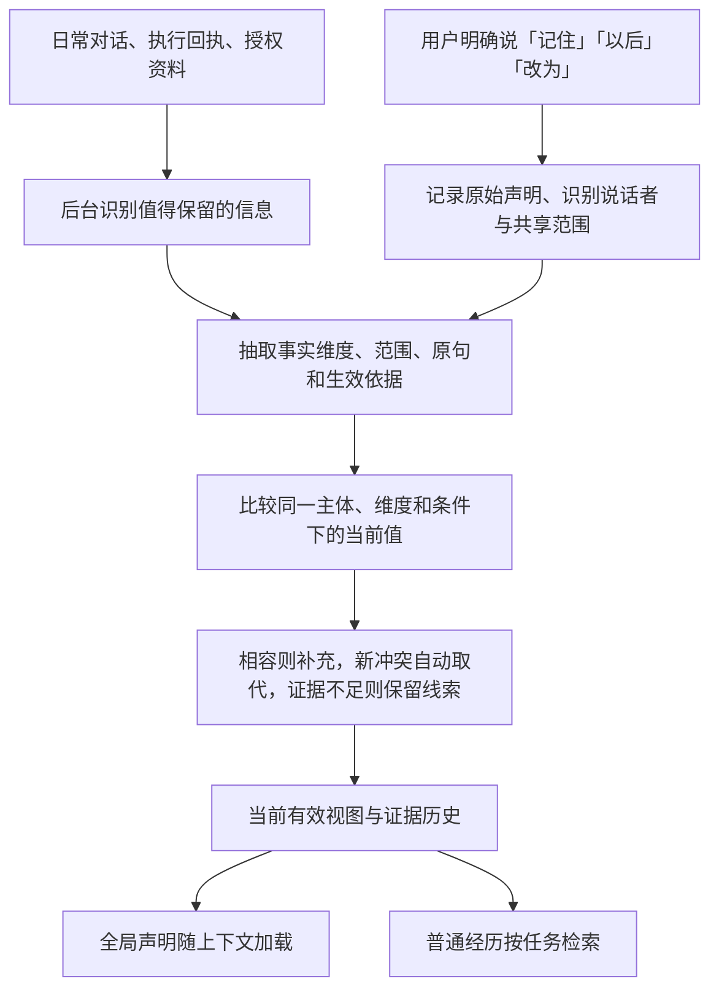

# 自动提炼、冲突取代与全局声明

**产品规则。** 日常交互由服务自动提炼。用户只能追加自己现在要表达的内容，记忆正文、修订链和仲裁结果由服务维护。对同一事实，更新且可信的新记忆可以淘汰冲突的旧值。有效记忆可以长期无人提及。用户明确面向所有助手的声明，由每个已接入且获准的助手主动加载。

这是[产品架构](architecture.md)的行为契约。最后一节列出现有实现和仍待交付的能力。

## 1. 两种输入，共用一次自动仲裁



| 环节 | 日常记录 | 明确声明 |
|---|---|---|
| 采集 | 记录谁说了什么、哪个动作实际完成、有什么回执。计划、引用和执行结果分开 | 绑定真实用户消息或所有者入口，保留原话与投递身份。助手的转述、文档中的示例只能作为间接证据 |
| 提炼 | 后台模型从原文提取可独立判断的陈述或经历，给出主体、事实维度、取值、条件、有效时间与原文位置。一次性要求保留在任务内 | 明确的长期偏好走声明通道，跳过“值不值得记”的模型筛选。一个句子里的多个偏好共用一个来源，按可独立更改的维度归并 |
| 生效 | 服务确认来源与含义后自动提交。暂时无法判断的候选保留证据，收到有关新证据时自动重试 | 可确定维度的声明同步生效。新维度或复杂自由文本先持久记录一条本人声明，明确标注细目归并状态。若新旧表达疑似冲突且尚未判清，当前视图显示新声明及不确定性，避免将两条都作为已确认默认值 |
| 反馈 | 成功、失败和适用版本进入经历。重复注入或转述沿来源回溯到同一根，不算新增佐证 | 用户再说“改为……”会产生另一条声明。页面可显示依据和版本差异。用户无须选中一条记录、编辑正文或批准归并 |

**自然语言怎样找到同一维度。** 提取器先按原文拆出可以单独改变的内容，再从该主体已有维度及别名中检索候选。例如“报告开头”和“报告第一段”可能指同一项，“开头放什么”和“整篇用什么语言”则可以分别改变。模型给出拟匹配的键、原句和范围，服务检查主体、范围、来源资格与证据版本。明确匹配则复用原键，确属新维度才建键。近义词匹配不清的先保留原话，等待后续证据自动归并。只有明确变更长期习惯的语句才产生新的本人偏好，一次要求保留在当前任务。

## 2. 什么情况下旧值退出当前记忆

裁决以**同一主体、同一事实维度、适用条件相交、两个取值不能同时成立**为起点。相似文本只帮助寻找候选。用于判新旧的是明确生效时间或可信来源的发生顺序。接收时间可用于诊断迟到，不能单独证明事实更新。

| 收到的内容 | 系统动作 | 下一次普通读取 |
|---|---|---|
| 此前没有这项事实 | 自动建立当前断言并附来源 | 返回新值 |
| 同一维度又表达相同含义 | 合并佐证，去除同源复述 | 返回一个当前值 |
| 同范围、同一维度，可信的新值与旧值冲突且先后可判 | 一个事务内生效新修订，旧修订记录被谁取代。旧摘要和已排队的注入在送出前复查版本 | 只提供新值。获准的历史查询仍可解释旧值何时有效 |
| 新声明只改一项，或只为某个项目设例外 | 只取代被点到的维度。项目例外仅在其范围内优先，全局默认在其他项目继续有效 | 返回该任务适用的组合 |
| 今天才导入一条事实时间更早的旧消息 | 作为历史证据，不逆转现值 | 继续返回现值 |
| 外部资料或助手推断与用户本人的偏好相反 | 记录为来源受限的观察。个人偏好采用本人声明 | 保留本人的现行声明 |
| 两条同等可信陈述互斥，既无明确先后也无覆盖指向 | 留存争议。有明确的同源消息顺序、新证据或后续声明时自动重算。普通任务不把争议值当确定事实 | 返回不确定或空，不要求用户处理审批单 |
| 一年无人提及、没有冲突、适用条件仍满足 | 不因年龄、未使用天数或使用次数降低其事实效力 | 仍属有效。相关经历按任务挑选，全局声明继续加载 |

**三个不同动作。** 冲突取代改变“当前采用哪个值”，并保留历史。用户声明“仅本周”限定适用区间，超出范围后不再适用。隐私遗忘和资料源撤回由独立的删除、权限契约处理。定时整理可以重新计算索引和摘要，无权仅因时间流逝让有效事实退场。

## 3. 让所有已接入助手读到声明

显式声明同时解决**持久化**和**投递**。只提供搜索工具，无法保证一个新助手在用户没重复偏好关键词时仍拿到偏好。Letta 支持将同一记忆块加入多个 agent 的上下文，并将其设为只读。跨不同宿主的版本传播与回执仍由 bmem 自己负责。[Letta 官方记忆块文档](https://docs.letta.com/v1-sdk/memory/memory-blocks)

1. **声明。** 所有者说“请记住……，所有助手通用”。服务记录说话者、原消息、作用域、意图与来源，自动绑定各项稳定的事实键，给出“已记录”“哪些已生效”“哪些替代了旧值”的回执。用户不需要知道键名、记忆 ID 或修订号。只有真实所有者消息或受信本机入口能授予“本人声明”的来源身份。
2. **发布。** 从权威库生成只读、带版本的全局声明快照，每项带维度、当前值、适用条件和出处。整库无须进入上下文。局部修改只刷新对应维度，已取代的旧值退出快照。目的地须满足用户已经授予的共享范围。
3. **加载。** 新助手接入、新会话开启或上下文压缩后重新建立时，在首个可执行任务前载入当前快照。已有会话在下一次可控的模型调用前检查版本，变化时提供新值及替代标记。离线助手恢复连接后补最新版本。该通道独立于用户本轮提问、词法命中和向量开关。
4. **核验。** 区分“服务已生效”“适配器已装入本次上下文”“产出实际遵循”。管理台可以列出各已接入助手最近装入的版本。只有搜索工具、无上下文接入点的宿主标记为“可查询”。超出上下文预算或离线时记录待送达，不以服务入库成功冒充助手已读。偏好作为用户默认值使用，具体任务的临时要求优先于通用偏好。

| 建议接口 | 调用者提供什么 | 服务或适配器返回什么 |
|---|---|---|
| 追加声明 | 已认证的本人消息引用、原话、全局或指定范围。沿用源消息 ID 防止重投产生第二次变更 | 声明编号、已生效的事实维度、新修订、被取代的旧修订及尚待归并项 |
| 获取当前声明快照 | 助手的注册身份、当前任务范围、已装入的快照版本。新会话或压缩后传空版本 | 版本相同返回无变化，否则返回按接收权限裁剪的完整当前快照。适配器用新快照替换专用上下文段，撤出的默认值也随之移除 |
| 记录装入结果 | 宿主、会话、上下文重建批次、实际装入版本与结果 | 该宿主最近一次可核实的装入状态。仅能追加上下文的宿主给出变更标记，并区分旧消息仍存在与专用上下文已替换。产出是否遵循用真实任务另测 |

**合成示例。** 所有者先声明“所有助手写测试报告时，开头放风险表，末尾列复验步骤”。服务生成“开头形式”和“末尾内容”两个维度。之后追加“以后改用风险清单开头”，只更新第一项。另一个助手收到的任务纵使只有“整理这次测试结果”，也应在开始时获得“风险清单＋复验步骤”。若用户说“这次给管理层只写一段”，仅对这次任务生效。原始两次声明均可追溯。

AdaMem 的合成实验发现，仅靠隐式反馈推断写入规则存在误判，因此本人明确声明直接进入声明通道。CoMMA 在 20 道明确事实更新题上观察到，写时覆盖和读时仲裁的精确匹配率同为 95%。设计据此把明确替代放在写入时处理，保留有歧义的竞争说法及各自条件。[AdaMem 表 1–3](https://aclanthology.org/2026.emnlp-industry.189.pdf) · [CoMMA 表 1–3](https://aclanthology.org/2026.aacl-long.88.pdf)

## 4. 当前版本具备什么

| 核查点 | 已有行为 | 与目标之间的差距 |
|---|---|---|
| 自动提炼 | Worker 有耐久性判断、候选提取、批次事务提交及巩固任务。声明有独立的同步写入路径 | 自由文本能否正确识别同义维度、局部变更及长期意图，仍需用冻结样本检验。[Worker](../../src/bmem/runtime.py) |
| 正式声明 | CLI `bmem declare`、MCP `memory_declare` 和 Web 声明均通向存储层。Codex/Claude hooks 与 DSH 插件能识别部分明确记忆措辞 | 两条无事实键的互斥自由文本可先同时生效。现有入口还允许按记忆 ID 和预期版本提交一份更正正文；旧修订保留。新产品仅暴露追加新声明的内容写入方式。[存储](../../src/bmem/store.py) · [宿主适配](../../src/bmem/adapters.py) · [DSH](../../src/bmem/dsh_plugin.mjs) |
| 更新与淘汰 | 同事实键、同条件且信任可比时，较新的有效值可更新，较晚导入的旧值可保留为历史。同一时点的可信冲突可进入争议 | 当前还存在 72 小时观察期晋升条件，以及每周对部分低可信、低置信、单来源项降低置信度的策略。后者不直接删除记录，也不作用于 T1 声明。新设计以证据与冲突决定事实效力。[仲裁与维护](../../src/bmem/store.py) |
| 共享读取 | 本机 MCP 可按 ID 回读当前值；支持的宿主可通过 hook/插件请求预算内记忆。另有共享索引供遵循入口指引的工具读取 | 普通召回依赖查询、排序、预算和去重。目前未验证产品具备“自动给每个助手装入全局声明版本并逐宿主确认”的协议。[召回实现](../../src/bmem/store.py) · [接入实现](../../src/bmem/adapters.py) |

**实际复验。** 使用真实 `Store.declare`，在两个隔离临时库分别依次声明“报告发现用段落列出”和“以后报告发现改用表格列出”。固定来源发生顺序，不运行后台模型。两次均提供同一事实键时，普通搜索只返回表格版，修订号为 2。两次均省略事实键时，同一搜索返回段落版和表格版，两条均为有效、修订号为 1。这个对照定位了写入时的差异。自由文本随后能否自动归并取决于提炼和维度判定。[已有语义归并测试](../../tests/test_acceptance.py)

另两项隔离复验直接影响如何表达例外。现版中仅改变 `project` 标签、保持事实键与条件相同，两个项目的取值会归并到同一条。声明未来才生效的取值，普通搜索也可能立即返回它。新设计应把“仅某项目适用”保存在参与仲裁的条件中，并在生成当前视图时检查生效区间。验收分别查询项目内外、预定生效时刻前后。[事实存储实现](../../src/bmem/store.py)

现有版本另通过 65 项相关回归用例，包括事实生效时间、迟到、争议解除、批次事务、跨宿主 API 和每周衰减。测试使用隔离库，部分候选由测试构造。复跑命令如下。

```sh
.venv/bin/python -m pytest -p no:cacheprovider -q \
  tests/test_fact_time.py tests/test_distill_transactions.py \
  tests/test_acceptance.py::test_cross_harness_declaration_and_correction \
  tests/test_acceptance.py::test_injection_dedup_revision_and_budget \
  tests/test_acceptance.py::test_free_text_declaration_can_be_semantically_reconciled \
  tests/test_acceptance.py::test_free_text_declaration_keeps_all_claims_after_multiple_add_candidates \
  tests/test_acceptance.py::test_independent_inference_cannot_promote_over_conflicting_declaration \
  tests/test_acceptance.py::test_weekly_decay_is_audited_and_not_repeated_daily
```

**新设计的验收判据。** 让 A、B、C 使用同一虚构所有者。在 A 声明两个偏好后，B 首次接入，C 保有旧会话。依次测试无关键词任务、只改一个维度、一次性例外、迟到旧证据、一年静默及断线重连。每一步分别核对当前事实、实际交给宿主的上下文和最终文档。另投递一份没有“记住”指令的工作日志，要求后台自动区分“已验证的解决方法”“尚未执行的猜想”和“助手对前文的转述”。核查原文定位与当前有效断言，全程无人参与提炼。真实宿主行为应单独运行验收。[评测协议](evaluation.md)
