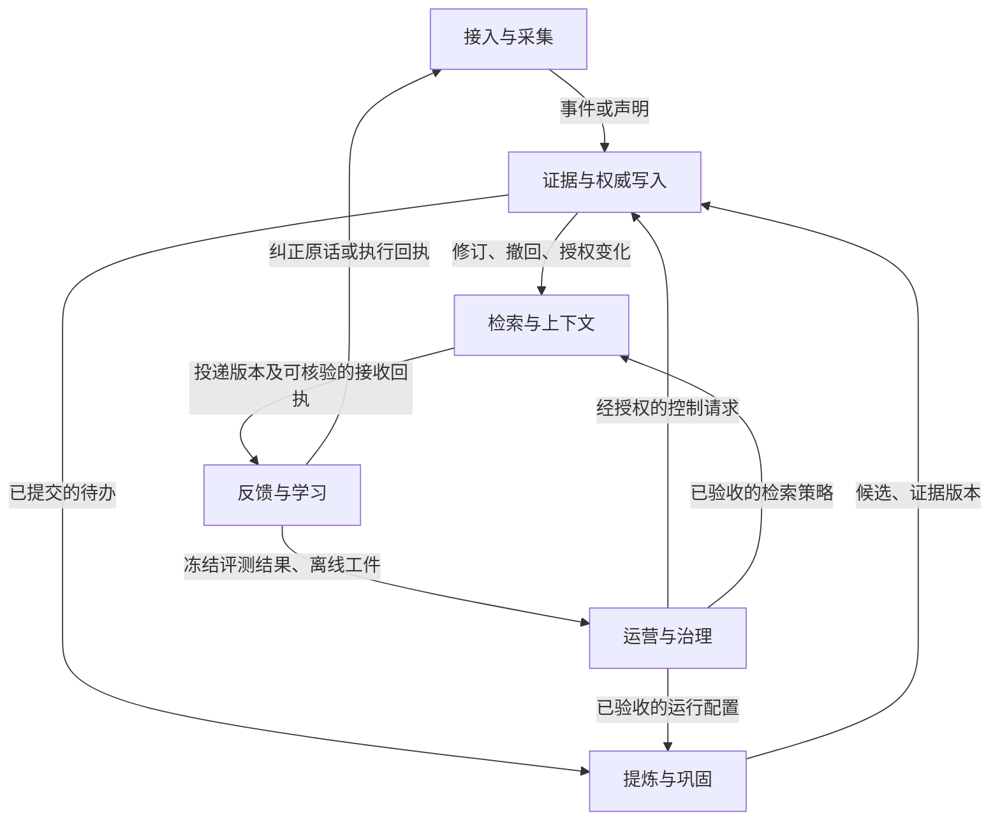

# 六个领域的模块、接口与开源选型

下表列明每种状态由谁维护、各环节能接哪些组件，以及替换后如何检验产品行为。设计面向一位用户、多款助手和多个授权来源。一期可部署为同一台机器上的一个服务、一组后台任务和一个事务库。六个领域是代码和数据职责边界，无须启动六个进程。[产品架构](architecture.md) · [记忆生命周期](memory-lifecycle.md)

## 状态归属

| 领域 | 自己维护的状态 | 提交给其他领域的结果 |
|---|---|---|
| 接入与采集 | 已注册来源与适配版本、订阅状态、页面游标、原生事件到本地回执的对应 | 带来源身份和授权版本的事件、本人原话、工具回执、源端编辑/撤回 |
| 证据与权威写入 | 根来源、证据版本、声明、任务/经历、断言修订、支持关系、有效范围、授权及撤回水位 | 唯一的生效、冲突、撤回和版本变更记录，事务中产生后续待办 |
| 提炼与巩固 | 提取任务、模型及模板版本、候选与处理进度、失败/待补证原因 | 有出处的提案交权威写入；记录提案被接受、合并或留待补证的回执 |
| 检索与上下文 | 可重建的词法/语义/导航索引、任务包、全局声明投影视图与投递记录 | 受授权的上下文、可展开的证据句柄、包版本及送出状态 |
| 反馈与学习 | 使用观察、任务结果、离线数据集清单、冻结评测与模型工件 | 纠正或执行回执走证据入口；经验证的策略或模型版本交运营发布 |
| 运营与治理 | 接入与使用策略的管理流程、受理和清理进度、备份清单、健康指标、发布与回退记录 | 调用权威事务变更授权或登记用户遗忘；发出经过验收的配置版本 |

例如，一次用户声明可以立即产生新修订，同时使两项旧派生结果失效。**只有证据与权威写入能确认新修订生效。** 检索可在后台完成前读取新声明。已过期的摘要、向量命中或待发送请求必须在交付前根据权威状态复核。清理进度和索引新鲜度各自可见。[授权与恢复契约](architecture.md) · [撤回与备份复验](local-evidence.md#3-撤回与备份恢复)

下图中的连线区分在线服务与离线学习。文中“已有”以核验日 **2026-11-19** 的工作树为准。接口约定描述调用者应看到的行为，开发时可自行命名。

## 1. 接入与采集

| 细分模块 | 输入、输出与可替换接口 | 当前依据与推荐实现 |
|---|---|---|
| 助手与应用适配 | 宿主回调、同意范围内的日志、SDK 提交或用户选定的导出 → 带说话者、会话和源对象版本的事件。适配器声明是否能报告上下文重建、真实路由、装入版本及最终行为 | **已有** Claude Code/Codex hooks、DSH 原生插件和 MCP 工具。**建议** 继续直接接宿主公开接口，MCP 用于显式查询、展开及提交本人原话；主动装入全局声明还需宿主生命周期支持。未提供回执的客户端显示“已提供/待确认”。 [适配器](../../src/bmem/adapters.py) · [DSH 上下文注册](../../src/bmem/dsh_plugin.mjs) · [MCP 工具入口](../../src/bmem/api.py) |
| 连接器与历史回填 | 经授权的来源账号、订阅事件或历史页 → 去重后的新增、修改、撤回。每种来源交付稳定对象 ID、源版本/变更顺序和下一页游标，标注其能感知的历史变化 | **已有** 飞书/Lark 以用户身份按选定类别读取资料。**建议** 先复用官方读取工具，在采集清单中逐项声明“支持回填、支持撤回通知、可重新对账”。暂时读不到一个对象时区分离线、无权、明确撤回。 [导入与版本标识](../../src/bmem/feishu_history.py) · [飞书 CLI](https://github.com/larksuite/cli/tree/c5fbf1a52df77d5cb9cac2b1501770b2fb9af7d2) |
| 身份、去重与任务关联 | 调用客户端、数据来源与事件 ID → 验证后的信封。用原生会话、工作树、任务标识和工件引用关联经历；同仓并行任务缺少可靠锚点时保留待关联状态 | **已有** 事件去重、导入游标。**建议** 新设计把“允许采集”和“允许读取/外发”分别授权。游标在页面的证据成功提交后前进，重启重复投递同版本须能取得原回执。来源资料、助手转述和历史注入都不能充作本人亲口声明。 [事件模型](../../src/bmem/models.py) · [原生历史导入](../../src/bmem/adapters.py) |

**开源与依赖。** 可直接复用 MIT 的 MCP Python SDK，现有锁文件为 1.30.0。飞书渠道可直接调用官方 MIT CLI，仍需平台授予相应用户范围。MemOS Local Plugin 在 DSH 的有界前台召回、串行后台采集值得借鉴；整包会引入 Node、原生 SQLite 依赖和另一份数据目录。Android 若仅作同机服务的授权客户端，可沿用采集和查询协议，无须引入同步存储。[MCP SDK v1.30.0](https://raw.githubusercontent.com/modelcontextprotocol/python-sdk/v1.30.0/README.md) · [飞书 CLI 许可](https://github.com/larksuite/cli/blob/c5fbf1a52df77d5cb9cac2b1501770b2fb9af7d2/LICENSE) · [MemOS 插件的具体行为](https://github.com/MemTensor/MemOS/blob/3a16e5fe3048a209f722806f4123fa2e533588fd/apps/memos-local-plugin/ARCHITECTURE.md)

旁路采集区分应用激活、选定窗口内容和平台授权日志。应用激活只记录活动，窗口内容需单独授权。停止采集和清理已有材料分别反馈进度。[macOS 激活通知](https://developer.apple.com/documentation/appkit/nsworkspace/didactivateapplicationnotification) · [ScreenCaptureKit](https://developer.apple.com/documentation/screencapturekit)

## 2. 证据与权威写入

| 细分模块 | 输入、输出与可替换接口 | 当前依据与推荐实现 |
|---|---|---|
| 证据保管 | 来源信封 → 稳定证据句柄、摘要校验值、最少必要原文及其位置。有附件时先持久化内容，再事务提交引用与采集回执 | **已有** SQLite 记录和独立证据文件。**建议** 小证据同库提交，大附件在受控目录原子发布，未获引用的文件可回收。允许保留的事实、到期的原文和用户要求抹除的资料分别处理。 [存储实现，`_write_evidence`、`ingest`](../../src/bmem/store.py) |
| 本人声明、经历与断言仲裁 | 直接声明或模型候选 + 支持/反对证据 → 当前值、有效区间、待生效、争议或仅供历史。事实身份包含主体、可比较的维度与适用条件；验证任务结果还要能定位工件版本 | **已有** T1 声明、修订、来源关系和候选批事务。**建议** 用户只追加声明，服务拆分维度并自动仲裁；低可信转述无法覆盖本人偏好。尚未到生效日的值不进入当前查询。同一来源多次转录只算一份证据。 [权威事务，`declare`、`apply_distill_batch`](../../src/bmem/store.py) · [已验证差距与目标规则](memory-lifecycle.md) |
| 关联、授权与失效 | 来源引用、声明和执行回执 → 支持、反驳、修订、依赖等有证据的版本关系。授权/遗忘请求 → 当前权限版本、立即禁读状态与下游清理待办 | **已有** 来源、修订、仲裁、墓碑及部分派生失效。**建议** 读者、用途、接收端同一时刻都满足条件才交付。组合摘要记录输入版本集；撤权时可以先使之失效，再凭剩余独立证据重算。 [SQLite 定义](../../src/bmem/schema.sql) · [`_invalidate_dependents`、`forget`](../../src/bmem/store.py) |

**开源与依赖。** 直接使用 SQLite 事务、约束和在线备份 API，官方将 SQLite 核心置于公有领域。可以用关系表记录实体、边和双时态区间。Graphiti 的 `episodes` 与事实边的多个时间字段给出实现参照；采用其图服务还会引入图后端、实体归并和新恢复流程。开放的 PROV-O 描述来源、活动和派生，可用作导出字段映射。参考这些设计不会自动取得完整 ACL 或级联删除能力。[SQLite 版权说明](https://www.sqlite.org/copyright.html) · [在线备份](https://www.sqlite.org/backup.html) · [Graphiti 的边对象](https://github.com/getzep/graphiti/blob/4ef979c74e1e68d08217cf0af4022ddbc89c257f/graphiti_core/edges.py) · [W3C PROV-O](https://www.w3.org/TR/2013/REC-prov-o-20130430/)

## 3. 提炼与巩固

| 细分模块 | 输入、输出与可替换接口 | 当前依据与推荐实现 |
|---|---|---|
| 提取与模型路由 | 已授权的原文范围、近期相关修订、任务和模型预算 → 带原文区间、主体、维度、条件、事实时间和不确定性的候选；允许返回零条 | **已有** 本地生成和可配置端点、结构化生成及后台任务。**建议** 远程生成只接收该目的地允许的正文，每次发送前复查；生成模型、分词器和模板独立标识。切换模型只影响新提议。 [Runtime 提炼](../../src/bmem/runtime.py) · [提供者请求](../../src/bmem/llm.py) |
| 按事实维度归并 | 普通经历、明确声明及候选维度 → 原话如何分解、可复用键、相容/冲突或需补证的理由；输出交权威写入复核 | **已有** 按键和条件匹配、信任等级与事实时间仲裁。**建议** 新句只改一个维度时保留其余有效偏好；归并无法确定时展示新原话与未决状态。重复出现、存放时间或模型给出的高分都不足以凭空提高来源资格。 [当前候选及晋升实现](../../src/bmem/store.py) · [声明分解与取代规则](memory-lifecycle.md) |
| 经历归纳、方法与重算 | 带结果的任务经历、反例、受影响的下游节点 → 有适用环境及反例的方法候选，或失去支持后暂停的旧摘要 | **已有** 巩固任务和来源变化后的重算路径。**建议** 对“计划做”与“已验证成功”分别建模；新版本、反例、源端撤回触发重新评价。等待模型期间，确定的本人声明仍可读。 [Worker 的 `_handle_consolidate` 和 `_handle_distill`](../../src/bmem/runtime.py) |

**开源与依赖。** 当前代码固定本机 Ollama 运行时版本 0.40.16，可复用其模型 API 和结构化输出；运行时代码采用 MIT，模型权重另查各自许可证。LangMem（MIT）可作可替换的离线提取器对手，其后台管理与热路径工具适合比较提取策略；采用整套 LangGraph 才需要相应运行时和持久化 store。若换模型，先让两种提取器对相同证据输出候选，再通过同一个权威事务回放，比较错主体、错时间、错误覆盖及每千事件成本。[当前运行时固定值](../../src/bmem/runtime.py) · [Ollama 许可](https://raw.githubusercontent.com/ollama/ollama/v0.40.16/LICENSE) · [结构化输出契约](https://docs.ollama.com/capabilities/structured-outputs) · [LangMem 后台和存储边界](https://github.com/langchain-ai/langmem/blob/4beb9c36a40953f09357e5b2dd62ecc726f22d13/README.md)

Mem0 OSS 可用来对照自动提取与记忆更新。其 Python 快速开始配置包含向量存储、生成和嵌入端点。做对照时固定可见资料、生成模型和候选预算，并记录外部端点实际收到的数据。[Mem0 OSS 固定版本快速开始](https://github.com/mem0ai/mem0/blob/fff8a6472512d1bc1a4bccab8c645b65a1df7fe5/docs/open-source/python-quickstart.mdx)

## 4. 检索与上下文

| 细分模块 | 输入、输出与可替换接口 | 当前依据与推荐实现 |
|---|---|---|
| 索引与关系投影 | 权威修订流及访问范围 → 按索引版本构建的原文词频、中文切分/技术标识符、向量和邻接关系 | **已有** FTS5、中文/标识符切分、独立向量库、来源关系图。**建议** 同时保留原词频字段和扩展字段，按证据域预先收窄搜索。主题社区/图摘要是可选导航，删除整份派生索引可以从当前仍有权保留的依据重建。 [`_fts_tokens`、`graph`、`rebuild_indexes`](../../src/bmem/store.py) · [本次分词对照](local-evidence.md) |
| 检索、融合与补读 | 查询、任务状态、接收者、有效/知晓时间、预算 → 经授权候选的对象及版本、可解释分值和按需补读句柄 | **已有** `_search_rows`、`_merge_semantic` 和 `recall`。**建议** 依问题选择精确当前事实、词法、语义、时间过滤或有界沿边。候选只返回引用，再按当前权威状态补原文。索引滞后时排除已过期的候选，明确声明可直接读事务库。 [检索与合并](../../src/bmem/store.py) · [实验与失败分类](evaluation.md) |
| 全局声明装入、任务证据包装与回执 | 当前全局声明快照、宿主上次已装入版本、可选任务命中 → 必须装入的有效声明、预算内证据包、目的地和实际版本 | **已有** 注入条目、版本与会话去重、部分宿主自动召回。**建议** 全局声明拥有独立通道和预算，支持无关键词、重连、上下文压缩后重装。若接收端不能确认装入则保留“已发送”；无法验证的宿主模型路由使用其获准的最宽目的地范围。 [现有投递表](../../src/bmem/schema.sql) · [交付语义](memory-lifecycle.md) |

**开源与依赖。** 直接使用 SQLite FTS5。仓库已经锁定 sqlite-vec 0.1.6，现有 `VectorIndex` 维护独立 `vectors.db`；可以关语义召回，但该扩展目前仍列在安装依赖中。该版本提供 MIT 和 Apache-2.0 许可选项。BGE-M3 模型卡标注 MIT，可与更小的本地多语模型同预算比较。切换向量空间时在新命名空间按模型、维度与距离度量重建，核对引用可见性并回放后才切换读指针。OpenClaw 的来源分层注入属于借鉴项。[FTS5](https://www.sqlite.org/fts5.html) · [sqlite-vec v0.1.6 说明](https://raw.githubusercontent.com/asg017/sqlite-vec/v0.1.6/README.md) · [现有依赖](../../pyproject.toml) · [BGE-M3 模型卡](https://huggingface.co/BAAI/bge-m3) · [OpenClaw 来源与注入](https://github.com/openclaw/openclaw/blob/9dc69b2b017bd1efa9a847687b959bd1f0996a8a/docs/concepts/memory-architecture.md)

Claude-Mem 的“搜索 → 时间线 → 取具体观察”可作为原文补读与任务接续的对照。在同一上下文预算下比较漏掉验证步骤、串任务和误用过时事实的次数。[Claude-Mem 读取流程](https://github.com/thedotmack/claude-mem/blob/c62467ca301c85e809f2f40809b862c23cf47c1a/docs/public/architecture/overview.mdx)

## 5. 反馈与学习

| 细分模块 | 输入、输出与可替换接口 | 当前依据与推荐实现 |
|---|---|---|
| 投递和使用反馈 | 已送出的包版本、宿主装入/引用信号、核验过的任务结果 → 分开的观察记录。本人新声明回到采集，工具测试回执回到证据；单次点击只记作弱行为观察 | **已有** `injections`、`injection_items` 记录提供过的修订，并能识别部分回流引用。**建议** 每条反馈附带可观察的动作、上下文版本和根来源；指标区分检索命中、送出、装入、引用和任务成功。 [投递表](../../src/bmem/schema.sql) · [回流识别](../../src/bmem/store.py) |
| 数据集与评测 | 合成或获准使用的案例、失败类型、金标及证据根 → 不同用途的带版本清单、独立冻结集、运行结果和可复核的错误样本 | **已有** 本次 LongMemEval 本地词法回放是研究脚本。**建议** 日常反馈先做任务级归因；原文、改写和衍生摘要按根来源/任务族/时间分组，防止训练测到自己。冻结集在训练侧只见版本标识和授权范围。 [本地回放脚本](replay_longmemeval.py) · [原始评测实现](https://github.com/xiaowu0162/LongMemEval/tree/9e0b455f4ef0e2ab8f2e582289761153549043fc) |
| 策略试验与离线训练 | 授权训练清单、候选排序/方法选择目标 → 版本化策略或权重、训练及评测配置、候选发布报告 | **建议新增。** 第一轮先调候选、补读和重排，简单策略能达标就无需训练。确需训练时，通用排序、提取格式或方法选择可用合成或明确获准的数据。个人当前事实留在外部记忆，以便逐条撤回；训练工件不携带用户权威状态。 [训练对象与启用条件](feedback-learning.md) |

**开源与依赖。** 可直接沿用仓库 Python、pytest 和本地 JSON 结果做回放。LongMemEval 仓库代码为 MIT，分发的数据来源与许可仍须分别核查。PEFT 是可选的离线适配器训练工具，项目采用 Apache-2.0，需要兼容的基础模型、训练环境及计算资源。MLflow 的 registry 可在已有多工件管理需求时记录版本、别名和评测元数据，轻量部署可先由本地工件目录与清单承担。运行一次训练只产生候选工件，即使训练成功，也必须经过独立冻结评测和运营发布才能供线上读取。[LongMemEval 代码许可](https://github.com/xiaowu0162/LongMemEval/blob/9e0b455f4ef0e2ab8f2e582289761153549043fc/LICENSE) · [PEFT v0.17.1 许可](https://github.com/huggingface/peft/blob/v0.17.1/LICENSE) · [MLflow 工件版本与别名](https://mlflow.org/docs/latest/ml/model-registry/workflow/)

## 6. 运营与治理

| 细分模块 | 输入、输出与可替换接口 | 当前依据与推荐实现 |
|---|---|---|
| 来源设置、隐私和审计 | 用户授予/收窄用途、停用来源、请求遗忘 → 权威模块受理编号及生效水位；再观察每个受管位置的处理状态 | **已有** 管理台、部分敏感级别约束和遗忘入口。**建议** 允许用户追加表达、管理授权、核对出处及发起隐私操作。控制面只发命令；断言正文、是否生效、何时失效统一由权威模块判断。 [HTTP 入口](../../src/bmem/api.py) · [现有管理台](../../src/bmem/static/index.html) |
| 健康、积压、回放与发布 | 组件健康、来源/索引水位、离线评测报告 → 可解释的背压、失败原因和当前使用的模型/策略版本 | **已有** Worker、状态接口和部分队列诊断。**建议** 分开记录可收事件、可提炼、可读现值、可做语义检索等能力。发布使用工件摘要和兼容性清单；回退恢复旧读指针，已经通过权威事务发布的事实维持可追溯的修订链。 [后台执行](../../src/bmem/runtime.py) · [状态及生成端点设置](../../src/bmem/api.py) |
| 可移植导出、备份与恢复 | 授权范围、快照/撤回水位、证据清单 → 可迁出的证据与事件包、可恢复备份、隔离区核验报告 | **已有** SQLite 在线备份、证据归档、墓碑重放、FTS 重建。**建议** 增设跨存储格式的领域导出：包含稳定 ID、版本、有效/知晓时间、权限/用途、根来源、证据边、墓碑和可保留附件哈希。若恢复点后的撤回水位不可取得，恢复预览标明截止点。 [备份、恢复实现](../../src/bmem/store.py) · [旧备份对照](local-evidence.md#3-撤回与备份恢复) |

**开源与依赖。** 直接用 SQLite Backup API 支持一致的数据库快照，另校验附件。若已有观测管线，可选 Apache-2.0 的 OpenTelemetry Python SDK，仅导出耗时、无正文的计数、版本和错误类别，控制端点与导出目的地。MLflow 是离线工件注册的可选外部服务，在线只需要已验证的工件和配置 ID。两套工具都无需进入个人事实的写事务。[SQLite Backup](https://www.sqlite.org/backup.html) · [OpenTelemetry Python v1.35.0 许可](https://github.com/open-telemetry/opentelemetry-python/blob/v1.35.0/LICENSE) · [MLflow v3.5.0 许可](https://github.com/mlflow/mlflow/blob/v3.5.0/LICENSE.txt)

## 可独立实现的接口

下列为建议的接口草图；现有 HTTP 路由和数据库表可以在适配层内更换。对调用者有约束的是稳定标识、结果状态和重试语义。

| 领域 | 实现器要接受的调用 | 调用者取得的结果 |
|---|---|---|
| 接入与采集 | `read_changes(source, cursor)`、`accept_event(envelope)` | 一页带版本的输入与待推进游标；相同来源和投递键返回相同回执。 |
| 证据与权威写入 | `append_statement(original, scope)`、`commit_proposal(proposal, evidence_versions)`、`revoke(source_version)` | 声明收录回执，各维度的生效/待判/争议与修订号，或变更后的撤回水位；后台作业无权绕过提交端口。 |
| 提炼与巩固 | `extract(evidence_window, policy_version)`、`consolidate(task_history, source_versions)` | 结构化候选、每项依据所在位置、所用模型及模板版本，或零候选/重试原因。 |
| 检索与上下文 | `search(request, visible_scope)`、`expand(handle, destination)`、`load_context(client, session_epoch, known_snapshot)` | 可见候选引用、授权原文、应装入的全局声明及任务包，各有独立版本。对原句的直接读取同样受目的地约束。 |
| 反馈与学习 | `record_outcome(delivery_id, evidence)`、`export_dataset(purpose, snapshot)`、`evaluate(artifact, frozen_cases)` | 可归因反馈、受用途限制的数据清单、评测结果和工件摘要。个人事实的变更需另交权威写入。 |
| 运营与治理 | `change_grant(owner_request)`、`restore_preview(archive, revocation_watermark)`、`activate_artifact(digest, evaluation)` | 调用权威事务取得的授权版本、恢复差异及可证明截止点、可回退的运行配置。 |

## 替换验收与导出边界

每次替换只选中一类组件，复用同一份带版本的合成轨迹。可先离线重放；只有需要线上验证的已授权流量才进入受控比对。下面给出能区分“新组件可以启动”和“产品行为仍正确”的判据。

| 被替换的组件 | 迁移或重建什么 | 回放时必须观察到什么 |
|---|---|---|
| 宿主、连接器或传输 | 重用源账号/对象/版本到证据 ID 的映射和最后已提交游标 | 断点后一页重投只产生一次入库；被撤回对象不复活；新的适配器无法读取自己仅获准上报的资料。无法提供预期钩子的客户端准确显示降级状态。 |
| 证据库、关系存储 | 导出事实、原话/根来源、时间、权限、权威边和撤回水位；在空库核对数量与引用闭合，再通过公共查询比对。仅有全文/向量索引不能恢复权威库 | 对相同源不同修订、同名不同主体、未来生效、过去时点查询、混合权限摘要和曾删内容，返回相同版本或同样拒读；单据可解释每一项差异。 |
| 生成模型、提示词或提炼器 | 只迁移待办、输入版本与政策版本，对同一有限样本重新生成候选 | 复述不增信，一句话多维更新互不覆盖，模型超时仍能提交本人声明；更换时仍在飞行的旧提案需经当前权限和证据版本复核。 |
| 词法/向量/图、排序与包装 | 从权威记录重新构建新索引，独立命名版本，保留授权可读的原文补查和旧索引回退能力 | 语义分支全关仍能装入独立全局声明；撤回后旧摘要/句柄不可读；同预算核对来源完整率、错注入、无依据作答、端到端时延和任务成功率。 |
| 评测器、训练与发布 | 导出任务、许可、根来源分组、金标、工具/模型版本、预算、输出工件摘要和发布指针 | 同一冻结集能解释成绩差异。撤回训练用途的样本从未来导出剔除，受影响历史数据与工件可定位并按承诺处置。切换/回退排序或方法选择工件无需回滚用户事实。 |
| 部署或灾难恢复 | 恢复权威快照、附件清单、可独立取得的更新撤回水位与配置，重建派生视图 | 分别测试原机恢复和空目录恢复。明确展示账户和资料源需重新授权的状态；完整性、撤回与接收域复核完成后才恢复普通读取。 |

本分册核查的是组件公开源码、指定版本的包/许可、官方 API 与仓库实现。列为“可直接复用”表示有可调用且边界明确的实现；“已有”可由相邻仓库文件定位。PEFT、MLflow、OpenTelemetry 以及新增的领域导出、全局声明装入回执、完整离线训练发布链均未在本轮部署。图投影的查询语义和离线训练的样本契约分别见专题，实际产品收益由冻结任务验收。[记忆知识图](knowledge-graph.md) · [反馈与学习](feedback-learning.md) · [评测与验收](evaluation.md)
