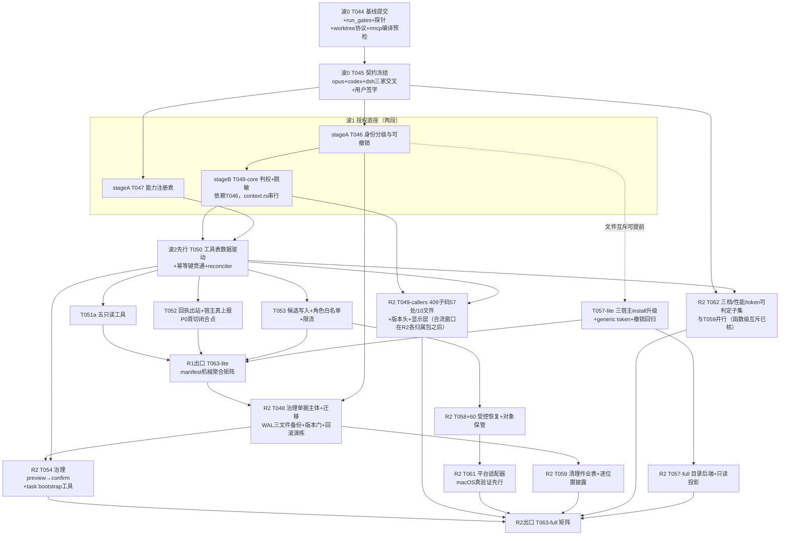

# Agent 接口开发与第一期收尾 · 统一实施计划

2026-11-23。本版是四轮多智能体交叉评审后的统一版，整份取代 v1。主线：把 `bmem mcp` 从「2 个只读工具」扩成完整 agent 接口，并顺带闭合第一期 P0 首切验收。副线：第一期收尾项按依赖分轮交付。协议选型已定 **MCP**，判断依据、被推翻的说法与规格代际影响见[协议选型说明](protocol-choice.md)（其 §5 五条已折叠进本计划 §六）。逐条对账见 [REVIEW-DECISIONS.md](REVIEW-DECISIONS.md)，包级台账见 [tasks.md](tasks.md)。

交付形状：**同一战役、两轮出口**。R1＝P0 首切＋最小可用 agent 接口（MVP 子集）；R2＝一期全量闭合＋治理面。能力面设计仍全量冻结，只分期暴露工具与验收出口，不推翻任何冻结决定。

## 一、范围与已冻结决定

| 决定 | 内容 | 来源 |
|---|---|---|
| 协议 | MCP（rmcp 3.11，stdio 先行）。ACP 三重名中两个已归档/并入 A2A，剩下的无通用调用面 | 用户冻结；protocol-choice §一/三 |
| 能力面 | 全量：读（检索/补读/当前声明/接手卡/台账）＋回执上报＋写入＋治理动作。四元表在 T045 冻结全部动作并加 `release_round` 列（R1/R2/conditional）；未上线动作登记 `available=false`＋`reason`（[extension-contract.md:20](../../docs/v2/technical/extension-contract.md#L20) 既有语义，已核） | 用户 2026-11-23 |
| 写入信任语义 | **agent 写入只进候选/观察层**，不直接成为当前有效声明；生效仍需所有者确认或后台提炼仲裁。不复用 owner-only 的 `POST /v2/statements`（[server.rs:518-519](../../src/v2/bmem/src/server.rs#L518-L519)，已核），另走 `candidate.submit` | 用户 2026-11-23 |
| 访问边界 | **只允许本机**。服务只 bind 回环（[server.rs:78](../../src/v2/bmem/src/server.rs#L78) `Ipv4Addr::LOCALHOST`，已核）、Host 头精确匹配（[server.rs:145-152](../../src/v2/bmem/src/server.rs#L145-L152)，在 fallback 内，已核）与 `X-Bmem-Instance` 核对。远程与跨机不做 | 用户 2026-11-23 |
| 接入方式 | 已知工具写 MCP 配置；未知工具用 generic token 出 stdio 启动行。凭据走文件交付（§八.2） | 用户 2026-11-23 |
| 主线顺序 | 先 MCP 接口，第一期验收顺带闭合；执行为 R1/R2 两个验收出口（任务指令已采纳 scope 车道结论） | 用户 2026-11-23 |
| 开发方式 | 多智能体并发开发；真实执行体名册见 §四 | 用户 2026-11-23 |

**新契约：角色白名单由服务端执行。** 现状核实：`actor_kind` 完全由调用方正文给出、只做枚举校验（[ingestion.rs:1149-1152](../../src/v2/bmem/src/ingestion.rs#L1149-L1152)，已核）；[ingestion.rs:77-78](../../src/v2/bmem/src/ingestion.rs#L77-L78) 注释声称的防线只覆盖「正文角色词」，不存在可供覆盖的「已认证 actor_kind」。因此冻结：`actor_kind` 由已认证身份推导，正文不得指定；`agent_writer` 提交 `user_message` → 403 且 `ing_event_versions`/`ing_jobs`/`authority_observations` 三表零增量；来源 categories 逐事件执行，越类别 403 整页回滚。这是 T053 的新增交付，不是既有防线。

本轮要修的四个既有事实（均已打开核对）：

1. **P0 首切装入凭证在产品路径上拿不到。** receipts/outcomes 路由全仓唯一调用者是合成客户端（[test_integration.py:506](../../tests/v2/test_integration.py#L506)、[:533](../../tests/v2/test_integration.py#L533)）；宿主适配器只调 `/v2/context/load`（[main.rs:1190](../../src/v2/bmem/src/main.rs#L1190)）；[native_hosts.py:525](../../tests/v2/native_hosts.py#L525) 反向断言 `loaded/used` 必须为 `unknown`。
2. **授权底座是二元不是分级。** bound 客户端永远只拿 `search`（[server.rs:1021-1040](../../src/v2/bmem/src/server.rs#L1021-L1040)，全仓仅 7 个 command_id，已核）；`governance_operations` 仅 4 列、`request_key` 全局 UNIQUE（[retrieval.rs:26-28](../../src/v2/bmem/src/retrieval.rs#L26-L28)，已核）；token 不可轮换、不可解绑（[context.rs:249](../../src/v2/bmem/src/context.rs#L249) bind 查询无 revoked_at/credential_version，已核）。
3. **MCP 写工具幂等键悬空。** 桥转发 key=None（[host.rs:122](../../src/v2/bmem/src/host.rs#L122) 末参 `None`，已核），client 不发 Idempotency-Key（[client.rs:59-61](../../src/v2/bmem/src/client.rs#L59-L61)，已核）；所有写路由走 `key(headers)?`，直接接成 MCP 工具必 422。T050 交付贯通。
4. **409 子码被消息前缀压扁。** `Error::conflict(` 全仓 **64 处 / 11 文件**（本人 rg 复核：platform 21、ingestion 11、integrations 9、context 7、history_tasks 5、server 4、vector 2、settings 2、retrieval 1、main 1、client 1）；[error.rs:27-37](../../src/v2/bmem/src/error.rs#L27-L37) 把非 key_conflict/cursor_mismatch 一律压成 `revision_changed`。T049 拆 core/callers 两阶段改造（§二）。

## 二、轮次与波次

### MVP 子集（R1，11 个台账项）

**T044、T045、T046、T047、T049-core、T050、T051a、T052、T053、T057-lite、T063-lite**。编号沿用 T044–T063，不新造体系。R1 出口即宣布 P0 首切闭合＋最小 agent 接口可用；其余包标注 R2 或条件包。

### 依赖图（统一版最终结构）

条件包 **T051b**（resources/prompts）与 **T056**（Streamable HTTP）默认不开工，门槛见 §六/§八；T064 本轮砍掉。图中不画。

### 关键路径与排期

- **R1 关键路径：T044 → T045 → T046 → T049-core → T050 → T052 → T063-lite。** 裁判原表述（T047 支线、T048 在链上）均被完整性批评者证伪后按两轮结构重算：T048 移 R2 后治理迁移不再压 P0 闭合路径；T049-core 依赖 T046（context.rs 串行）且在 W1 整体闸门内。若 T047 实测工期超过 T046+T049-core，关键路径改走 T047 支线，ASM 按探针排期调整。
- **T052 完成即 P0 第一步「已提供/已装入」闭合**：真实宿主＋真实模型同一次运行的 loaded 回执与 wire 捕获互证。「已采用/独立结果」仅在 real_local_model 输出断言通过时闭合，否则 T063 对应子步标 partial，不得宣称第一步完成。证据唯一来源 `tests/v2/artifacts/native_receipts.json`。
- 排期（沿第三轮工作量估计按两轮调整）：R1 约 6–8 天（W0 约 1 天、W1 约 2 天、W2 约 3–4 天含 T052 M-L 预算、出口约 0.5–1 天）；R2 约 4–6 天（T048 工期 +50% 迁移演练；长尾依赖驱动并行）；合计约 10–14 天。单实现者下名义并行不缩短日历时间，ASM 串行合流是真实瓶颈，按负载动态调整。

### 出口判据（全部机器可判定）

| 出口 | 判据 |
|---|---|
| R1 | ① `run_gates.py --profile assembly` all_pass=true；② native_receipts.json 两款宿主 real_local_model `loaded_state==observed` 且与 wire 捕获互证、至少一款 `used_evidence_kind=model_output_assertion`、outcome 由 verifier≠attempt 主体上报；③ candidate.submit 角色白名单/限流/撤销负对照红先绿后成对 run id；④ T063-lite 矩阵 P0 第一步子步 1–7 verdict=evidence，第二步子步 evidence 或 partial＋命名缺口；⑤ generic token 接入一个自研 stdio 客户端走通 initialize→tools/list→candidate.submit |
| R2 | [acceptance.md:50](../../docs/v2/product/acceptance.md#L50) P0 首发集合（声明切片、真实基础提炼接手、A01–A08、A12）矩阵全 evidence，或用户签字的 partial/blocked_external 缺口行；三平台/签名/飞书各有命名材料门槛（§七） |

## 三、并发纪律

1. **一包一 worktree，命名与清理协议固定。** 路径 `<repo>/.worktrees/T<NNN>-<slug>`（gitignore 条 `.worktrees/`），不放 /private/tmp（避免 OS 清理；现存 6 个陈旧 worktree 实测约 4.5 GiB，本人 os.walk 复核）。创建时写 `.worktrees/<pkg>.meta`（pkg_id/created_at/executor/base_commit）。T044 交付 `scripts/cleanup_worktrees.py`：超 7 天或对应包已合流即 `git worktree remove`，写 `artifacts/worktree_cleanup.json`；run_gates 步 0 dry-run 报告、步 13 apply。每波合流前 ASM 确认 `.worktrees/` 只有当前波次的包。每 worktree 构建产物上限 5 GB，超出即 FAIL 并清理。
2. **CARGO_TARGET_DIR 与 --jobs 数学。** `CARGO_TARGET_DIR=<worktree>/target-<pkg>`（gitignore），`~/.cargo` 只读共享。并发 cargo 进程上限 2（与在途实现 worktree ≤2 同口径），每进程显式 `--jobs 2`（全局 `CARGO_BUILD_JOBS=2`，2×2=4 线程，10 核留 6 核给系统/门禁）；loadavg>8（建议阈值，ASM 按实测调整）即降 `--jobs 1`；run_gates 启动 cargo 显式传 `--jobs 2`。**同时在途实现 worktree ≤2**（一实现一复核或双实现交叉 codex 复核）；DSH 只做固化模板填空与装配树复跑；codex 只读复核全程并行。构建类任务不与门禁同波次。
3. **热点文件走装配补丁，形式定义固定。** 热点：`server.rs` 路由/dispatch、`main.rs` 子命令枚举、`index.html` 导航、`intake.js`，以及门禁文件 `test_native_hosts.py`（T044 重构后归 T052 独占）、`test_integration.py` 台账计数段（:544-553，归 T052）、`browser_smoke.cjs`（唯一浏览器入口，禁逐文件直跑）；`browser_integrations.cjs` 扩展归 T057。每包交付 `patches/<pkg>.json`，schema 由 T045 冻结（字段：file_path、function_scope、route_additions[{method,path,handler,capability_bits}]、middleware_stack[{layer,order}]、enum_variants、match_arms）。T044 交付 `scripts/apply_patch.py`：按 file_path 分组→同文件按轮次/波次排序→逐文件 dry-run（git apply --check 形态）→冲突即 FAIL 并输出冲突行→无冲突则 apply→写 `artifacts/patches_applied.json`（pkg/file/line_range/commit_before/commit_after）。ASM 合流只运行 `apply_patch.py --wave <N>`，不手工编辑热点。热点文件的补丁由该波次最后一个包交付 reconciler 函数（T050 交付 `reconcile_routes()` 消费所有 route_additions），禁止多包直接改同一 match 块。
4. **函数级互斥与越界检测。** 同文件不同函数段视为互斥文件，包定义必须列函数级范围：platform.rs objects 保管段归 T058+60、适配器段归 T061；retrieval.rs 治理段归 T048/T059、Zstd 段归 T062（两段无共享函数/表，本人核对 :12/:88-92/:161-165/:229 对 :26-28/:573-706）；context.rs 判权/注册段归 T046、台账计数段归 T052、token 段归 T062。跨段变更一律走装配补丁。run_gates 步 12 用脚本对账各包声明文件集与实际 `git diff --name-only`（含 untracked）交集，非空即阻断；另断言 `Error::conflict(` 计数不增（T049-callers 合流后归零）。
5. **每包验收四件套**（详见 tasks.md 通用模板）：可执行入口＋机器断言＋工件路径（`tests/v2/artifacts/<pkg>.json`，含装配树 commit＋二进制 sha256＋run_id）＋负对照变异点红绿成对。无工件＝未完成；只认装配树真跑，不接受工作包自报。
6. **台账与 validation 由 ASM 统一维护**，worker 不得改 `tasks.md`/`validation.md`。不推送任何远端；不触碰真实 `~/.bmem`，实例测试一律 mkdtemp 隔离根。
7. **门禁独立复跑**：T044 探针 `codex exec --sandbox workspace-write`（限装配 worktree，可写面仅 target-gate/ 与 tests/v2/artifacts/）。通过则每波门禁由 codex 复跑一次并比对 gates.json；失败则降级为 codex 只读机械核验（gates.json schema 校验＋shasum -c＋AST 用例计数＋二进制 sha256 比对），并在 validation.md 显式记录「门禁复跑局限：实现者同会话自证＋跨族只读核验」，不得静默等同独立复跑。

## 四、执行体与模型选型

可用性基线（2026-11-23 委托方实测，protocol-choice §6；T044 复探留档后才用于派工）：

| 执行体 | 版本/用法 | 状态 |
|---|---|---|
| CC＝本机 Claude Code | `claude 2.1.308`，worktree cwd＋探针确认路由（Sonnet 档探针失败回落本会话主模型并留档） | 可用 |
| CX＝codex-cli | `codex exec --sandbox read-only --skip-git-repo-check`（默认模型第三轮外部评审实跑通过，产物 /tmp/cx_stdout.txt 本人核验；`-m gpt-5.5` 须探针）；workspace-write 须探针 | 可用（只读已证） |
| DSH＝DeepSeek Harness | `dsh headless --permission-mode read-only\|workspace-write [--add-dir <worktree>] - < prompt`；profile 固定 deepseek-v4.1-flash-economy、reasoningEffort off、maxTokens 8192；**无 --sandbox 参数**（v1 通用约束系别家 CLI 参数，删除） | 可用（read-only 实跑完成一份真实评审，/tmp/dsh_out.txt 本人核验；写预置须探针，失败由 CC 代写） |
| SUB-opus / SUB-sonnet | 会话内 Claude 子代理，仅 opus、sonnet 两档可用 | 可用 |
| ASM＝装配者 | 本会话单点串行写＋CX 只读复核；read-only codex 不得承担装配写 | — |

**不可用（本轮实测证据）**：`agy 1.5.15` 账号地区资格被拒（/tmp/agy_err.txt 本人核验原文 "not currently available in your location"），标等待账号恢复本轮不派包；`gemini` CLI 已 EOL；opencodex 路由 `gpt-5.6-sol/terra/luna`、`gpt-5.5`、`gpt-5.4-mini` 与 `fable` 档全部 Model not exist（protocol-choice §6＋第三轮实测）。v1 凡指派 AGY / SUB-sol / SUB-terra / SUB-luna / SUB-mini / ocx-* 的包全部重派；旧 SUB 名作废。

**隐私复核闸门（改写）**：授权/身份/治理语义类包（T045、T046、T048、T049-core、T053、T054）必须 **claude-opus（SUB-opus）＋外部 codex（CX 只读）＋dsh（DSH 只读）三家独立结论一致**才合流；起草者与复核者跨族（A≠B），同模型两实例不算两份独立复核。实现集中于 CC 后，跨族反审为硬性兜底。

每包派工登记五列，缺一列不派工：**执行体、确切模型（只写探针通过的路由名）、读写模式、互斥文件（函数级）、备用人选**。分工：

| 任务类型 | 执行体 | 说明 |
|---|---|---|
| 契约与语义起草（T045、T049-core 语义） | SUB-opus 起草＋CX/DSH 对抗复核 | 三家交叉闸门 |
| Rust 实现（T046/T048/T050/T051/T052/T053/T054/T058+60/T059/T061/T049-callers 及 T057 Rust 半） | CC worktree 实现，CX 只读复核（隐私类加 DSH/SUB-opus） | 严格 TDD＋互斥文件 |
| 描述符与 schema（T047） | 脚本从 command-catalog P0 三表生成骨架＋CC 接线＋CX 审 schema 语义 | 条目数以脚本输出为准，不写死 |
| Web（T057、T063 界面复核） | CC | 沿 [intake.js:117-125](../../src/v2/web/intake.js#L117-L125)/[:243-253](../../src/v2/web/intake.js#L243-L253) 与 server.rs:666-676/704-712 既有 integrations 模式扩展（已核） |
| 驱动脚本（T052/T062） | CC 编写，DSH 只在固化模板上填空与装配树复跑 | 装配者真跑一次，不接受脚本自报 |
| 装配/合流/门禁/台账（T044/T063） | ASM 单点串行写＋CX 只读复核 | 杜绝并发写热点 |

启动模板按 CLI 分列：claude＝worktree cwd＋探针确认模型；codex＝`codex exec --sandbox read-only --skip-git-repo-check [-m 探针通过模型]`；dsh＝`dsh headless --permission-mode <preset> [--add-dir <worktree>] - < prompt`。T044 对每模板跑 PONG 级探针留档路由/模型/模式/耗时（`artifacts/executors.json`），每波合流复探，波中失效即切备用人选并记台账。严禁把仓库内容、本机路径、内网信息写进任何外部请求。

## 五、门禁

载体：`tests/v2/run_gates.py`（T044 交付；文件名不匹配 test*.py 以免被 discover 吸入）。固定 `--manifest-path src/v2/bmem/Cargo.toml` 与装配专用 `--target-dir target-gate`（gitignore）。每步写 `artifacts/gates.json{step,command,exit,duration_ms,stdout_tail}`。

**冷跑策略**：每波合流门禁开始执行 `cargo clean -p bmem --target-dir target-gate`（只清 bmem 产物、保留依赖缓存；步骤顺序保证 clean 在 clippy/build 之前，二进制随后重链，不存在「clean 删二进制而 test 不重链」问题）。全量 `cargo clean --target-dir target-gate` 仅限三种情形：R1/R2 出口门禁、任何 Cargo.toml/Cargo.lock 变更、run_gates.py 自身变更。

| 步 | 内容 | 判定 |
|---|---|---|
| 0 | cleanup_worktrees.py --dry-run | 报告陈旧 worktree |
| 1 | cargo fmt --check | exit 0 |
| 2 | clean -p bmem → clippy --locked --all-targets --no-deps -- -D warnings | 输出必须含「Checking bmem」（冷目录结构性保证新鲜） |
| 3 | cargo build --locked（位于 clean 之后、test 之前） | 记录二进制绝对路径＋sha256＋mtime；`find src/v2/bmem/src src/v2/web -newer <binary>` 必须为空（web 资源 include_str! 内嵌，陈旧二进制会测旧 UI） |
| 4 | cargo test --locked | 解析「N passed; 0 failed; 0 ignored」写工件；ASM 对各包申报新增数核对增量 |
| 5 | 基线 discover：BMEM_V2_TEST_BIN=<本次构建> python3 -m unittest discover -s tests/v2 -v | testsRun==脚本按 ast 对全部 test_*.py 的 def test_ 求和（防静默零收集）；**skip 集合==按平台/环境计算的期望集，任何意外 skip 即 FAIL**；收集名单必须含 test_native_hosts 且用例数>0 |
| 6 | 全证据 discover（assembly 必选）：先 GET 127.0.0.1:11434/api/tags 确认 qwen3:4b-instruct-2507-q4_K_M 在位，记录 claude/codex 实际版本并与钉住矩阵（claude 2.1.308/codex-cli 0.171.0）核对 | 模型缺失或版本不符→该步 BLOCKED（ASM 复验后更新矩阵，不得静默 SKIP）；随后 BMEM_V2_TEST_REAL_MODEL=… BMEM_V2_TEST_NATIVE_HOSTS=1 重跑 discover，timeout 900s，**断言 skipped==0（任何 skip 即失败）**；宿主版本/模型名/二进制 sha 写同一 gates.json |
| 7 | 浏览器唯一入口：解析 BMEM_V2_PLAYWRIGHT_MODULE，node tests/v2/browser_smoke.cjs（已 require 全部 6 子模块并传播失败，本人核对 :72-81/:160；禁逐文件直跑） | 缺 playwright/chromium→generic 档 browser_mode=syntax_only 降 WARN；assembly 档含 Web 改动时必选 PASS |
| 8 | node --check 全部 src/v2/web/*.js 与 tests/v2/*.cjs | exit 0 |
| 9 | git diff --check | exit 0 |
| 10 | shasum -a 256 -c docs/v2/reviews/technical/current.sha256（21 项，本人核对） | **对已提交基线校验**；改技术文档的包必须在同一受审 diff 携带基线更新（重算脚本输出作 diff 附件），漂移即 FAIL；禁门禁现场重算再校验（恒真步骤） |
| 11 | 执行体探针 | artifacts/executors.json |
| 12 | 文件边界对账：各包声明文件集（函数级）vs git diff --name-only＋untracked | 越界即 FAIL；Error::conflict( 计数不增 |
| 13 | cleanup_worktrees.py --apply | artifacts/worktree_cleanup.json |

汇总 `all_pass` 仅当无 FAIL/BLOCKED 且必选步（6，及涉 Web 改动时的 7）全 PASS。「任何 skip 即失败」在 assembly 档兑现为步 6 skipped==0＋步 5 期望 skip 集精确相等；[CONTRIBUTING.md:55](../../CONTRIBUTING.md#L55) 的真实模型 opt-in 安全跳过政策只适用于未配置模型的开发本地跑，不适用于 assembly 门禁。另写 `artifacts/validation_numbers.json` 供 validation.md 脚本注入，禁手填；gates.json 带 `p0_evidence_complete` 供 T052/T063 引用。

**负对照必须先能红**：每包负对照按变异法点名实码破坏点（见 tasks.md 通用模板），对基线二进制先跑红、修复后跑绿，红/绿 run id 成对写工件。T052 的翻转 observed 断言必须先对 T044 基线二进制跑红。

## 六、MCP 规格代际影响（protocol-choice §5 折叠）

rmcp 3.11 协议版本上限 2025-11-25（legacy era）；MCP 现行稳定版 2026-07-28 已移除握手与协议会话。五条规格影响落进计划：

1. **era 姿态声明进 T045**：显式声明 bmem 是 legacy-era server（≤2025-11-25）；`server/discover`、`_meta` 强制头（protocolVersion/clientCapabilities）属新 era 要求，本期不实现；升级判据＝rmcp 支持 2026-07-28 且四级 Tier-1 SDK 到位后再评估 dual-era。Legacy client × modern-only server 会 Fails，本期不追新即天然兼容现网客户端。
2. **无状态 preview→confirm 用服务端自铸句柄（T054）**：跨调用状态只能以服务端自铸句柄（preview_id）作普通 tool 参数传递；保持「显式两个工具＋句柄参数」，不得改成协议会话态。理由同时来自规格与撤销语义（撤销要下一请求生效）。`delivery_id`/`handle`/`backup_id` 同为自铸句柄，天然符合。
3. **两种 list_changed 路径进 T050 契约**：现 era `notifications/tools/list_changed`；新 era `subscriptions/listen`＋`notifications/subscriptions/acknowledged`（进程重启后客户端须重新订阅）。契约同时写明两种，本期实现现 era，避免升级时改公开语义。
4. **T056 降级为待拍板（§八.7）**：stdio 覆盖 100% 已验证本机客户端（[integrations.rs:251-253](../../src/v2/bmem/src/integrations.rs#L251-L253) 三宿主 install 全写 stdio 配置，已核）；HTTP 传输对「只允许本机」的唯一实际收益（不支持 stdio 的自研 agent 也能连）可由已有 `/v2` HTTP API＋generic token 替代取得（写面需 T053 条件路由，见下）。是否保留 T056 交用户拍板；默认本轮不做。
5. **依赖预检进 T044**：启用 `transport-streamable-http-server` 需联网拉 sse-stream/tokio-stream 等（本地 registry 无缓存，research-brief 简报 2 已核源码未核编译）。T044 在**独立一次性 worktree** 做时间盒 ≤4h 的编译 spike（启用 feature＋nest_service＋authenticate middleware＋initialize 冒烟），结果写 `artifacts/rmcp_spike.json{attempt,duration_ms,exit,blocker}`，供 T045 签字时拍板 T056；主线 Cargo.toml/Cargo.lock R1 不改，零新增网络依赖。spike 失败→退路 A（独立 127.0.0.1 hyper 监听）同样 ≤4h 时间盒；皆失败维持 stdio 并记 named gap。

配套约束：计划不得出现依赖 sampling/roots 的设计（SEP-2577 已 Deprecated）；`input_required` 记为升级后替换项，不进本期关键路径；T056 若将来上线，文档必须明写「非规范的本机自建鉴权、不实现 RFC 9728、不透传任何令牌」并登记决策记录；`/mcp` 挂载必须位于复用 authenticate() 全套的 middleware 之后（Host 检查在 fallback 内，nest_service 会绕过，[server.rs:101](../../src/v2/bmem/src/server.rs#L101)/[:145-152](../../src/v2/bmem/src/server.rs#L145-L152) 已核），禁静态 Client、逐请求重鉴权。退路 B 时点悖论消解：若用户在 T045 签字时选择「自研 agent 走 HTTP 直连」，T053 同包交付 `/v2/agent/candidates` 路由（装配补丁，共用 agent_intake 入口、同一角色白名单与限流）——触发决定前移到 T045，早于 T053 实施；不得复用 owner-only statements，也不得把裸 `/v2/events` 当 agent 写面。

## 七、风险与退路

| 风险 | 判断（核实依据） | 退路 |
|---|---|---|
| T052 real_local_model 证据链是 P0 闭合单点 | 高；tee 代理要同时伺候两款真实宿主协议细节（claude 经 ANTHROPIC_BASE_URL 的流式/count_tokens；codex wire_api=chat 对 ollama，[native_hosts.py:248](../../tests/v2/native_hosts.py#L248) 现为 responses 需改，已核）。前置条件第三轮已核成立（11434 模型在位、宿主版本与钉住矩阵一致） | M-L 预算预留；卡住则 P0 第一步停 partial、T063 与首发顺延，不得为赶出口把夹具证据冒充真实证据 |
| 治理迁移×授权重构×错误语义在活数据上叠加 | 高；库是 WAL（[server.rs:43](../../src/v2/bmem/src/server.rs#L43)，已核）。**迁移前备份＝停服（service.lock 排他，[platform.rs:523-525](../../src/v2/bmem/src/platform.rs#L523-L525)）→复制 database.db＋-wal＋-shm 三文件→sqlite3 PRAGMA integrity_check 必须 ok**。archive::backup() 不得当回滚点：它在副本里 unbind 全部客户端（[archive.rs:51](../../src/v2/bmem/src/archive.rs#L51) 调 unbind，[:329](../../src/v2/bmem/src/archive.rs#L329) UPDATE token_hash='unbound:'，已核）且受 check_objects 门控（:258-263） | T048 移 R2，移出 P0 闭合路径；事务内四步重建、失败自动回滚；加 PRAGMA user_version 版本门防旧二进制回滚跨主体误回放（[retrieval.rs:573](../../src/v2/bmem/src/retrieval.rs#L573)/[:695](../../src/v2/bmem/src/retrieval.rs#L695) 单键回放，已核）；恢复执行器 T058+60 在 R2 交付前，回滚为停服换文件手工规程，**T048 验收必须演练一次**（种旧数据→迁移→模拟失败→从备份恢复→断言完整）；不做双写过渡 |
| 单会话装配＋门禁自证 | 高；ASM 与 CC 同为本会话，约 9 包装补丁串行汇入一个写者；T046/T047/T050 语义补丁改同一 match 块 | reconciler 函数＋apply_patch dry-run 冲突即 FAIL；codex workspace-write 探针复跑门禁，失败则只读机械核验＋显式记录局限（§三.7） |
| 正文注入诱导写入候选 | 真实存在；现有防线仅覆盖正文角色词（ingestion.rs:77-78 注释语义），结构化 actor_kind 由正文给出只做枚举校验（:1149-1152，已核） | 角色白名单＋来源 categories 逐事件执行是 T053 新增交付；保留 span 门控；候选默认不生效；每主体速率/字节阈值＋429 |
| rmcp 挂载与 axum 0.8.9/tower 0.5.3 边界未编译验证 | 中；feature 存在与 API 形状已对源码核实，编译未验证 | T044 编译 spike 前移（§六.5）；退路 A 独立 hyper 监听；皆失败维持 stdio 记 named gap |
| 宿主版本漂移 | 真实；[004 validation.md:12](../004-bmem-v2/validation.md#L12) 记录当时 Codex 0.167.0，现钉住 0.171.0 | 步 6 钉住矩阵核对，不符 BLOCKED，ASM 复验后更新矩阵 |
| 门禁 runner 自身失效或环境缺失 | 中 | BLOCKED 语义不得静默 SKIP；T044 首次完整 assembly 门禁预留调试预算 |
| Cargo.lock 与指纹基线漂移 | 中 | 步 10 对已提交基线校验；改文档包同 diff 携带基线更新 |
| 执行体路由波中失效、实现集中 CC | 中；agy/gemini/ocx 系已不可用 | 五列派工＋备用人选＋每波复探；跨族反审硬兜底 |
| 签名/三平台真机/飞书租户外部材料 | 无法本机闭合；delivery-plan.md:17「三平台发行与配置贯穿 P0」（已核） | 全部改 blocked_external＋owner=user＋材料清单：macOS Developer ID＋notarytool 凭据；Windows Authenticode＋signtool；发行渠道定义；Linux/Windows 真机命名登记；飞书真实租户登录态＋样本消息。T061 真验证只限本机 macOS launchd，systemd/schtasks 代码＋fixture（verdict 上限 partial）。首发口径交用户拍板（§八.6） |
| 本机并发构建资源争用 | 中；10 核，陈旧 worktree 实测约 4.5 GiB | §三.2 jobs 数学＋5GB 上限＋清理协议 |

## 八、已锁定决定（合并四轮 11 项；2026-11-24 用户「全部按建议默认锁版」）

下面每条的「建议默认」即为**生效值**。后续要改某项，须在本节登记变更内容、日期与受影响包号，不要另开决策清单。

1. **速率阈值默认数字**：建议 60 事件/分钟、1 MiB/分钟；「并发 4」重定义为 HTTP 层每主体同时在途请求上限或删除该数字。limits 结构 (client_id, window_start, events, bytes, updated_at)、60s 滑动窗、retry-after 必带、429→MCP isError/retriable 映射、重放是否计费、在途释放时机随 T045 冻结。经既有 settings 机制可调、不做新 Web 控件（坚持做控件须同包分配设置字段/持久化/重启回读用例）。影响 T045/T053。
2. **generic token 交付方式**：建议文件交付——`bmem connector token` 只输出 client_id＋stdio 启动行，凭据由 CLI 写 `run/clients/<id>.json`（0600、atomic，复用 [integrations.rs:281](../../src/v2/bmem/src/integrations.rs#L281) 形态，已核）；stdout/启动参数/宿主配置明文均不含 token 值。若坚持 stdout 展示，必须为 `token=<value>` 单行（命中 [authority.rs:70](../../src/v2/bmem/src/authority.rs#L70) 脱敏模式，已核）并明示该值会进入宿主转录、可能被 history.import 回灌成可检索记忆。影响 T057。
3. **T064 本轮砍掉**：建议砍（SUB-luna 不可用、DSH 占用关键路径、rmcp client 需 reqwest 0.13 新 major 而本仓 0.12，[Cargo.toml:14](../../src/v2/bmem/Cargo.toml#L14) 已核）。Hermes/OpenClaw/第三方 MCP 试点保留为 [004 validation.md:111](../004-bmem-v2/validation.md#L111) 已知缺口，下一轮凭真实宿主材料再开。
4. **并发规模与 jobs 数学**：建议在途实现 worktree ≤2、并发 cargo 进程 ≤2、每进程 --jobs 2（2×2=4 线程，10 核留 6 核给系统/门禁）、loadavg>8 降 1（建议阈值，ASM 按实测调整），ASM 按负载动态调整（允许波内调整）。影响全部波次排期。
5. **三项隐私语义（T045 签字时一并确认）**：(a) history.import 对 agent 采「请求单＋所有者 preview→confirm」（建议默认，保住能力面全量可调用，与「历史导入由用户主动勾选发起」偏好一致）还是完全 owner-only；(b) agent intake 来源默认无 extract 授权、仅 loopback 模型目的地，远端需逐来源显式授权（建议采纳）；(c) Browser 取读法 (a)：保留 owner-console 全量动作，仅把隐式代理判定显式化；「不得签发 client 凭据」收窄为裸 `POST /v2/clients`（[server.rs:542-543](../../src/v2/bmem/src/server.rs#L542-L543) owner-only，已核）并显式豁免 integrations install 路径（否则 T057 浏览器安装流程死，完整性批评者已证实）。影响 T045/T046/T054/T057。
6. **P0 首发宣布口径**：建议默认＝macOS 无签名本机安装真验证通过＋Linux/Windows 适配器代码就绪（fixture partial）＋签名/真机/飞书 blocked_external 单列，即可宣布 P0 首发（无签名本机安装属开发者分发，非公开渠道发行）；若要求三平台真机＋签名才可宣布，T061 升级为 R2 出口硬门槛并把外部材料等待计入排期。影响 T061/T063-full/排期。
7. **条件包 T051b/T056 与 HTTP 直连**：建议默认不开工。T051b 门槛＝出现已命名 resources-only 真实客户端（登记名称/版本/连接失败实测）或所有者签字需求；T056 是否保留交用户拍板（protocol-choice §5.4），门槛＝已命名 HTTP-only 客户端＋≤4h spike 通过。若用户选择自研 agent 走 HTTP 直连，T053 条件路由 `/v2/agent/candidates` 在 T045 签字时触发。影响 R2 范围与 T053。
8. **T062 推迟项**：建议接受——p99/CPU/内存/解码读放大全量 profile、三系统对比、10 万/100 万语料、真实任务准确率配对 lab 列为首发后缺口与紧凑模式启用门槛（[compression-and-performance.md:3](../../docs/v2/technical/compression-and-performance.md#L3) 保真回退已冻结、acceptance.md:31 配对比较属 P1，已核），不阻塞首发。影响 T062。
9. **T048 回滚手工规程**：建议接受停服换文件手工规程＋验收演练（depgraph-6），不把 T058+60 的 can_apply/restore 能力前移进 T048（前移会把 archive.rs/platform.rs objects 段拉进 R1，破坏 MVP 互斥）；R2 内 T048 与恢复执行器交付之间的窗口局限记入台账。影响 T048/T058+60。

10. **MCP 写工具幂等键来源（T045 签字时一并确认）**：建议默认＝调用方 `idempotency_key` 入参优先、缺省由桥派生 UUID、confirm 类键派生自 preview_id（复用 [main.rs:1038](../../src/v2/bmem/src/main.rs#L1038) grant-confirm-{preview_id} 形态，已核）；server.rs 写路由 `key(headers)?` 形态不改，由桥保证必有值（现状 [host.rs:122](../../src/v2/bmem/src/host.rs#L122) 转发 key=None，已核）。对应 T045 冻结条文 (6) 与 T050 幂等键贯通；不确认则 T053/T054 写工具必 422。影响 T045/T050/T053/T054。（R4-merge 对齐补入，见 REVIEW-DECISIONS §E。）
11. **task bootstrap 交付方式二选一（T045 签字时定死）**：建议默认＝T054 同包交付 task.create/attempt.start MCP 工具（HTTP 侧 POST /v2/tasks 已存在 [server.rs:598](../../src/v2/bmem/src/server.rs#L598)、manage_tasks 门控 context.rs:370，已核，桥接即可）；备选＝明示 bootstrap 仅 owner/HTTP 并改写 grant.change 前置为「task_id∈调用者创建任务∪所有者预授权任务集」。不定死则 stdio-only agent 永远满足不了 grant.change 前置，task_delivery 写路径自锁。对应 T045 冻结条文 (11) 与 T054。影响 T045/T054。（R4-merge 对齐补入，见 REVIEW-DECISIONS §E。）

已吸收不再单列：两轮拆分（任务指令已采纳 MVP 子集）；装配补丁形式定义（任务指令要求，depgraph-2 落地）；T049-callers 与 T050 同波 server.rs 冲突（callers 移 R2 后合流窗口＋apply_patch 串行消解）。
