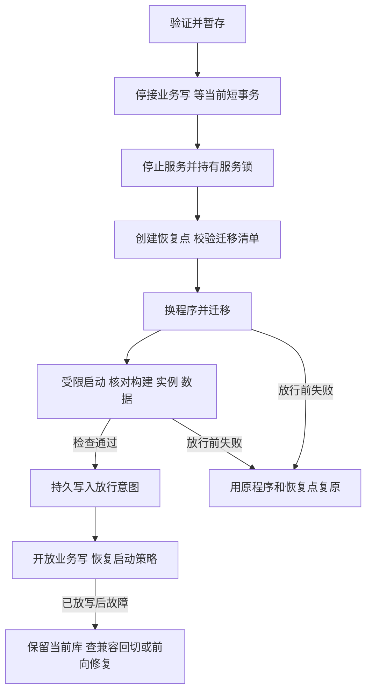

# 技术设计 · bmem 发布与升级

日期 2026-11-27 · [需求与验收](spec.md) · [实施台账](tasks.md) · [来源与选型](research.md)

## 架构

一次构建交付 CLI、常驻服务、内嵌工作台、Hook 和 MCP。**成功标准是每个入口运行预期构建并访问原实例。** 当前代码版本号为 0.2.0，`service stop` 返回的是停止请求，健康响应主要报告版本。升级需要新增构建身份、阶段状态和放行检查。[CLI](../../src/v2/bmem/src/main.rs) · [服务](../../src/v2/bmem/src/server.rs)

| 模块 | 所有权及插点 |
|---|---|
| 发布工作流与清单 | `.github/workflows/` 构建、测试、打包、发布分权限；`scripts/release/` 生成提交、构建、签名和平台证据 |
| 安装和更新 | `src/v2/bmem/src/update/` 处理 TUF、目标选择、单安装锁、更新账本与平台切换。由 `main.rs` 在通用 `client::start` 分支前进入，专用启动器及更新器同源复用 |
| 运行态协调 | `platform.rs` 保持既有数据根的 `service.lock`；`client.rs`、`server.rs`、`host.rs`、启动器检查维护状态。维护围栏阻止业务 CLI/Hook 自启和服务管理器重启旧版 |
| 同实例恢复 | 复用 SQLite Backup 原语，专用恢复点保留完整权威库、设置库和已登记的迁移目标。拆分 `server::database` 的迁移、预检、发布服务与 worker 启动。校验并最后提交兼容标记 |
| 宿主 | `integrations.rs` 既有登记范围内核对并修复路径，保留 client、授权和原生配置中的其他内容。长驻 stdio 清点并重连，Web 刷新确认嵌入资源构建 |

## 正式发布

| 阶段 | 可重复流程和门槛 |
|---|---|
| 候选 | 从审核过的完整提交取干净 checkout，检查 Cargo 版本、锁文件、发布说明，生成 `vX.Y.Z` 对应构建身份。Bump 后才开始签名，示例 `v0.3.0` |
| 构建 | 固定 Rust 与构建依赖，用 `cargo build --release --locked` 构建生产制品。记录 commit、版本、目标三元组、构建 ID、ABI 和最终哈希。测试时钟候选独立生成，用于 006 冻结回放 |
| 验证 | 六组普通用户安装、旧版接管、再升级、原生日志与故障注入。最终签名制品下载后二次验签并在目标机复测。记录停写、空间、恢复时长。沿用 006 的全部 134 条用例及现有门禁 |
| 发布 | 保护发布标签并在发布环境签名。先建草稿、提交六目标最终资产、平台说明、摘要、验证结果，再公开不可变 Release。外部读回制品并验证长度与哈希。向渠道站点添加 TUF 核验的目标目录及版本化 targets/snapshot，保留历史索引，最后发布 timestamp 指向本次完整目录 |
| 维护 | 普通缺陷用更高版本修复。撤下未适合推广的目标时重新签发更高序号渠道元数据。已有用户按当前库兼容情况执行程序回切或前向修复。到期前续签 timestamp，按 TUF 根轮替程序保留连续版本 |

| 平台 | 目标 | 首装、替换和验收 |
|---|---|---|
| macOS | `aarch64-apple-darwin`、`x86_64-apple-darwin` | Developer ID、Hardened Runtime、公证。验证最低声明 macOS、普通账号、launchd KeepAlive、现有链接、真实 Gatekeeper |
| Linux GNU | `aarch64-unknown-linux-gnu`、`x86_64-unknown-linux-gnu` | 同卷替换。用各架构原生的最低已声明 glibc 环境验证；覆盖 systemd 用户服务和前台模式 |
| Windows | `aarch64-pc-windows-msvc`、`x86_64-pc-windows-msvc` | 签名与时间戳。用户级计划任务、含空格路径和原生 ARM64 验证。更新器从不同路径运行，等待命令本身及其他 bmem EXE 释放目标，再用 `ReplaceFileW`，核对 ACL、备份及结果摘要 |

每一目标记录实际最低 OS/ABI 和验证机器，得到证据后才声明支持。有损坏或缺席的测试目标时，保持上一稳定渠道。发布及签名配置按维护者权限分离。GitHub Actions 固定步骤依赖，发布环境与签名角色使用单独权限。[GitHub 构建系统安全](https://docs.github.com/en/code-security/tutorials/implement-supply-chain-security/securing-builds)

## 旧版接管与全面替换

| 现有入口 | 接管动作 | 放行证据 |
|---|---|---|
| 旧 0.2.0 无 `update` | 从官方发布页独立验证并运行一次受管安装器，先列出入口、实际目标、安装类型、数据根和实例。用户指定哪一份后接管 | 原路径的实际文件摘要是选定制品，实例与源身份一致 |
| Shell 路径和符号链接 | 优先就地替换已明确归属的真实文件。保留受管别名；刷新 shell 查找缓存或重开终端。多份副本逐个报告，仅在明确属于同次接管时更新登记 | 重开终端后 `command -v` 或 `Get-Command -All` 与构建 ID 均可核对 |
| 登录启动及自动拉起 | 保存运行和启用状态，暂停本实例对应的 launchd、systemd 用户单元或计划任务，禁止普通客户端自启 | 恢复原运行方式，实际进程映像、实例及持锁状态一致 |
| 已安装 Hook、MCP 与 Web | 只按登记修复仍指向旧路径的配置。优先保持命令路径；已有 MCP 子进程自然退出或重连，配置原样保留；浏览器重认证并加载新资源 | 两款真实宿主重新连接后实测 Hook 与 MCP；校验服务构建和网页构建 |
| Cargo、Homebrew、APT、Scoop 等管理的安装 | 当前来源交给对应管理器。自有源码安装迁往官方受管入口需明确选择，旧位置冲突列入切换步骤 | 每个入口的所有者和命令解析结果清楚，第三方包登记可继续正常工作 |

旧版只有原生停止接口。安装器暂停登记启动器，真正停止旧服务并独占旧版也遵守的 `service.lock`，先创建并落盘前围栏恢复点，再替换已确认入口和建立新写入世代。每种受支持的旧构建先在隔离副本确认旧版打开新库即拒写，且打开失败无迁移副作用。只有正式围栏生效后，受限候选才可接管服务锁。旧入口冲突或围栏检查失败时恢复旧运行态；若已改库但未提交，先通过独立安装器恢复旧库和程序。首次接管提交后，旧 0.2.0 与新写入世代不兼容。若初始停服，使用受限启动验收，事务完成后恢复停止状态。

## 升级和恢复

1. **预备**。下载、校验、解包、`--version`/构建自检和可用空间检查在停写前完成。二进制和备份空间分别核算安装卷和数据卷。按安装路径加更新锁，再验证定位、实例和数据卷。
2. **排空**。维护模式拒绝新写与领取新作业，返回可重试维护状态。已确认写入保留；外部调用待办保留持久租约或幂等键。先停本实例登记启动器。macOS 上给 launchd 异步注销独立的 90 秒窗口，识别仍在退出的任务。随后用原 35 秒窗口取得服务锁，期间如有客户端重新启动同实例服务，读取其当前本机端点并重试认证排空。只有实际持有服务锁才进入快照。预检失败时核对原程序摘要并恢复原启动项，避免重复注销。换程序之后的恢复仍须先取得服务锁。旧版接管与正常升级分别测试。
3. **备份与切换**。在同一停写边界备份两库，记录业务水位、受管迁移清单和原程序摘要。安装暂存与目标同卷，Unix 刷新新文件后原子替换并刷新父目录；Windows 由独立副本等待已识别占用，替换结果按摘要复核。下载、账本和恢复点都使用用户私有权限。
4. **迁移与核验**。先对隔离副本预演导致写兼容变化的迁移，预演初始化的默认数据根和 locator 都指向临时目录。正式执行时保持维护围栏，分库事务内记录迁移水位，最后写兼容标记。候选仅开更新探针且禁用 worker，核对 build ID、实例、两库一致性、FTS 实际读取、撤回对照、Web 资源标记和只读绑定鉴权。探针在完整性与检索检查完成后才监听，独立等待上限为 5 分钟。更新锁和常规服务启动仍用 12 秒。探针进程退出或等待超时按提交前失败恢复。会写入业务数据的 Hook、上下文投递和回执由最终制品的隔离验收验证，真实实例在放行后核对宿主重连。
5. **提交**。先持久写入放行意图，后开放业务写和 worker，恢复原启动策略。若这一步之后崩溃，按可能已经写入处理。程序重启和宿主自动重连只使用实际已选择的入口。
6. **恢复**。放行前失败可恢复同实例映像及上一可执行文件。放行之后仅在旧构建对当前库实际写世代和其它持久格式均通过验证时回切程序，保留当前世代及可信发行状态。其余情况排空写入并保留最新库，用已验证的兼容修复版前滚。遇到文件或账本校验不一致保持维护态，可信启动器依据实际摘要恢复。

## 宪章核对

单实例及单写者保持成立；停写时确认的事件和 outbox 保持持久；未开放写入的候选隔离外部调用；恢复点只存本机；发布审核、自动测试、实际安装和宿主验收分别留证。路径、过程和失败状态见[命令契约](contracts/update.md)，数据与恢复见[状态模型](data-model.md)。
